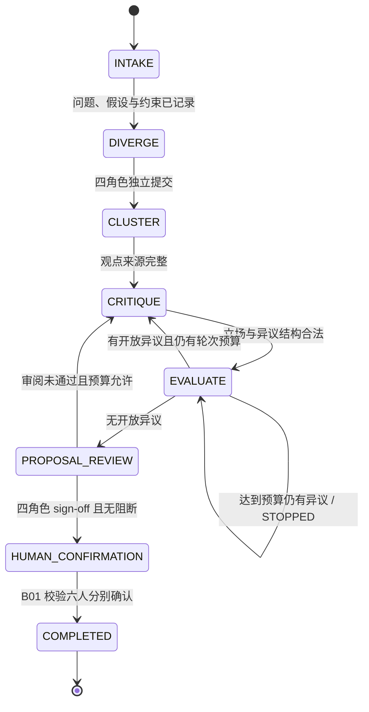

# B02 流程编排 Agent 设计说明

## 1. 目标与范围

`WorkflowAgent / discussion_controller` 是多智能体讨论流程的唯一控制者。它接收上游 Idea 与约束，调用角色和共识评价适配器，将观点、异议、决议与需求确认状态写入黑板，并保证阶段迁移可观察、可暂停、可恢复、可回放。

本模块不负责后续“设计规格 → 开发任务分解 → 开发任务编排”，也不以模型输出替代需求质量评价。

## 2. Workflow 图



`WAITING_HUMAN`、`PAUSED`、`STOPPED`、`BLOCKED` 是控制状态，不是“共识通过”。只有 `COMPLETED` 表示六人确认后的 R1 已发布。

## 3. 阶段迁移表

| 当前阶段 | 事件 | 守卫条件 | 下一状态 |
|---|---|---|---|
| INTAKE | frame_completed | 问题定义已记录 | DIVERGE |
| DIVERGE | independent_completed | 至少四个不同角色成功提交 | CLUSTER |
| CLUSTER | cluster_completed | 观点来源完整 | CRITIQUE |
| CRITIQUE | critique_completed | 立场和异议结构合法 | EVALUATE |
| EVALUATE | revision_required | 有开放异议且 round < max_rounds | CRITIQUE |
| EVALUATE | human_required | 高影响价值分歧未解决 | EVALUATE / WAITING_HUMAN |
| EVALUATE | budget_exhausted | 有开放异议且达到轮数上限 | EVALUATE / STOPPED |
| EVALUATE | discussion_converged | 无开放异议 | PROPOSAL_REVIEW |
| PROPOSAL_REVIEW | review_rejected | 有 Pending / Disagree 且预算允许 | CRITIQUE |
| PROPOSAL_REVIEW | review_completed | 四角色 sign-off 完成且无阻断异议 | HUMAN_CONFIRMATION |
| HUMAN_CONFIRMATION | requirements_confirmed | B01 校验六人确认与需求验收字段 | COMPLETED |

非法迁移不会被静默忽略：等待人工、暂停、停止、阻断和完成状态均不能通过普通 `step()` 越过。

## 4. 控制伪代码

```text
on_start(idea, constraints, budget):
    blackboard = B03.create(idea, constraints)
    stage, round = INTAKE, 0

step(run):
    assert run.status == READY
    if pause_requested: pause_and_checkpoint()
    dispatch STAGE_STARTED
    try:
        execute_current_stage_through_adapter()
    except AgentError as error:
        B03.record_failure(error)
        status = BLOCKED             # 不伪造观点或共识
        return

    if stage == EVALUATE:
        verdict = B06.evaluate(blackboard)  # B02 只消费评价
        if verdict.needs_human:
            status = WAITING_HUMAN
        elif verdict.open_count > 0 and round < max_rounds:
            round += 1
            stage = CRITIQUE         # 定向批判回路
        elif verdict.open_count > 0:
            status = STOPPED         # 达到预算不等于共识
        else:
            stage = PROPOSAL_REVIEW

    if stage == HUMAN_CONFIRMATION:
        status = WAITING_HUMAN       # 不得自动越过 B01 门槛
    B03.append_event_and_checkpoint(run)

confirm_requirements(run, six_members):
    assert stage == HUMAN_CONFIRMATION
    R1 = B01.publish(draft, six_members)
    stage, status = COMPLETED, COMPLETED

replay(run_id):
    for event in B03.ordered_events(run_id):
        apply_control_transition(event)
    verify_replayed_state_equals_checkpoint()
```

可运行实现以 `backend/workflow_definition.py` 和 `backend/controller.py` 为准。

## 5. 接口契约

### B02 输入

- B01：Idea、约束、需求确认门槛。
- B03：运行快照读写、有序事件追加与读取。
- B04：独立观点、结构化批判、Proposal 草案与 sign-off 候选输出。
- B06：开放异议数、高影响异议数、是否需要人类、是否可前进等评价。

### B02 输出

- 当前 `stage / status / round / max_rounds`。
- 有序控制事件：`sequence / event_id / type / time / payload / after`。
- 供 B05 消费的运行与黑板快照：HTTP 主动查询，以及 `ws://127.0.0.1:7100/ws/runs/{run_id}` 只读实时推送。
- WebSocket 连接后发送完整 `snapshot`；每次事件持久化后发送 `event + 最新 run`，支持断线重连恢复。
- 人类裁决入口、暂停恢复入口、六人确认入口仍使用 HTTP，前端不能直接改写控制状态。
- JSON / Markdown 运行报告与回放校验。

### 黑板关键数据

```text
idea, constraints, problem, assumptions
claims[], clusters[], objections[], stances[]
decisions[], open_questions[]
proposal_draft, signoffs[]
requirements_draft, r1
```

角色适配器不得直接改变阶段；B06 只返回评价；B01 的六人确认未通过时，`r1` 必须保持为空。

## 6. 验收场景

| 场景 | 必须观察到的控制结果 |
|---|---|
| 正常收敛 | 第一轮开放异议触发批判回路；最终停在六人确认，六人确认后才发布 R1 |
| 价值分歧 | `WAITING_HUMAN`，自动推进被拒绝；裁决内容写入决议并关联异议 |
| 预算耗尽 | `STOPPED`，开放异议保留，R1 为空 |
| Agent 失败 | `BLOCKED`，失败原因可见，不伪造观点或后续阶段 |
| 暂停恢复 | `PAUSED` 时不派发任务；恢复后从原 checkpoint 继续 |
| 持久化回放 | 重载后事件不变；连续事件回放后的控制状态等于 checkpoint |
| 非法输出 | 角色缺失、字段缺失或异议指向错误时阻断，不继续迁移 |
