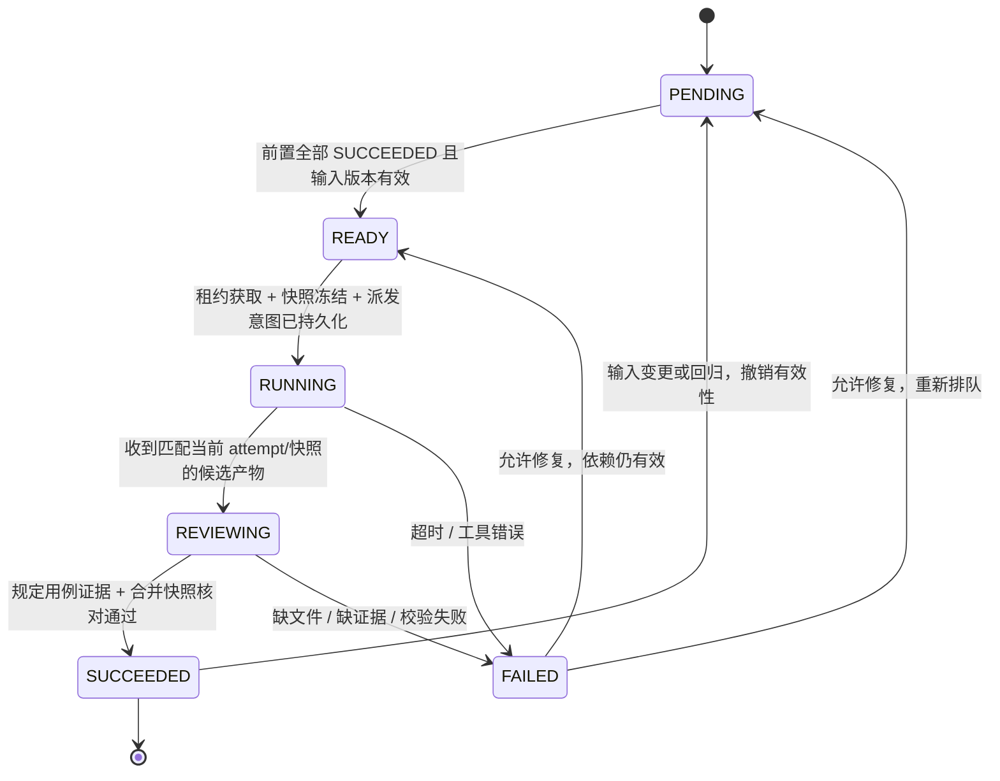

# B03 黑板数据 Agent（BlackboardAgent）设计文档

> 版本：v1.0（草案） · 更新时间：2026-11-16 · 状态：待 B02 交叉评审 / 待六人确认
> 负责人：陈怡雯 · 工作块：B03 · 角色标识：`BlackboardAgent`
> 上游基线：《第十组 设计规格与开发任务编排.docx》中的 R1 / S1 / C1、T01—T11、表 2 / 表 5 / 表 7
> 交叉评审：B02（WorkflowAgent，`B02 ↔ B03`）

## 0. 文档目的与范围

本文把主文档第 10.3 节对 B03 的职责描述，展开为可评审、可追溯、可落地的设计规格。覆盖：

- 共享黑板的存储结构与事件协议（第 3、4 节）
- 任务状态迁移、输入快照、检查点与恢复（第 5 节）
- 供 B02 / B04 / B05 / B06 调用的原子操作与租约接口（第 6 节）
- 案例 T02 数据层：实体、约束、迁移文件与测试数据（第 7 节）
- 验收映射、交接接口与开放问题（第 8—10 节）

本文不做什么：

- 不定义调度决策逻辑——状态迁移由 B02 独占，B03 只提供持久化与原子操作。
- 不修改 S1 / C1 / 任务包，不降低验收门槛；有歧义时登记 Open Question 并阻塞相关任务。
- 不定义 Agent 执行模板与模型适配（B04）、界面与导出（B05）、测试规则与共识评价（B06）。
- 不为 Orchestrator 另建业务数据库；黑板过程数据与校园业务数据分离。

编号约定沿用主文档：`LR-01—05`、`T01—T11`、`TC-*`、`D-01`、`R1/S1/C1`；本文新增的设计条目用 `DS-B03-xx` 编号，便于建立追溯。

## 1. 职责、输入与输出

### 1.1 工作边界（主文档 10.3）

设计任务状态、产物清单、事件去重、输入快照、租约与持久化；提供案例数据库与测试数据适配样例。

### 1.2 输入

| 输入 | 来源 | 说明 |
|---|---|---|
| 任务 schema、事件 schema | B01 设计、经 T01 登记冻结的标准任务包 | 任务编号、依赖、输入输出、验收、写入范围 |
| 案例实体与版本约定 | S1 / C1（B01 主责，六人确认） | `User` / `LostItem` / `ClaimApplication`、字段边界、错误码 |
| 版本标识 | B01 / B02 | `spec_version`、`contract_version`、`plan_version`、`run_id`、`attempt_id` |
| 状态机与调度规则 | B02（WorkflowAgent） | 迁移条件、租约语义、检查点写入时机 |

### 1.3 输出

| 阶段 | 交付 |
|---|---|
| 当前（设计） | 存储和事件协议、迁移与快照设计、租约与原子操作接口、T02 数据模型与测试数据样例 |
| 后续（实现） | `task_store`、`artifact_store`、案例 T02 数据层 |

### 1.4 交接接口（主文档 10.3）

- 向 B02 提供原子状态及租约操作；
- 向 B04 / B06 提供版本有效的产物读取；
- 供 B05 查询（只读）。

## 2. 总体数据架构：两类数据分离

`DS-B03-01` 黑板过程数据与校园业务数据必须物理或逻辑隔离：

| 维度 | 黑板数据（过程数据） | 校园业务数据（T02） |
|---|---|---|
| 内容 | 任务、状态、事件、产物、证据、缺陷/决策 | `User`、`LostItem`、`ClaimApplication` |
| 归属 | 平台运行时（B03 维护） | 案例数据库（B03 设计，DB-01 执行） |
| 写者 | B02 独占状态写入；各 Agent 追加事件/产物 | BE-01 经服务层写入；B03 不代写 |
| 目标 | 支撑调度、恢复、验收、追溯 | 支撑 LR-01—05 业务功能 |
| 约束 | 版本快照、幂等、租约、检查点 | S1/C1 字段边界、唯一约束、隐私规则 |

依据主文档 3.3：`数据库 Agent 不负责为 Orchestrator 另建数据库`，运行时由**单一状态服务**管理快照和事件；团队通过共同版本及授权接口访问，成员本地副本不作为共享状态源。

具体隔离策略（开放项见 10）：默认采用两个独立存储命名空间（如 `blackboard.*` 与 `campus.*` 分库或分 schema）；连接与凭据分离；表名不交叉引用。

## 3. 黑板存储协议

### 3.1 六个信息区（主文档表 2）

| 信息区 | 保存内容 | 关键字段（B03 定义） | 版本 / 不可变性 | 案例示例 |
|---|---|---|---|---|
| `Spec Baseline` | 规格版本、确认状态、约束、Open Questions | `spec_version`, `contract_version`, `approved_ref`, `open_questions[]` | 冻结后只读；变更产生新版本 | S1 与 C1 为唯一输入基线 |
| `Task Registry` | 任务编号、需求引用、目标、输入输出、依赖、验收 | `task_id`, `req_refs[]`, `design_refs[]`, `depends_on[]`, `write_scope`, `acceptance[]` | 由 T01 冻结，`plan_version` 绑定 | T04 关联 LR-02 与 LR-03 |
| `Execution State` | 状态、责任 Agent、尝试次数、输入快照、起止时间 | `task_id`, `run_id`, `attempt_id`, `state`, `responsible_agent`, `attempt_count`, `input_snapshot_ref`, `started_at`, `finished_at`, `rev` | `rev` 递增，CAS 更新；历史尝试保留 | T04 第一次提交与返修分别保留 |
| `Artifacts` | 文件引用、版本标识、内容校验值、关联任务 | `artifact_id`, `task_id`, `attempt_id`, `version`, `content_hash`, `candidate_commit`, `write_scope` | 只追加；`r1`/`r2` 为不同版本 | T04 r1 与 r2 并存 |
| `Test Evidence` | 用例编号、输入、预期、实际、测试环境、产物版本 | `test_id`, `input`, `expected`, `actual`, `env`, `artifact_ref`, `verdict` | 只追加，绑定被测产物版本 | TC-P02 引用被测 T04 r1 |
| `Issues / Decisions` | 缺陷、阻塞原因、修复任务、变更决定、处理记录 | `issue_id`/`decision_id`, `severity`, `target_id`, `status`, `resolution_ref` | 只追加；关闭需复测证据 | D-01 由测试创建、复测关闭 |

### 3.2 公共约定

`DS-B03-02`

- 所有 ID 为服务端生成的 UUID 字符串（与 C1 一致）。
- 事件、产物、证据、缺陷/决策均为**只追加**（append-only）；更正通过新版本记录，不覆盖历史。
- 每条记录携带产生时的 `spec_version` / `contract_version` / `plan_version` / `input_snapshot_ref`。
- 产物以 `content_hash` 校验内容一致性；提交记录引用 `candidate_commit`。
- 黑板记录的最小可见单位是"版本有效的快照"；B04/B06/B05 只能读到对当前 `input_snapshot_ref` 有效的产物。

### 3.3 逻辑模型概览

```text
Spec Baseline ──< Task Registry ──< Execution State ──< Artifacts
      │                  │                 │                  │
      └── version ───────┴── input_snapshot ┴──> Test Evidence
                                   │
                              Issues / Decisions
                                   │
                            Event Log（贯穿全部）
```

（`──<` 表示一对多；Event Log 为所有区的追加日志，按 `event_id` 去重。）

## 4. 事件协议与幂等去重

### 4.1 事件类型

| 事件 | 产生者 | 含义 |
|---|---|---|
| `task.dispatched` | B02 | 派发意图已持久化、租约已获取、快照已冻结 |
| `task.submitted` | B04 / DB-01 / FE-01 | 候选产物已提交（不等于成功） |
| `task.review_passed` / `task.review_failed` | B06 / QA-01 | 独立验收结论 |
| `task.failed` | B02 | 超时、工具错误或验收失败 |
| `spec.changed` | B01 | 规格/契约变更，触发受影响任务失效 |
| `lease.acquired` / `lease.expired` / `lease.released` | B02 / B03 | 资源租约生命周期 |

### 4.2 事件结构

```text
event_id             UUID，全局唯一，幂等键
run_id               运行实例
task_id              关联任务
attempt_id           尝试编号（与 run_id/task_id 共同定位唯一尝试）
event_type           见 4.1
input_snapshot_ref   事件产生时绑定的输入快照
producer             block_id / role_id
payload              结构化内容（candidate_commit、evidence_refs 等）
occurred_at           产生时间
processed_at          B02 处理时间（由 B02 决策，B03 记录）
```

### 4.3 去重与幂等规则

`DS-B03-03`

1. `event_id` 唯一；`append_event` 对相同 `event_id` 返回"已接受"，不重复写入、不重复触发。
2. 回调必须匹配**当前** `attempt_id` 与 `input_snapshot_ref`；不匹配者写入事件日志作为历史证据，**不推进状态**。
3. 已过期尝试的回调只能作为历史证据，不能推进状态（主文档 5.5.1）。
4. 派发使用幂等键 `idempotency_key = (run_id, task_id, attempt_id, dispatch_seq)`；中断重发不产生第二次有效执行。
5. B02 处理事件时先写日志与检查点，再重算可执行集合；B03 保证"日志与检查点"在同一存储事务内可见。

## 5. 状态迁移与快照设计

### 5.1 任务状态机（主文档表 7）



**决策权在 B02；B03 只提供 `cas_state` 原子持久化，`rev` 不匹配即拒绝。**

| 状态 | 含义 | 进入 / 离开条件（B02） | B03 持久化职责 |
|---|---|---|---|
| `PENDING` | 已创建，依赖未满足 | 前置全部成功且版本有效 → `READY` | 记录依赖与阻塞原因 |
| `READY` | 依赖满足，等资源 | Agent 空闲、租约可获取、分支就绪 → 登记运行快照 → `RUNNING` | 提供租约获取、快照冻结 |
| `RUNNING` | 正在当前尝试 | 合法候选产物 → `REVIEWING`；超时/工具错误 → `FAILED` | 记录 `attempt_id`、起止时间 |
| `REVIEWING` | 等待检查与验收 | 证据与快照核对通过 → `SUCCEEDED`；缺失/失败 → `FAILED` | 绑定 `Test Evidence` 与产物版本 |
| `SUCCEEDED` | 当前版本已验收 | 可释放下游；回归/输入变更 → 撤销有效性 | 标记 `valid`，记录 `accepted_commit` |
| `FAILED` | 本次失败 | 登记错误与尝试历史；修复 → `PENDING` / `READY` | 保留失败证据与 `rev` |

### 5.2 输入快照（input_snapshot）

`DS-B03-04` 派发前冻结，验收时核对仍有效：

```text
snapshot_ref         UUID
task_id / run_id / attempt_id
spec_version, contract_version, plan_version
dependency_artifact_refs[]   # 每项含 artifact_id + content_hash
task_package_ref             # 任务包引用
frozen_at
valid                        # true / false（失效由 B02 触发）
```

- 上游规格或产物变更 → B02 调用 `invalidate_affected(change_ref)`，B03 标记相关快照 `valid=false` 并登记失效原因。
- 完成后核对快照仍有效；无效则本次验收不得置 `SUCCEEDED`。

### 5.3 检查点（checkpoint）与恢复

`DS-B03-05` 检查点内容：

```text
plan_version, spec_version, contract_version
task_states:   { task_id: { state, rev, attempt_id, input_snapshot_ref } }
processed_event_ids: set[event_id]
artifact_manifest: { task_id: [ArtifactRef...] }
leases:        { resource_key: Lease }
last_checkpoint_at
```

- **写入时机**：每次收到任务提交、验收完成、超时或规格变更事件，B02 先写日志和检查点，再重算可执行集合。
- **恢复流程**：从检查点载入；对仍标为 `RUNNING` 的尝试核实实际进程/调用状态；确认停止或回收租约后才重派；**不能直接把所有 `RUNNING` 任务再执行一次**（主文档 5.5）。
- 检查点写入与事件日志追加在同一事务内，避免"事件已处理但检查点未落盘"。

### 5.4 产物版本

- `Artifacts` 只追加：`r1`、`r2` 为同一任务的不同版本；每版绑定 `attempt_id`、`content_hash`、`candidate_commit`。
- 供 B04/B06 的读取接口只返回对当前 `input_snapshot_ref` **版本有效**的产物；无效版本不返回，不静默降级。

## 6. 租约与原子操作接口（供 B02 调用）

### 6.1 接口清单（伪代码）

```python
# 原子状态操作（B02 独占写入）
def get_task_state(task_id: str) -> ExecutionState: ...
def cas_state(task_id: str, expected_rev: int, next_state: TaskState, *,
              attempt_id: str, input_snapshot_ref: str,
              reason: str | None = None) -> CasResult: ...   # rev 不符则拒绝

# 资源租约（队列 / 写入范围冲突）
def acquire_lease(resource_key: str, *, task_id: str, attempt_id: str,
                  ttl_seconds: int, idempotency_key: str) -> Lease: ...
def renew_lease(lease_token: str, ttl_seconds: int) -> Lease: ...
def release_lease(lease_token: str) -> None: ...
def reclaim_expired_leases(now) -> list[Lease]: ...

# 输入快照
def freeze_input_snapshot(task_id: str, *, spec_version, contract_version,
                          plan_version, dependency_artifact_refs: list[str]) -> SnapshotRef: ...
def get_snapshot(ref: SnapshotRef) -> InputSnapshot: ...
def verify_snapshot_still_valid(ref: SnapshotRef) -> bool: ...
def invalidate_affected(change_ref: str) -> list[SnapshotRef]: ...

# 事件（幂等）
def append_event(event: Event) -> EventAppendResult: ...
def list_events(after_event_id: str | None, limit: int) -> list[Event]: ...

# 产物（B04 / B06 读取）
def put_artifact(task_id, attempt_id, version, content_hash,
                 candidate_commit, write_scope) -> ArtifactRef: ...
def get_artifacts_for_task(task_id, *, valid_snapshot_ref) -> list[Artifact]: ...

# 检查点
def write_checkpoint(cp: Checkpoint) -> None: ...
def load_checkpoint() -> Checkpoint | None: ...

# 只读查询（B05）
def get_snapshot_view() -> SnapshotView: ...   # 任务状态、阻塞原因、最近事件
```

### 6.2 原子性与一致性

`DS-B03-06`

- `cas_state` 用 `expected_rev` 防止并发覆盖；B02 之外无写入者。
- 租约带 TTL；`reclaim_expired_leases` 供 B02 恢复时回收，避免"队列以为占用、实际已死"。
- `acquire_lease` 按 `write_scope` 做冲突检测；范围重叠时拒绝派发。
- `append_event`、`write_checkpoint`、`put_artifact` 均为幂等或版本化写入。
- 产物与证据绑定 `input_snapshot_ref`；版本不一致时接口显式拒绝，不返回过期数据。

### 6.3 给其他块的读接口

| 消费方 | 接口 | 约束 |
|---|---|---|
| B04 / DB-01 / BE-01 | `get_snapshot` + `get_artifacts_for_task` | 只读版本有效产物；执行结果事件回传 B02，不自改状态 |
| B06 / QA-01 | `get_artifacts_for_task` + `list_events` | 验收结论以事件提交，由 B02 写入状态 |
| B05 | `get_snapshot_view` | 只读；界面不直接改状态；模拟与真实接口结果要能区分 |

## 7. 案例 T02 数据层设计

### 7.1 范围与依赖

- 输入：S1 / C1 的实体及约束（B01，T01 已冻结）。
- 输出：用户、失物、申请模型；建表或迁移文件；测试数据。
- 直接依赖：`T01`。
- 验收：标识和关联有效；`lost_at` 非空；凭据字段受保护；申请防重复约束可验证。
- 运行时执行者：`DB-01`（模板由 B04 提供，数据库上下文由 B03 提供）。

### 7.2 逻辑模型

**User**

| 字段 | 类型 | 约束 |
|---|---|---|
| `id` | UUID 字符串 | 服务端生成，主键 |
| `account` | 字符串 | 唯一，3—64 字符，仅字母/数字/下划线，按小写存储与查重 |
| `password_hash` | 字符串 | 不可逆哈希；不得出现在任何公开响应 |
| `nickname` | 字符串 | 1—30 字符 |
| `created_at` | 带时区时间 | 服务端生成 |

**LostItem**

| 字段 | 类型 | 约束 |
|---|---|---|
| `id` | UUID 字符串 | 主键 |
| `publisher_id` | UUID 字符串 | 外键 → `User.id`；由服务端从会话取得，客户端不可指定 |
| `name` | 字符串 | 1—80 字符 |
| `description` | 字符串 | 1—1000 字符 |
| `location` | 字符串 | 1—120 字符 |
| `lost_at` | 带时区时间 | **必填**，缺失/空/格式错误拒绝且不写入 |
| `status` | 枚举 | 本轮仅 `waiting` |
| `created_at` | 带时区时间 | 服务端生成 |

**ClaimApplication**

| 字段 | 类型 | 约束 |
|---|---|---|
| `id` | UUID 字符串 | 主键 |
| `lost_item_id` | UUID 字符串 | 外键 → `LostItem.id`，对象必须存在 |
| `applicant_id` | UUID 字符串 | 外键 → `User.id`，由会话取得；禁止认领自己的信息 |
| `statement` | 字符串 | 1—500 字符 |
| `status` | 枚举 | 本轮仅 `pending`；确认/驳回/完成状态未定义，不得加入 API |
| `created_at` | 带时区时间 | 服务端生成 |
| — | 唯一约束 | `(lost_item_id, applicant_id)` 唯一，重复申请 → `DUPLICATE_CLAIM` |

### 7.3 字段校验（C1 边界）

`DS-B03-07`

- 除 `password` 外，字符串去首尾空白后判空；非字符串、`null`、超长值均拒绝。
- `account` 按小写存储与查重；长度与字符集按 7.2 表。
- 未知请求字段一律以 `INVALID_FIELD` 拒绝（由服务层实现，数据层不设可绕过路径）。
- 所有 ID 服务端生成，不接受客户端传入。

### 7.4 隐私与权限

- `password_hash` 不进入任何公开响应，包括列表、详情、发布结果。
- 公开列表/详情/发布结果统一 `LostView`，不返回 `publisher_id`、联系方式或凭据。
- 本人资料与申请记录只从受保护接口按会话身份读取，不允许客户端传用户编号查他人。
- 登录凭据不得明文保存或返回。

### 7.5 事务与并发

`DS-B03-08`

- 业务失败不产生部分写入。
- 认领申请的对象状态检查、权限检查与插入在**同一事务**内完成；唯一约束把并发重复申请转为 `DUPLICATE_CLAIM`。
- 发布时若 `lost_at` 非法，整条拒绝、不写入。

### 7.6 错误映射（数据层需支撑的约束）

| 错误码 | HTTP | 数据层约束 |
|---|---|---|
| `REQUIRED_FIELD` / `INVALID_FIELD` | 400 | 非空、长度、格式、未知字段校验 |
| `UNAUTHENTICATED` | 401 | 会话有效性 |
| `FORBIDDEN` | 403 | 认领自己的信息、越权读取 |
| `NOT_FOUND` | 404 | 对象存在性 |
| `DUPLICATE_ACCOUNT` / `DUPLICATE_CLAIM` / `INVALID_STATE` | 409 | 唯一约束、状态约束 |
| `INTERNAL_ERROR` | 500 | 事务回滚，不向客户端返回内部堆栈 |

响应结构：`{ok:true,data:值}` / `{ok:false,error:{code,field,message}}`；失败不返回 `data`；权限/凭据/对象不存在/内部错误时 `field=null`。

### 7.7 迁移文件与测试数据

迁移文件（伪 DDL，最终语法由 DB-01 按实际数据库确定）：

```text
001_create_user.sql              # User 表 + account 唯一索引（小写归一）
002_create_lost_item.sql         # LostItem 表 + publisher_id 外键 + status 枚举
003_create_claim_application.sql # ClaimApplication 表 + 外键 + (lost_item_id, applicant_id) 唯一约束
```

测试数据样例（虚构/脱敏）：

| 类别 | 数据 | 用途 |
|---|---|---|
| 合法 | 用户 `u001`/`u002`；失物 `i001`（`lost_at` 带时区）；申请 `c001`（`u002` 认领 `i001`） | T03—T05 正常流程 |
| 边界-账号 | 重复 `account`（大小写变体）、2 字符、65 字符、含非法字符 | `DUPLICATE_ACCOUNT` / `INVALID_FIELD` |
| 边界-时间 | `lost_at` 缺失、空串、非 ISO 8601 | 拒绝且不写入 |
| 边界-认领 | 认领自己发布的失物、对同一失物重复申请、认领不存在对象 | `FORBIDDEN` / `DUPLICATE_CLAIM` / `NOT_FOUND` |
| 编排夹具 | 缺 TC-P02/TC-P03 的缺证据夹具；故意漏检的故障夹具 | `TC-ORCH-GATE` / `TC-ORCH-FAULT`（与主运行隔离） |

测试夹具与正式运行数据隔离，不能通过正常接口绕过证据门槛（主文档 5.5.2）。

## 8. 验收条件映射

| 主文档 10.3 / T02 验收 | 本文设计对应 |
|---|---|
| 中断后可恢复 | 5.3 检查点 + 6.1 `load_checkpoint` / `reclaim_expired_leases` |
| 任务与产物版本一致 | 5.2 输入快照 + 3.2 公共约定 + 6.2 版本绑定 |
| 案例业务数据与编排状态分开管理 | 第 2 节两库分离 + 第 7 节独立业务模型 |
| 标识和关联有效 | 7.2 外键与 UUID 服务端生成 |
| `lost_at` 非空 | 7.2 / 7.3 / 7.7 边界用例 |
| 凭据字段受保护 | 7.4 隐私规则 + `LostView` |
| 申请防重复约束可验证 | 7.2 唯一约束 + 7.5 事务 + 7.7 边界用例 |
| 事件去重、过期回调不推进状态 | 4.3 幂等规则 |
| 界面不直接改状态 | 6.3 B05 只读接口 |

## 9. 与组员的交接接口汇总

| 对象 | 我从对方获取 | 我提供给对方 | 评审关系 |
|---|---|---|---|
| B01 蔡昀漪 | R1/S1/C1、任务与事件 schema、版本约定 | T02 数据模型、追溯条目 `DS-B03-xx` | B01 复核测试规则；共同规格修改需全消费方确认 |
| B02 陈昱希 | 状态机、租约语义、检查点时机 | 原子状态/租约/快照/事件接口（第 6 节） | **B02↔B03 固定交叉评审** |
| B04 汤志豪 | 运行时角色模板、写入范围 | 版本有效产物读取、数据库上下文 | 接口变更同步所有消费方 |
| B05 雍谨绮 | 展示需求 | `get_snapshot_view` 只读查询 | 界面不直接改状态 |
| B06 吴天昊 | 验收用例与证据要求 | 产物与事件读取、测试数据隔离 | QA 独立验收；B01 复核测试规则 |

## 10. 开放问题（Open Questions）

以下问题不在本设计中擅自决定；需六人确认后更新版本并同步消费方：

1. **存储技术选型**：基础调度可沿用 Python 结构化状态 + 检查点文件；是否引入 SQLite 承载黑板与案例库，需与 B02/B04 对齐环境约束。
2. **事件 schema 最终字段**：以 B01 发布的 T01—T11 标准任务包为准；本文 4.2 为建议最小集。
3. **租约 TTL 与重试预算**：数值由 B02 按调度规则确定，B03 提供可配置参数。
4. **测试数据的规模与脱敏规则**：本文给出结构与样例，具体数据集由 B06 验收用例反推、六人确认。
5. **`SUCCEEDED` 失效触发细节**：由 B02 的 `ImpactAnalyzer` 决定触发条件，B03 提供 `invalidate_affected` 能力。

## 附录 A：术语表

| 术语 | 含义 |
|---|---|
| 黑板 | 保存开发过程任务、状态、产物、证据、决策的共享存储 |
| 输入快照 | 派发前冻结的规格/契约/计划/依赖产物版本集合 |
| 租约 | 对资源或写入范围的有时限占用，防止并发冲突与重复执行 |
| 幂等派发键 | 中断重发时不产生第二次有效执行的键 |
| 版本有效 | 产物/证据绑定的快照未失效，且是当前尝试对应的版本 |
| DB-01 | 案例数据库运行时角色，执行 T02 数据层 |

## 附录 B：权威条款索引

| 主题 | 主文档位置 |
|---|---|
| 黑板六信息区 | 3.2 表 2 |
| 两类数据分离 | 3.3 |
| T02 任务卡 | 4.2 表 3 |
| 状态含义与迁移 | 5.4 表 7 |
| 派发、事件、检查点恢复 | 5.5 / 5.5.1 |
| 故障夹具隔离 | 5.5.2 |
| B03 职责与交接 | 10.3 |
| 交叉评审关系 | 10.9 |
| 分工与任务映射 | 10.10 表 5 |
| 案例数据模型与 C1 | 2.2.2 / 2.2.3 |
