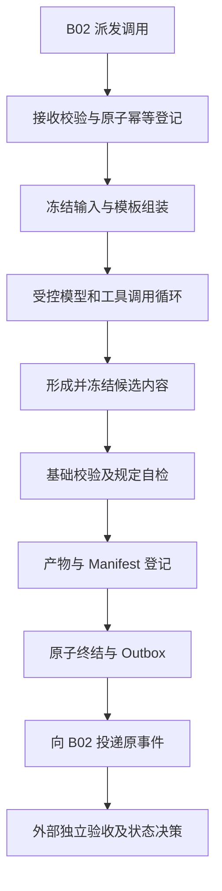

# B04 agent_runner 模块设计

本文定义 Agent 从任务接收、上下文组装、模型和工具调用，到自检、产物提交及执行反馈的完整机制。agent_runner 是 B04 的通用运行协调模块，支持不同产品、可扩展角色和多类型产物，并与 model_adapter、tool_executor、共享状态和 Orchestrator 协作。

| 项目 | 内容 |
| --- | --- |
| 文档版本 | v0.1.1 |
| 上层协议 | `b04.exec.v0.2` |
| 角色模板依据 | B04 Agent 角色模板 v0.1 |
| 模型模块依据 | model_adapter 设计 v0.1.1，模块契约 `b04.model.v0.1` |
| 负责人 | 汤志豪 |
| 状态 | 待交叉评审的设计草案 |
| 更新日期 | 2026-11-16 |
| 范围 | 任务接收、上下文、调用循环、自检、产物、事件与恢复 |
| 交付性质 | 模块与接口设计，不表示执行器、工具接口或运行验收已实现 |

本次为未发布草案的接口一致性修订，协议标识保持 `b04.exec.v0.2`，模块标识保持原值。新增枚举和字段须由全部消费方按协议第 14 节共同确认，不能据此声明兼容已部署旧实现。角色模板 v0.1 的专业职责保持适用。

## 1 设计依据与责任边界

### 1.1 依据

1. [B04 任务执行协议设计 v0.2.1](<./B04_任务执行协议设计.md>)：调用包、身份、状态边界、产物、反馈和恢复。
2. [B04 Agent 角色模板设计 v0.1](<./B04_Agent角色模板设计.md>)：公共与专业模板、十四项绑定变量、PM 首次规划和专业检查。
3. [B04 model_adapter 模块设计 v0.1.1](<./B04_model_adapter模块设计.md>)：ModelRequest／ModelResult、CallControl、调用预算、工具往返、模型切换和错误。

本文细化 runner 的内部机制，不另建任务 schema、供应商协议或全局状态机。新增组件、证据结构和原子存储能力是拟议接口，须与消费方评审。tool_executor 的执行、查询和停止接口在本文中仅定义所需能力，具体契约仍待单独确认。

### 1.2 职责边界

| 模块 | 主责 | runner 的交接 |
| --- | --- | --- |
| B01／专业规则 | Design Spec、PM 规划、任务与产物契约、覆盖和计划合理性 | 按版本消费，输出候选和问题；不自行改范围或接受计划 |
| B02 Orchestrator | 阶段与任务调度、资源、重派、停止恢复和全局状态 | 接收派发、返回事件，不直接修改 SUCCEEDED 等状态 |
| B03 共享状态 | 快照、配置、记录、产物、租约和原子操作 | 通过授权接口读写，成员本机副本不作为状态源 |
| agent_runner | 一次授权调用的接收、装配、执行、自检和提交 | 协调模型与工具，真实记录结果，不唯一验收自己 |
| model_adapter | 选定模型的单次标准调用和响应归一 | 构造请求与控制对象，处理结果，不绕过适配层直连模型 |
| tool_executor | 授权工具的真实执行、副作用及操作记录 | 校验行动并调用，不能以模型文字代替实际操作 |
| B05 | 配置、运行展示与控制入口 | 提供可查询详情；控制经 B02，固定交叉评审 |
| B06 | 独立质量、验收规则、证据及回归 | 提交候选与自检，反馈由 B02 转为新派发 |

运行时 Agent、模型、任务所有者和 B01—B06 人类工作块分别标识。runner 不固定产品、任务数量、角色集合或审批人数。

### 1.3 核心约束

- 接收回执表示入口已接受，不表示执行成功。
- 模型输出是草稿或行动意图，真实产物、工具结果和控制元数据由程序核验。
- 候选提交、自检通过、独立验收和全局成功是不同结果。
- 同一 attempt 固定模型、模板和输入基线；改变交 B02 新派发。
- 每次新的模型调用和工具操作有独立编号、授权和预算记录。
- 同一次派发最多形成一个执行终结结果，消息重传不重复执行。
- 支持无已有任务图和 Git 的首次 PM 规划，支持计划、文档、代码和报告。

## 2 内部结构与数据接口

### 2.1 逻辑组件

| 组件 | 责任 |
| --- | --- |
| AdmissionController | 校验调用包、身份、版本、能力、幂等与接收登记 |
| ContextAssembler | 解析快照、选择必要片段、绑定模板和构造标准消息 |
| AgentLoop | 协调模型、工具和输出纠正，遵守调用终止与预算 |
| BudgetCoordinator | 为模型、工具、自检和执行时限分配已有额度 |
| CheckCoordinator | 冻结被检内容，运行已声明检查并保存真实证据 |
| ArtifactPublisher | 检查实际产物，登记版本和 Manifest，原子提交候选 |
| EventOutbox | 事件编号、持久待发送记录、重传与回执处理 |
| RecoveryCoordinator | 核对未结束调用、工具副作用、提交和停止情况 |

这些是模块内职责，不要求额外微服务或数据库。持久记录和原子边界与 B03 统一，B02 保留阶段及状态决策权。

### 2.2 B04 对外接口

沿用协议 v0.2，B04 入口将调用交给 runner：

```text
invoke_agent(envelope) -> InvocationReceipt
get_invocation(invocation_ref) -> InvocationSnapshot
stop_invocation(invocation_ref, reason) -> StopReceipt
describe_capabilities(catalog_ref) -> CapabilityCatalog
```

| 返回对象 | 最小内容 |
| --- | --- |
| InvocationReceipt | accepted、duplicate、invocation_ref、reason_code、message |
| InvocationSnapshot | 身份、本地阶段、终结结果、停止状态、最近模型／工具、候选、事件投递和阻塞引用 |
| StopReceipt | 指定调用、confirmed／pending／unknown、未结束操作及停止证据 |
| CapabilityCatalog | 定义、模型、工具、产物和环境能力及限制，供规划和派发 |

查询不重新执行任务。调用方身份和资源权限由可信运行上下文核验，不只相信请求体中的字符串。

### 2.3 依赖接口

| 依赖 | runner 所需能力 | 约束 |
| --- | --- | --- |
| model_adapter | describe_model、validate_request、generate、cancel_call、get_call | 沿用 model_adapter 模块契约 b04.model.v0.1 的签名和结果 |
| ToolExecutorPort | execute_tool、get_operation、stop_operation 的逻辑能力 | 方法名为拟议设计；请求沿用协议工具身份、参数、范围和时限 |
| B03 | 读取快照／配置、原子接收、操作登记、产物暂存／封存、终结与事件待发送、查询 | 按原调用归属及操作 purpose 授权；候选须当前执行租约，诊断／观察／清理使用独立授权；不直接更新全局任务状态 |
| B02 | submit_event、reconcile_terminal、控制状态及当前派发核验 | 全局任务状态、重派、接受和下游释放由 B02 决定；本地执行终结由 B04 经 B03 登记 |
| 专业检查器 | schema、引用、DAG、业务及其他已注册检查 | 规则来源不因 runner 调用而转为 B04 所有 |

### 2.4 完整链路



图示为候选提交路径。失败、阻塞和已确认停止按各自阶段收尾；产物形成与自检失败的不同反馈见第 6、8 节。

## 3 调用接收

### 3.1 接收步骤

1. 校验 protocol_version、基本字段、类型与阶段条件。
2. 验证 B02 派发身份、project／run／invocation／attempt／dispatch、当前控制和租约。
3. 按项目范围查询幂等登记，核对冻结派发内容。
4. 检查快照、Agent 定义、模板、契约、模型、工具、资源和必要输入的引用及状态。
5. 检查输出能力、存储命名空间与代码任务条件；空文件范围本身不是规划任务错误。
6. 在 B03 原子登记接收、本地阶段 ACCEPTED 和 execution_accepted 待发送事件。
7. 返回稳定 InvocationReceipt，再按资源和控制条件开始准备。

未接受前的结构、授权或引用错误同步拒绝，不调用模型或工具。B02 记录拒绝及全局处理；缺基本身份时不伪造事件关联。接收之后出现的缺输入或矛盾按本协议报告执行阻塞。

### 3.2 幂等规则

幂等键使用协议约定的 project_id、run_id、invocation_id、attempt_id 组合，核对 dispatch_id 和请求指纹。指纹使用冻结包及解析配置版本，不含当前时间、动态剩余额度或明文凭据。

| 情况 | 处理 |
| --- | --- |
| 首次合法派发 | 原子登记，只有一个执行者获得有效执行权 |
| 同键同内容重复请求 | 返回 duplicate=true 及原调用引用，不再启动 |
| 同键异内容 | EXEC_DISPATCH_CONFLICT，不覆盖原输入 |
| 旧 attempt 或已撤销授权 | 拒绝新执行，允许授权查询历史 |
| 已终结调用重传 | 返回既有结果和投递状态，不创建新终结事件 |
| 未知执行状态 | 先恢复核对，不将“未见结果”解释为“未执行” |

仅本机内存去重不足。B03 原子登记与租约须约束有效执行者；发布时再次核验租约及当前版本，防止检查后授权变化。具体租约代际或等效隔离机制由 B02/B03 确认。

### 3.3 接收回执模板

以下及后续 JSON 均为设计模板。引用、占位校验值和夹具结果须由实际运行替换，不能作为已经完成的证据。本文件使用独立 run 演示，不与其他文档示例构成真实日志。

```json
{
  "accepted": true,
  "duplicate": false,
  "invocation_ref": {
    "project_id": "product-cli-demo",
    "run_id": "run-runner-demo-001",
    "invocation_id": "invoke-plan-001",
    "task_id": null,
    "attempt_id": 1,
    "dispatch_id": "dispatch-runner-plan-001"
  },
  "reason_code": null,
  "message": "接收记录及事件已持久化，等待执行"
}
```
首次 PM 的 task_id、plan_ref、workspace_ref 和 source_control 可以为 null，前提是输入输出及 Workflow 契约允许。开发调用需有接受的计划和任务关联，修改仓库时须有代码扩展与隔离工作区。

## 4 上下文组装

### 4.1 来源与绑定

ContextAssembler 消费冻结输入，不重新生成规格或自行挑选“最新版本”。角色模板中的十四项变量按下表绑定：

| 模板变量 | 来源及规则 |
| --- | --- |
| invocation_context | 已核验的项目、调用、尝试、模式和快照，task_id 可为空 |
| goal | 调用包的本次目标，只读 |
| agent_definition | 指定定义及能力、模型策略和升级对象 |
| input_contract | 解析输入契约，包含必需性、类型和允许状态 |
| output_contract | 解析产物结构、数量及检查要求 |
| context_items | 本次允许的规格、设计、文件、决策和反馈，保留来源 |
| spec_context | 当前产品必要规格片段，PM 规划时必需 |
| plan_context | 输入计划及状态；首次规划为 null |
| capability_catalog | 冻结能力目录，PM 规划时必需 |
| tool_descriptions | 本次实际授权的工具及参数，不是全部注册工具 |
| write_scope | 项目、阶段、定义和派发约束的有效交集 |
| limits | 已冻结执行与调用预算，不能由模型追加 |
| required_checks | 输出契约规定的检查定义，与结果分开 |
| feedback_context | 缺陷、异议、旧产物和变更原因；普通调用可为空 |

读取候选用于评审是合法场景，按 input_contract 明确其候选状态。开发依赖需满足接受门槛，不能将候选引用伪装成已接受产物。

### 4.2 装配过程

1. 解析组合模板包，取得公共前缀、专业片段、变量类型和渲染规则。
2. 对输入读取实际内容并核验项目、版本、允许状态和校验值。
3. 按已配置的片段选择规则取得必要信息，记录 selector 或定位。
4. 对结构变量进行类型序列化、转义和数据区隔离，不执行模板中的任意表达式。
5. 构造标准 system／user 消息，核对所有必要变量已经绑定。
6. 保存上下文来源清单、渲染消息引用及校验值，供调用与恢复追溯。
7. 模型调用前检查上下文大小与能力，不静默删掉必要约束或改用别的模型。

超限时按已授权策略调整可选片段，保留调整记录；必要信息仍无法容纳则报告能力或输入问题，交 B01/B02 处理。公共规则、产品数据和工具结果的权限边界不得通过拼接被抹平。

### 4.3 上下文记录模板

下例为上下文来源与绑定元数据，实际绑定值及消息保存在相应受控引用中。prompt_fragment 的命名是待注册设计。

```json
{
  "context_contract_version": "b04.context.v0.1",
  "execution_mode": "mock",
  "invocation_ref": {
    "project_id": "product-cli-demo",
    "run_id": "run-runner-demo-001",
    "invocation_id": "invoke-plan-001",
    "task_id": null,
    "attempt_id": 1,
    "dispatch_id": "dispatch-runner-plan-001"
  },
  "input_snapshot_id": "snapshot-runner-plan-001",
  "input_snapshot_sha256": "<snapshot_sha256>",
  "agent_definition_ref": "agent:pm-planner@1",
  "prompt_template_ref": "prompt:pm-planner@1",
  "resolved_component_refs": [
    "prompt:common-agent@1",
    "prompt-fragment:pm-planner@1"
  ],
  "input_items": [
    {
      "artifact_ref": "spec:product-cli-demo@1",
      "kind": "design_spec",
      "state": "accepted",
      "sha256": "<spec_sha256>"
    },
    {
      "artifact_ref": "catalog:runtime-capabilities@1",
      "kind": "capability_catalog",
      "state": "accepted",
      "sha256": "<catalog_sha256>"
    }
  ],
  "binding_names": [
    "invocation_context",
    "goal",
    "agent_definition",
    "input_contract",
    "output_contract",
    "context_items",
    "spec_context",
    "plan_context",
    "capability_catalog",
    "tool_descriptions",
    "write_scope",
    "limits",
    "required_checks",
    "feedback_context"
  ],
  "bindings_ref": "<resolved_bindings_ref>",
  "message_bundle_ref": "<rendered_messages_ref>",
  "message_bundle_sha256": "<messages_sha256>"
}
```
### 4.4 工具历史与上下文更新

input_snapshot 保持不变。模型往返新增的真实工具结果以追加记录进入对话历史，每次调用保存完整有效请求的指纹和来源。不得修改原快照来隐藏输入或行为变化。

缓存按项目、引用版本、校验值和访问约束隔离。其他项目历史、未授权文件、密钥和无关聊天不进入上下文；产品文档或工具输出中的指令不能扩大授权或覆盖职责。

## 5 执行循环与模型调用

### 5.1 准备执行

PREPARING 阶段取得所需环境：非代码调用准备授权产物命名空间，代码调用核对仓库、base_commit、分支与隔离工作区。缺少必要环境时明确阻塞，不假装执行。

EXECUTING 前再次检查控制与租约，登记 execution_started。每次实际调用前核验剩余期限、模型／工具额度和当前授权，执行前检查不只进行一次。

### 5.2 构造 ModelRequest

runner 使用 model_adapter 模块契约 b04.model.v0.1 的完整字段，保持以下关联：

| 请求项 | runner 责任 |
| --- | --- |
| 运行身份和快照 | 从接收记录复制，禁止模型覆盖 |
| model_call_id、call_seq | 为每次新生成、继续或纠正分配新编号 |
| agent_definition_ref、prompt_template_ref | 与已解析组合模板一致 |
| model_policy_ref、model_config_ref | 来自定义和冻结派发，attempt 内固定 |
| messages | 绑定模板、必要上下文和已核验工具历史 |
| response_spec | 从输出契约及已批准结构化保障策略派生 |
| tools、tool_choice | 只描述本次可请求的工具，不代表免除执行前授权 |
| parameters、call_limits | 满足模型策略、上下文和执行剩余期限 |
| budget_ticket_ref／CallControl | 通过共享预算分配，不由模型产生 |

先调用 validate_request，再由 generate 在发送前复核可变控制。预检通过不是发送授权永久有效，也不代表模型已产生结果。

### 5.3 ModelResult 分流

| 模型结果 | runner 行为 |
| --- | --- |
| status=ok，response.kind=final | 校验内容分支、类型及候选基本结构，准备真实产物 |
| status=ok，response.kind=tool_calls | 校验每项工具意图，再交 executor；不是最终完成 |
| status=error | 按 MODEL_ 到 EXEC_ 映射、阶段和已配置纠正策略处理 |
| status=in_progress | 仅在原期限内查询同一 ModelCallRef，不重发、不新分配编号 |
| status=unknown | 停止新副作用，核对／取消模型调用，报告不确定性 |
| status=cancelled | 核对停止范围及已有副作用，按控制结果收尾 |
| 模型自称完成或生成状态字段 | 仅作为数据；不据此生成全局成功或接受记录 |

输出纠正只在既定策略允许、预算足够且 attempt 未终结时进行，使用新 model_call_id。默认不自行换模型或另建任务尝试。截断或不合法工具意图不能进入 executor。

### 5.4 工具执行机制

工具桥接以协议第 14.4—14.5 节为准。先按 binding_ref 核对唯一版本和模型输入 schema；write_file 内联内容必须经过 stage_draft_content 生成受控 content_ref 及哈希，再构造带 tool_binding_ref 的 ToolRequest。将原意图、原参数／归一参数指纹、OperationRef 和草稿引用一并持久化，重传复用原映射。

1. 核对工具名、版本、参数 schema、运行身份、租约和有效范围。
2. 持久化模型意图与 operation_id 的映射；重放同一意图查询原操作，不再生成新副作用。
3. 为实际执行申请额度，传递不超过 attempt 剩余期限的时限。
4. 调用 ToolExecutorPort，记录真实结果、变更文件／对象、退出信息和错误。
5. 已结束且允许继续的模型来源操作，按 ToolFeedback 完整字段组装匹配的 tool 消息；非模型来源检查不伪造 tool_call_id。
6. in_progress 只查询原 OperationRef；unknown 或停止未确认先核对副作用，不作为正常完成消息触发新生成，不追加成功结果或盲目重做。

operation_id 在本次调用内唯一，并与工具、参数、目标及意图指纹绑定。同编号异内容拒绝。模型 tool_call_id 只是意图关联，不能直接当作跨项目或跨 attempt 的唯一幂等键。

基础实现可按返回顺序执行多个工具意图。需要并行时由角色、工具和资源能力共同支持；不得将同一资源的冲突写入并行执行。不能因为模型一次返回多项意图就绕过容量或范围约束。

### 5.5 循环伪代码

以下表达控制职责，不是已实现的可执行代码。

```text
读取已接受的调用记录和冻结上下文
检查当前控制、租约及环境

在尚无最终候选时：
    检查执行期限及共享预算
    构造新 ModelRequest 和 CallControl
    调用 model_adapter.generate

    如果结果进行中：
        在原期限和控制额度内查询原 ModelCallRef，不重发请求
    如果结果未知：
        停止新副作用，核对调用并按恢复流程收尾
        不再次发送同一个未知请求
    如果已取消或发生错误：
        按既定策略处理，禁止已终结 attempt 继续调用
    如果返回工具意图：
        校验并执行授权工具，保存真实结果
        追加工具历史，使用新模型调用编号继续
    如果返回最终内容：
        校验基本结构，形成可读取的候选草稿
        若允许且有预算，可在执行阶段纠正结构错误
        否则结束执行循环或报告无法形成候选

冻结候选内容，执行规定自检
核验真实产物、范围、版本与证据
原子登记执行终结结果及待发送事件
按回执重传事件，不重新执行 Agent
```

## 6 自检机制

### 6.1 两类检查

| 类别 | 例子 | 对提交的影响 |
| --- | --- | --- |
| 基础交付校验 | 产物真实存在、可解析、类型／基本 schema、写入范围、校验值和身份匹配 | 不满足时不能形成合规候选，报告失败或按授权策略纠正 |
| 契约规定的专业或行为自检 | 计划覆盖／DAG 检查、构建、业务用例、权限和回归 | 失败或证据不齐可如实提交候选，标 failed／incomplete，外部门槛不能放行 |

基础校验是程序责任，不能用“模型认为结构正确”代替。专业检查器由相应主责块定义，runner 调用不获得规则修改权。自检通过不替代独立验收。

### 6.2 被检内容冻结

先取得不可变的被检内容标识，再运行检查。对象使用版本和实际字节 SHA-256；代码可先形成 candidate_commit，在受控环境检查该提交。报告存于 B03，不要求写入它所引用的同一提交。

检查过程中若生成代码、锁文件或其他受检输入发生变化，应重新冻结并重跑受影响检查。不能把旧报告的版本号替换成新值。临时日志和测试数据按环境配置隔离，不污染业务源码。

本版不在最终 SELF_CHECKING 阶段自动无限修复。执行阶段内的授权迭代受预算限制；最终检查如实记录，进一步返修按 B02 派发处理。

### 6.3 检查证据

每项记录 check_ref、规则版本、subject、输入快照、环境、预期、实际、结果和操作证据。结果为 passed、failed、not_run；无法执行记录原因与错误证据，不能当作通过。

整体状态：任何已执行检查失败为 failed；没有失败但有规定检查未运行或证据缺失为 incomplete；全部规定检查完成且证据有效才是 passed。即使整体为 failed，也单独列出所有缺失检查。

### 6.4 自检报告模板

本例夹具中 schema 和引用检查返回通过，DAG 校验器故障导致未取得结果。候选基本结构有效，但质量证据不齐，不能放行。

```json
{
  "check_report_contract_version": "b04.self-check.v0.1",
  "evidence_kind": "self_check",
  "execution_mode": "mock",
  "invocation_ref": {
    "project_id": "product-cli-demo",
    "run_id": "run-runner-demo-001",
    "invocation_id": "invoke-plan-001",
    "task_id": null,
    "attempt_id": 1,
    "dispatch_id": "dispatch-runner-plan-001"
  },
  "input_snapshot_id": "snapshot-runner-plan-001",
  "input_snapshot_sha256": "<snapshot_sha256>",
  "subject": {
    "artifact_ref": "candidate:product-cli-demo/plan@runner-1",
    "kind": "task_plan",
    "sha256": "<plan_sha256>"
  },
  "environment_ref": "<check_environment_ref>",
  "required_check_refs": [
    "check:plan-schema@1",
    "check:plan-references@1",
    "check:plan-dag@1"
  ],
  "results": [
    {
      "check_ref": "check:plan-schema@1",
      "result": "passed",
      "expected": "符合已注册计划结构",
      "actual": "模拟检查器返回结构符合",
      "operation_id": "op-check-schema-001",
      "evidence_refs": [
        "<schema_check_evidence_ref>"
      ]
    },
    {
      "check_ref": "check:plan-references@1",
      "result": "passed",
      "expected": "输入和计划内输出槽可按规则解析",
      "actual": "模拟检查器返回引用符合",
      "operation_id": "op-check-references-001",
      "evidence_refs": [
        "<reference_check_evidence_ref>"
      ]
    },
    {
      "check_ref": "check:plan-dag@1",
      "result": "not_run",
      "expected": "计划依赖无环",
      "actual": null,
      "operation_id": "op-check-dag-001",
      "evidence_refs": [
        "<validator_error_ref>"
      ],
      "reason": "校验器调用失败，未取得检查结论"
    }
  ],
  "overall_status": "incomplete",
  "missing_check_refs": [
    "check:plan-dag@1"
  ],
  "known_issue_refs": [
    "<validator_issue_ref>"
  ]
}
```
### 6.5 独立验收边界

B04 的开发自检始终标 self_check。测试执行角色若被 B02 派发为指定独立流程，使用 B06 的规则和独立上下文，证据种类按该流程契约标识；不能因显示名为 QA 就获得独立验收效力。

B06 消费候选和证据，B01 按规则复核覆盖与证据，B02 决定接受和状态。runner 不把自己的自检报告改名为独立报告，也不在检查失败时自行放宽预期。

## 7 多类型产物与提交

### 7.1 真实产物形成

| 产物类型 | 形成方式与校验 |
| --- | --- |
| task_plan | 保存结构化候选对象，核对输出 schema、来源和计划内引用，不直接加载任务图 |
| design_document | 保存实际文档，关联设计来源和评审要求 |
| source_bundle | 核对文件变更、范围、提交、构建输入和自检目标 |
| test_report | 保存实际执行结果、目标版本和证据，不用预测结果填 passed |
| review_report／change_proposal | 保存明确目标、异议、证据、建议与待决定项，不自行确认接受 |

输出种类和数量由 output_contract 确定，不能任意增加未声明类型。代码任务遵循分支、候选提交与后续合并要求；非代码任务可使用版本化存储，不强制 Git。

### 7.2 提交顺序

1. 将草稿内容或代码放入授权工作区／暂存区，核对真实内容。
2. 冻结版本，执行并保存自检；确保报告对应同一内容。
3. 核验产物范围、结构、校验值、字节数、输入快照和当前控制条件。
4. 在 B03 登记不可变候选对象、证据及 Manifest，检查引用均可读。
5. 原子关联本地终结结果与 candidate_submitted 待发送事件。
6. 通过 submit_event 投递；按原 event_id 重传，保留回执。
7. 由外部评审、合并或对象接受流程决定是否形成有效接受成果。

独立对象上传可以先于最终发布，但暂存、已登记候选和已接受产物必须区分。上传成功不等于候选终结已提交，更不等于业务接受。

### 7.3 原子终结与事件

B03 应提供等效原子能力，始终核验服务身份、原调用归属和“尚无终结结果”，再按终结类型分别校验：candidate_submitted 必须持有当前 execute 授权、有效租约与输入；execution_failed／execution_blocked／execution_stopped 使用绑定原调用的 report 授权，不以前述执行条件仍有效为前提。随后一次完成：

- 绑定已封存的候选 Manifest 或错误／阻塞／停止结果；
- 将本地阶段置 TERMINAL，写入唯一执行终结类型；
- 按 submission_id 调用协议第 14.8 节 commit_terminal，分配稳定 event_id／event_seq 并写待发送记录。

这不是全局任务状态更新。report 授权只允许记录原调用结果；旧 attempt 的事件由 B02 标为历史，不影响新 attempt。cleanup 授权只允许停止及核对已有资源，不允许新模型、命令或业务写入。若原子调用响应丢失，先按提交幂等标识查询结果，不能既补发候选终结又生成第二个失败终结。失败前已上传的暂存对象保留为诊断或按配置回收，不伪装为正式交付。

### 7.4 Manifest 模板

使用协议第 14.7 节 Canonical Manifest。必需摘要均内嵌，execution_record_ref 只承载大对象和详细追踪，不能代替作者、输入、模板、调用／操作、时间及检查字段。

以下与第 6.4 节自检报告绑定同一候选。示例字节数、引用和哈希均须替换为真实值。

```json
{
  "manifest_contract_version": "b04.manifest.v0.2",
  "protocol_version": "b04.exec.v0.2",
  "execution_mode": "mock",
  "project_id": "product-cli-demo",
  "run_id": "run-runner-demo-001",
  "invocation_id": "invoke-plan-001",
  "task_id": null,
  "attempt_id": 1,
  "dispatch_id": "dispatch-runner-plan-001",
  "input_snapshot_id": "snapshot-runner-plan-001",
  "input_snapshot_sha256": "<snapshot_sha256>",
  "workflow_definition_ref": "workflow:se-basic@1",
  "agent_definition_ref": "agent:pm-planner@1",
  "model_config_ref": "model:mock-planner@1",
  "tool_config_ref": "tools:planning-readonly@1",
  "output_contract_ref": "contract:task-plan-output@1",
  "artifacts": [
    {
      "artifact_ref": "candidate:product-cli-demo/plan@runner-1",
      "kind": "task_plan",
      "version": "runner-1",
      "media_type": "application/json",
      "schema_ref": "schema:task-plan@1",
      "sha256": "<plan_sha256>",
      "size_bytes": 2048
    }
  ],
  "execution_record_ref": "<runner_execution_record_ref>",
  "self_check_refs": [
    "<self_check_report_ref>"
  ],
  "self_check_status": "incomplete",
  "missing_check_refs": [
    "check:plan-dag@1"
  ],
  "known_issue_refs": [
    "<validator_issue_ref>"
  ],
  "source_control": null,
  "review_status": "pending",
  "submission_id": "submission:run-runner-demo-001:invoke-plan-001:1",
  "input_refs": [
    {
      "artifact_ref": "spec:product-cli-demo@1",
      "kind": "design_spec",
      "sha256": "<spec_sha256>",
      "state": "accepted"
    },
    {
      "artifact_ref": "catalog:runtime-capabilities@1",
      "kind": "capability_catalog",
      "sha256": "<catalog_sha256>",
      "state": "accepted"
    }
  ],
  "prompt_template_ref": "prompt:pm-planner@1",
  "author": "service:agent_runner",
  "started_at": "2026-11-16T02:10:00.000Z",
  "finished_at": "2026-11-16T02:10:30.000Z",
  "change_summary": "生成当前产品的候选任务计划并保留自检与已知问题",
  "model_call_refs": [
    "<model_call_record_ref>"
  ],
  "tool_operation_refs": [
    "<tool_operation_record_ref>"
  ],
  "required_check_refs": [
    "check:plan-schema@1",
    "check:plan-references@1",
    "check:plan-dag@1"
  ],
  "open_questions": []
}
```
Manifest 已内嵌必要摘要；execution_record_ref 关联详细消息、模型／工具日志及 Ledger，不替代协议必填字段。accepted_commit 或对象接受记录由外部流程登记。

## 8 执行反馈

### 8.1 事件与触发

| 事件 | 触发条件 | 反馈内容 |
| --- | --- | --- |
| execution_accepted | 合法调用已原子接收 | 身份、定义、快照及接收记录 |
| execution_started | 环境就绪，开始实际执行 | 本地阶段和开始信息 |
| execution_progress | 有必要的阶段、调用或检查进展 | 阶段、调用／操作引用、预算和问题摘要 |
| candidate_submitted | 合规候选与唯一终结记录已提交 | Manifest、类型、自检状态和缺失检查 |
| execution_failed | 不能形成合规候选或执行因故障结束 | EXEC_ 分类、阶段、证据、已知副作用和停止情况 |
| execution_blocked | 接收后发现缺输入、矛盾或必要决定 | 问题、影响、所需决定和 escalation_target |
| execution_stopped | 已确认停止且尚无其他终结结果 | 原因、停止范围、残留结果与证据 |

候选、失败、阻塞和已停止四种终结结果互斥。candidate_submitted 后的独立质量失败由 B06 发给 B02，不由 runner 再发一个执行失败。

### 8.2 候选反馈模板

本例只展示 accepted、started、一次 progress 和 candidate 四个事件，因此终结 event_seq 为 4；实际进度事件数量由运行决定，不固定序号。

```json
{
  "protocol_version": "b04.exec.v0.2",
  "event_id": "event-runner-plan-001-04",
  "event_type": "candidate_submitted",
  "project_id": "product-cli-demo",
  "run_id": "run-runner-demo-001",
  "invocation_id": "invoke-plan-001",
  "task_id": null,
  "attempt_id": 1,
  "dispatch_id": "dispatch-runner-plan-001",
  "input_snapshot_id": "snapshot-runner-plan-001",
  "input_snapshot_sha256": "<snapshot_sha256>",
  "event_seq": 4,
  "occurred_at": "2026-11-16T02:10:30.000Z",
  "execution_mode": "mock",
  "producer": "B04",
  "payload": {
    "agent_definition_ref": "agent:pm-planner@1",
    "manifest_ref": "<runner_manifest_ref>",
    "artifact_kinds": [
      "task_plan"
    ],
    "self_check_status": "incomplete",
    "missing_check_refs": [
      "check:plan-dag@1"
    ],
    "submission_id": "submission:run-runner-demo-001:invoke-plan-001:1",
    "manifest_sha256": "<manifest_sha256>",
    "terminal_record_ref": "<terminal_record_ref>"
  }
}
```
该事件要求外部流程检查缺失证据，不代表计划接受。产物存在但检查不完整，与产物无法交付，是不同反馈。

### 8.3 Outbox 投递与回执

- 事件先持久化再投递，重传沿用 event_id、event_seq 和内容，不能重建新编号。
- recorded：确认已记录，重复回执不重复触发本地行为。
- stale：标记仅作历史，不推进当前有效任务，不重发旧产物来覆盖新版本。
- rejected：保留原事件和 receipt_ref；终结事件进入协议第 14.8 节 reconcile_terminal，非终结事件按协议第 6.3 节交 B02 登记诊断或决定，不构造缺失的终结 submission_id。
- 通道故障消耗独立传输预算，耗尽后保留待发送状态和问题，供恢复或人工检查。

永久拒收或身份／结构冲突按 submission_id 通过 report 授权对账，resolution 使用 recorded、stale、retry_delivery、new_attempt_required 或 manual_required。B02 记录 decision_ref；必要时决定新 attempt，B04 不伪造第二个终结结果。业务终结、投递和对账状态分别查询。

事件投递失败不是重新运行 Agent 的理由。终结已提交而未确认投递时，本地显示 TERMINAL 与 pending_delivery 两个维度，不能显示为“独立验收成功”。

### 8.4 给 B02 的有效反馈

ExecError 和处置矩阵使用协议第 14.6 节。接收前无效才同步拒收；已接收后的内部模型／工具请求错误使用 EXEC_MODEL_ERROR／EXEC_TOOL_ERROR，补全原错误字段，不能修改已经发出的 InvocationReceipt。

错误和阻塞 payload 应包含具体阶段、EXEC_ code、category、message、evidence_refs、recoverability、requested_action、stop_status，以及已知问题和必要升级对象。

缺输入说明缺哪个引用或字段、影响哪些输出、需要谁决定；工具故障说明 operation_id 和副作用是否已确认；模型未知说明 model_call_id、调用记录及停止情况；检查失败说明被检版本、预期、实际和复现入口。

敏感正文、堆栈和日志使用受控证据引用，公共反馈不泄露密钥。模型置信度或“已经修好”的文字不能替代以上信息。

## 9 状态、控制与预算

### 9.1 本地阶段

`ACCEPTED → PREPARING → EXECUTING → SELF_CHECKING → SUBMITTING → TERMINAL` 表示 runner 的执行进度。失败、阻塞或确认停止可从相应阶段收尾，正常候选经过检查与提交。

同一 dispatch 的 TERMINAL 不重新开启。返修、模型／模板切换和重验由 B02 使用新 attempt；已有模型调用结果核对、停止清理和事件重传作为追加记录处理，不产生第二个终结结果。

### 9.2 停止与取消竞态

收到 stop_invocation 后，先记录控制意图，停止新模型、工具和候选发布，再对当前 model_call_id／operation_id 请求停止并核对。

StopReceipt 的 pending 或 unknown 不等于远端停止。确认执行已停止且尚无终结结果时，才能提交 execution_stopped。若早已提交候选或失败，只追加停止回执和清理信息，不再发另一终结事件。

超时可提交 execution_failed 并标 stop_status=unknown，继续保存待核对资源信息；B02 在确认旧操作停止或有效隔离之前不能安全重派。迟到响应与取消并发时都保留，当前授权及原子发布条件决定结果能否提交。

### 9.3 暂停与失效

暂停由 B02 停止新派发，按协议允许已运行调用在有效授权下提交。取消、输入失效或执行授权撤销阻止新业务操作与候选发布；原调用的诊断、查询、停止和事件投递使用独立 report／observe／cleanup 授权，不能被执行租约失效一并阻断，也不能借此继续业务执行。

输入变更由 B02 计算影响并新派发；runner 不自动读取最新产物补到旧 attempt。旧记录、失败证据和模型异议保留。

### 9.4 预算核算

统一使用协议第 14.2—14.3 节 ControlContext／BudgetTicket。调用包 limits 是 attempt 上限，父 invocation 账本跨重派保留消耗及未知预留；adapter／executor 是相应实际执行的原子扣账方，runner 不重复扣账。观察、诊断、清理和传输各有独立有限额度。

| 预算 | 核算方式 |
| --- | --- |
| 执行期限 | 覆盖准备、执行、自检和整理，单次调用不延长总期限 |
| 模型发送 | runner 申请票据，adapter 在同一账本预留并结算，不重复扣成两份，也不漏记实际发送 |
| token | 保留观测／估算／未知来源，不将未知记为零；必要输入超限不静默删减 |
| 工具调用 | 实际工具执行和自检均占相应额度，未知副作用保留未结算记录 |
| 传输 | 事件重发独立限额，不创建新模型或工具调用 |
| 失败重派 | 由 B02 维护 retry_count／retry_budget，runner 只读 |

可由既定资源策略为最终检查和提交预留资源，但不能擅自增加额度。执行期限后不发起新模型或工具副作用；已提交终结的事件仍可按传输策略送达。未提交的候选若已超期，按控制与有效性核对，不绕过发布门槛。

## 10 异常与恢复

### 10.1 阶段处理

| 情况 | 行为 |
| --- | --- |
| 接收包无效或派发冲突 | 同步拒绝，分别使用 EXEC_INVALID_ENVELOPE／EXEC_DISPATCH_CONFLICT |
| 接收后输入缺失或规格矛盾 | execution_blocked，报告引用、影响与所需决定 |
| 能力不足 | EXEC_CAPABILITY_UNAVAILABLE，经 B02/B01 调整，不静默换模型或删检查 |
| 模型错误／未知 | 使用 adapter 的 MODEL_ 到 EXEC_ 映射，保留 call 证据；未知先停止新副作用 |
| 工具执行故障 | EXEC_TOOL_ERROR，记录操作及副作用；检查工具故障也可形成明确 not_run 自检 |
| 写入越界或授权失效 | EXEC_WRITE_SCOPE／EXEC_LEASE_INVALID，阻止操作并核对停止 |
| 基础产物结构、存在性或校验失败 | EXEC_ARTIFACT_INVALID，无法纠正时 execution_failed |
| 专业／业务自检失败或不完整 | 可提交真实候选和 failed／incomplete 证据，外部验收不放行 |
| 超时或预算耗尽 | EXEC_TIMEOUT／EXEC_BUDGET_EXHAUSTED，停止新动作并记录已有结果 |
| 存储或发布响应不明 | 先查提交状态，不能直接生成另一个终结结果 |

未预期 runner 异常使用 EXEC_RUNNER_ERROR，停止新副作用并保存阶段、原因和实际状态，按 report 授权提交 execution_failed；不能伪装为业务检查失败。

### 10.2 检查点内容

检查点至少保存：冻结派发指纹、阶段、租约、上下文／消息引用、model_call_id 与 call_seq、工具意图及 operation_id 映射、实际结果、预算、候选与自检版本、终结标识、待发送事件和回执。

恢复不得只凭本地内存或某个文件是否存在。读取共享记录，并用 adapter.get_call、工具操作查询和产物引用核对外部实际状态。

### 10.3 恢复决策

| 已知状态 | 安全动作 |
| --- | --- |
| 已接收且尚无副作用，授权仍有效 | 核对后从准备检查点继续 |
| 模型响应已持久化 | 复用响应，核对处理标记，不重复发送生成 |
| 模型已发送但结果未知 | 查询／停止并报告，不能盲目重发 |
| 工具已完成并有证据 | 复用结果，不重复副作用 |
| 工具结果或副作用未知 | 核对实际目标和停止状态，隔离未明操作 |
| 候选终结已提交、事件未确认 | 只重传既有事件 |
| 原子提交是否成功未知 | 按同一提交标识查询，不另建终结 |
| 新 attempt 已生效 | 旧结果留历史，不写入或覆盖新产物 |

内部去重控制重复有效执行，不承诺外部模型在所有网络中断下绝无重复计费。副作用无法确认时必须显式保留不确定性。

### 10.4 返修、重验与切换

B06 的失败结果交 B02。B02 派发返修时保留 invocation_id 和任务关联，增加 attempt_id，按原因更新 retry_count；上游失效重验使用 revalidation_id，不因重验启动增加失败计数。

新 attempt 接收旧缺陷、复现、输入和证据引用。runner 不把旧测试报告改成新版本，不丢失异议，也不将旧工具副作用当作未发生。模型、模板或输入变化按既有配置规则重新冻结，不在旧 attempt 内切换。

## 11 场景说明

### 11.1 首次 PM 规划

B02 从预定义规划阶段发起，task_id／plan_ref／source_control 可为空。runner 组装产品 Design Spec、能力目录和 PM 模板，经模型产生候选计划，保存实际 JSON 对象并检查。B01/B06 完成质量与规定确认后，B02 才加载计划。

第 6—8 节例子中 DAG 检查缺结果，因此事件虽然已提交，计划仍待评审且不能生效。结构可读与质量证据充分分别判断。

### 11.2 工具往返与代码产物

实现角色返回工具意图，runner 经校验交 executor 修改授权文件，保存实际结果，再使用新模型调用编号继续。形成 candidate_commit 后，自检和证据绑定其内容；B02/B06 等外部流程完成接受和合并核对。

页面、服务或 CLI 的具体工具与规则来自产品配置。没有界面或数据库要求时，不强制派发前端或数据库角色。

### 11.3 失物招领反馈测试

T04 的 lost_at 规则来自案例 C1。代码和局部自检由案例角色执行，TC-P01／02／03 等证据随版本提交；缺规定证据或实际行为错误均不能放行。

正常门槛在局部验收阻止缺陷；隔离漏检夹具可预置错误成功 r1，由集成检查发现 D-01，再经 B02 派发返修并复测。该夹具不改变 runner 的通用判断或为正常运行增加绕过入口。

### 11.4 跨产品与独立性

用 Web 案例和 CLI 规格验证同一 runner，改变角色定义、工具、输入输出契约和检查规则；核心逻辑不按产品名分支。测试和评审角色也通过共同入口运行，但其独立身份、规则和接受权由 Workflow/B06 保证。

本节及 JSON 都是设计推演，不是已完成运行或测试的记录。

## 12 验收标准

| 编号 | 动作 | 通过标准 |
| --- | --- | --- |
| B04-AR-01 | 接收合法、无效和重复派发 | 回执、拒绝和幂等一致，同键异内容不覆盖 |
| B04-AR-02 | 首次 PM 无任务图或 Git | 按契约接受并产生计划对象，无伪造前置条件 |
| B04-AR-03 | 绑定十四项模板变量 | 来源、类型和版本正确，必要槽位无缺失 |
| B04-AR-04 | 候选评审与接受依赖分别读取 | 输入状态按契约处理，不混淆候选与接受 |
| B04-AR-05 | 产品数据、工具结果或其他项目混入 | 控制边界有效，越权数据不进入上下文 |
| B04-AR-06 | 必要上下文超限 | 明确反馈，不静默丢约束或换模型 |
| B04-AR-07 | 模型最终响应、错误、未知与工具意图 | 分支正确，未知不继续副作用，意图不等于执行 |
| B04-AR-08 | 多轮工具往返 | 新 model_call_id／call_seq，操作映射可追溯，attempt 配置不变 |
| B04-AR-09 | 重复工具意图、参数改变或副作用未知 | 复用已确认结果、拒绝冲突或先核对，不盲目重做 |
| B04-AR-10 | 产物不存在、结构错误或写入越界 | 基础门槛拒绝合规候选 |
| B04-AR-11 | 专业自检失败、未运行或缺证据 | 真实记录 failed／incomplete，不自动放行 |
| B04-AR-12 | 自检后修改被检内容 | 失效相关证据，重新冻结并检查 |
| B04-AR-13 | 计划、文档、代码和报告分别提交 | 类型、真实引用、校验与存储策略正确 |
| B04-AR-14 | 并发发布、取消或提交响应丢失 | 最多一个终结结果，按原子状态核对 |
| B04-AR-15 | 事件丢失、重复、乱序及过期 | 原事件重传，历史不覆盖新 attempt |
| B04-AR-16 | 模型、工具、检查预算及超时 | 统一受控、不重复扣费记账、不重置未知消耗 |
| B04-AR-17 | 本地停止与远端未知 | 不虚报 confirmed，B02 安全核对后再重派 |
| B04-AR-18 | 在模型、工具、自检和提交阶段中断 | 恢复实际记录，不重新执行有效副作用 |
| B04-AR-19 | 返修、重验、模型或模板切换 | 经 B02 新 attempt，历史与失败预算保持 |
| B04-AR-20 | mock／live 和两种不同产品 | 模式明确，核心复用，模拟不冒充真实验收 |
| B04-AR-21 | 失效后原子终结 | 候选受 execute 门槛，失败／阻塞／停止按 report 保存且不影响新 attempt |
| B04-AR-22 | 工具内联内容和完整反馈 | 真实暂存、哈希、绑定和幂等映射闭合，所有外层结果字段保留 |
| B04-AR-23 | 进行中模型／工具结果 | 查询原引用，不重发或伪造完成消息 |
| B04-AR-24 | Manifest 必需摘要与票据 | 摘要内嵌完整，父／子预算各自核算且无重复扣账 |
| B04-AR-25 | 终结事件永久 rejected | 独立对账并保留原终结，有明确 resolution 和 decision_ref |

B04 实现与自检，B05 交叉评审；B01 核对规划和产物，B02/B03 核对控制、存储及原子边界，B06 独立验证。证据绑定产品、调用、模式、配置、被检版本和预期／实际结果。文档解析和示例检查不替代运行验收。

## 13 交付计划与待确认项

### 13.1 后续实现

1. 对齐 B02 调用／控制和 B03 接收／租约／事件原子接口。
2. 实现接收、十四项上下文绑定及确定性 mock 闭环。
3. 接入 model_adapter 与预算记录，完成工具往返及未知状态核对。
4. 接入检查器、实际产物封存、Manifest 和 Outbox。
5. 验证停止竞态、恢复与独立验收，再开展真实模型和跨产品联调。

本文未创建 Python runner、工具驱动、存储实现、配置 schema 或真实报告，也未修改三份依据文档。

### 13.2 待确认事项

| 编号 | 内容 | 确认方 |
| --- | --- | --- |
| B04-AR-OQ-01 | 接收、当前授权、租约代际及并发执行权 | B02/B03/B04 |
| B04-AR-OQ-02 | 上下文片段、缓存、变量绑定及快照格式 | B01/B03/B04 |
| B04-AR-OQ-03 | CallControl、模型／工具预算票据与结算 | B02/B03/B04 |
| B04-AR-OQ-04 | ToolExecutorPort 的执行、查询、停止与幂等契约 | B02/B03/B04 |
| B04-AR-OQ-05 | 基础结构校验、专业检查及独立证据分类 | B01/B06及专业块 |
| B04-AR-OQ-06 | 产物封存、终结 CAS／等效原子能力和 Outbox | B02/B03/B04 |
| B04-AR-OQ-07 | 超时、停止未知、未预期错误的事件映射和恢复 | B02/B04/B06 |
| B04-AR-OQ-08 | 展示、传输预算、跨产品夹具和验收证据 | B01/B05/B06 |

平台共同接口按总设计评审，B04/B05 固定交叉评审，相关消费方确认其契约。产品运行审批按 Workflow 配置；阻断项暂停受影响部分，不能把待实现能力标为已支持。

## 14 修订记录

| 版本 | 日期 | 内容 | 状态 |
| --- | --- | --- | --- |
| v0.1 | 2026-11-16 | 建立接收、上下文、调用、自检、产物、反馈与恢复设计，衔接协议和已有模板及模型模块 | 原草案 |
| v0.1.1 | 2026-11-16 | 修复终结权限，统一进行中状态、工具暂存／反馈、错误、Manifest、预算及拒收对账 | 待评审 |
