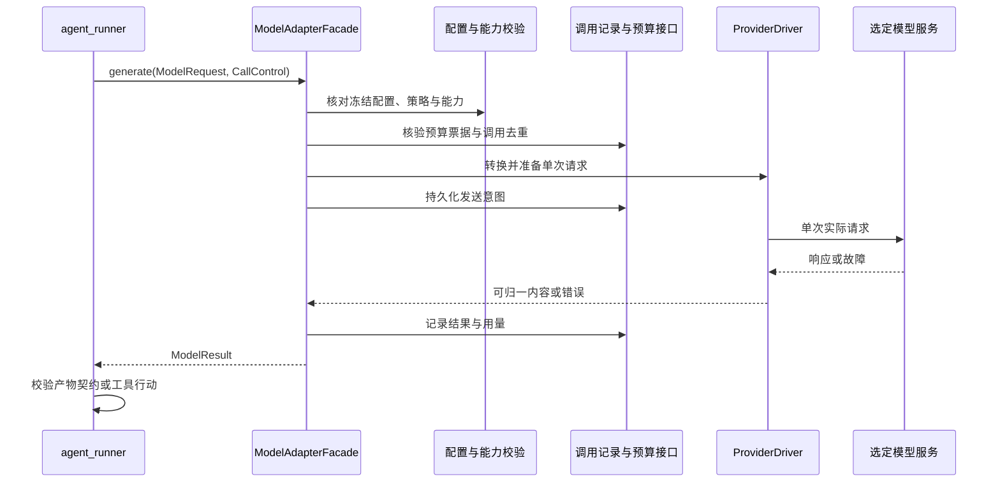

# B04 model_adapter 统一模型调用模块设计

本文定义 model_adapter 的统一接口、配置与能力匹配、请求响应结构、调用记录、模型切换和错误处理。模块服务通用 SE Workflow 平台，支持 PM 规划、设计、实现、测试和评审等角色，不包含具体产品的任务分解规则或业务实现。

| 项目 | 内容 |
| --- | --- |
| 文档版本 | v0.1.1 |
| 模块契约版本 | `b04.model.v0.1` |
| 上层运行协议 | `b04.exec.v0.2` |
| 角色模板依据 | B04 Agent 角色模板 v0.1 |
| 负责人 | 汤志豪 |
| 状态 | 待交叉评审的设计草案 |
| 更新日期 | 2026-11-16 |
| 交付性质 | 模块设计与接口模板；未包含已实现驱动、真实供应商接入或通过报告 |

本次为未发布草案的接口一致性修订，协议标识保持 `b04.exec.v0.2`，模块标识保持原值。新增枚举和字段须由全部消费方按协议第 14 节共同确认，不能据此声明兼容已部署旧实现。角色模板 v0.1 的专业职责保持适用。

## 1 设计依据与职责

### 1.1 依据

- [B04 任务执行协议设计 v0.2.1](<./B04_任务执行协议设计.md>)：模型输入输出、调用身份、配置冻结、预算、模型切换和错误分类。
- [B04 Agent 角色模板设计 v0.1](<./B04_Agent角色模板设计.md>)：model_policy_ref、组合模板、上下文装配、工具描述和模型草稿的可信边界。

本文新增的方法、字段和 MODEL_ 错误码是模块内部契约的拟议细化，不改变上层 EXEC_ 事件和全局状态规则。模型服务的具体 SDK、API 版本和供应商映射须经选型后核对并注册，本文不预设某家服务的实际参数或能力。

### 1.2 职责边界

| 组件 | 主责 | 与 model_adapter 的边界 |
| --- | --- | --- |
| B01／PM 规划规则 | 产品规格到任务计划、覆盖及依赖合理性 | adapter 接收已装配消息，不决定产品任务和 DAG |
| B02 Orchestrator | 阶段、资源、派发、失败重派、停止恢复和状态 | adapter 返回调用结果，不选择新 attempt 或放行任务 |
| agent_runner | 模板与上下文装配、调用循环、输出契约校验、候选提交 | adapter 提供模型调用与归一结果，不生成正式 Manifest |
| model_adapter | 能力核验、标准请求转换、模型调用、响应归一与调用错误 | 不执行模型提出的工具，不判断完整业务验收 |
| tool_executor | 授权工具的真实执行和副作用记录 | 接收 runner 已核验的行动，不由 adapter 直接调用 |
| B03 数据服务 | 不可变配置、快照、记录与产物存储 | 通过受控读取和调用记录接口使用，不新增全局状态源 |
| B06 质量模块 | 独立检查、证据和接受要求 | 模型返回成功不是业务或质量验收通过 |
| B05 平台界面 | 配置与执行信息展示，控制入口 | 展示脱敏能力及调用记录；控制经 B02 |

模块只负责把受授权的标准请求送到选定模型，并把真实响应或故障转换为稳定结构。产品、角色、任务和输出契约应能在不改供应商驱动的情况下变化。

### 1.3 基础版约束

- 使用完整响应接口；流式输出作为可选后续能力，未支持时明确拒绝，不静默改变模式。
- 默认关闭 SDK／HTTP 自动重试和自动 fallback。
- 一次 Agent attempt 内固定 model_config_ref；切换模型由 B02 新派发。
- 支持文本、结构化结果和工具调用意图的统一表达，具体能力按配置检查。
- 首次 PM 调用允许 task_id=null，不要求已有开发计划或 Git 提交。
- mock 和 live 分别记录，模拟结果不作为真实接入证据。

## 2 结构与依赖

### 2.1 内部组件

| 组件 | 输入输出与职责 |
| --- | --- |
| ModelAdapterFacade | 面向 runner 的统一接口，组织校验、调用、取消与结果返回 |
| ConfigResolver | 按冻结引用解析模型配置、策略和能力声明，核验项目可访问性 |
| CapabilityValidator | 检查模态、消息、工具、结构化输出、参数、上下文和组合能力 |
| ProviderDriverRegistry | 根据已注册 driver_ref 选择供应商驱动，不根据产品名选择 |
| ProviderDriver | 标准消息到供应商请求的转换、一次实际发送、原始响应解析 |
| ResponseNormalizer | 归一内容、工具意图、终止原因、用量和错误，不判断产品语义 |
| CallControl／CallLedger 接口 | 对接取消、时限、预算预留、调用去重及持久记录 |
| CredentialResolver | 在调用时解析凭据引用，不向模型、公共日志或结果暴露密钥 |

这些是逻辑职责，可在实现中合并文件，不要求引入额外微服务。CallLedger 等持久能力与 B03 对齐，调用预算与 runner／B02 对齐，不形成独立的任务状态机。

### 2.2 调用关系



工具结果由 runner／executor 取得，再作为下一次标准消息输入。adapter 不在一次 generate 内自动执行工具或循环调用模型。

## 3 配置、策略与能力

### 3.1 三种引用

| 引用 | 含义 | 使用方式 |
| --- | --- | --- |
| model_policy_ref | Agent 定义要求的模型能力及允许配置边界 | 来自角色定义，限制可选模型与参数 |
| model_config_ref | 本次 attempt 选定的模型配置 | 与派发及快照一致，调用间不能替换 |
| model_capability_ref | 对选定配置能力的版本化声明 | 用于预检，记录声明来源及适用范围 |

模型、驱动、能力声明、生成参数、输出格式和转换规则的版本均进入调用记录。服务返回的实际模型或版本如不可得，明确标记 unavailable；配置版本可追溯不等于外部模型输出逐字可复现。

### 3.2 模型配置示例

以下为确定性 mock 驱动的设计配置，不代表已实现的注册记录。

```json
{
  "model_config_ref": "model:mock-planner@1",
  "provider": "mock",
  "model_id": "mock-planner",
  "driver_ref": "driver:mock@1",
  "model_capability_ref": "model-capability:mock-planner@1",
  "endpoint_ref": null,
  "credential_ref": null,
  "generation_defaults": {
    "temperature": 0.2
  },
  "provider_options": {},
  "transport_policy_ref": "transport:single-send@1"
}
```
live 配置通过受控 endpoint_ref 和 credential_ref 解析服务连接；不接受模型输出、产品文档或未授权调用参数指定新的服务地址、密钥或代理。provider_options 仅允许驱动明确支持的已注册字段，并进入有效请求摘要。

### 3.3 能力描述

describe_model 返回 ModelDescription，至少包含配置、驱动和能力版本，以及以下能力信息：

| 能力 | 校验要求 |
| --- | --- |
| input_modalities | 请求模态必须全部支持；基础版只承诺已注册的文本能力 |
| instruction_roles | 能保留控制指令与用户／工具数据边界，不能静默压平为同一权限 |
| structured_output_modes | 区分 text、json_object、json_schema，schema 特性按注册 profile 检查 |
| native_tool_calls | 声明是否支持原生工具意图及工具结果回传 |
| parallel_tool_calls | 不支持时不得把并行请求误报为已支持 |
| feature_combinations | 核对工具、结构化输出等功能能否组合，不能只检查单项开关 |
| supported_parameters | 校验参数类型、范围和缺省，不静默丢弃不支持参数 |
| context_limits | 输入、保留输出及工具／schema 开销满足已知限制 |
| cancellation | 区分本地中断、可确认远端停止和无法确认 |
| usage_reporting | 声明可报告的用量字段和预算计量能力 |

未知能力返回 unknown，并由策略决定能否调用。必要能力未知或缺失时拒绝；可选能力只有在事先允许的显式策略下才可不启用，并记录该决定。

### 3.4 参数合并

有效参数由冻结模型配置的默认值和本次经授权的覆写组成。覆写须满足 model_policy 和驱动约束，并进入请求指纹；不允许改变 provider、model_id 或扩大预算。

区分字段未提供、null、0、false 和空值，避免把合法的零值当成缺省。没有适配映射的必要参数直接报错，不改名猜测或静默删除。服务默认值如无法获知，记录为 provider_default，不填写猜测值。

## 4 对外接口

### 4.1 统一方法

以下是逻辑异步接口设计，不绑定语言框架或 SDK。

```text
describe_model(model_config_ref, call_context) -> ModelDescription

validate_request(request, call_context) -> ValidationResult

generate(request, call_control) -> ModelResult

cancel_call(model_call_ref, reason, call_context) -> ModelCancelResult

get_call(model_call_ref, call_context) -> ModelCallSnapshot
```

| 方法 | 约束 |
| --- | --- |
| describe_model | 读取脱敏配置与能力，不调用模型生成内容，不泄露凭据 |
| validate_request | 验证身份、冻结配置、字段和能力，不进行生成；预检不预先消耗发送额度 |
| generate | 发送前再次核验控制与额度，只处理一个逻辑模型调用 |
| cancel_call | 只作用于授权的模型调用，不直接取消整个任务或新建 attempt |
| get_call | 返回已记录状态、最近结果及不确定性，不为“查询”重新执行请求 |

call_context／call_control 是可信运行环境提供的控制对象，携带授权身份、配置读取、CallLedger、预算票据和取消信号。它们不是模型可以填写的文本字段。

控制对象遵循 B04 协议第 14 节。generate 使用 execute 授权和当前租约；get_call 使用 observe，cancel_call 使用 cleanup，调用故障记录使用 report。执行租约失效不等于失去原调用的查询、诊断和停止权；这些控制授权均绑定原资源，不允许新生成或业务写入。

| 返回对象 | 最小字段与语义 |
| --- | --- |
| ValidationResult | valid、request_fingerprint、model_config_ref、model_capability_ref、issues；valid 不代表已发送或已预留额度 |
| ModelCancelResult | model_call_ref、stop_status、local_request_state、remote_execution_state、evidence_refs；stop_status 为 confirmed／pending／unknown |
| ModelCallSnapshot | model_call_ref、call_state、request_fingerprint、result_ref、stop_status、usage_reconciliation、最近记录时间；未知字段明确标未知 |

call_state 是本地调用记录阶段，可为 prepared、sent、response_recorded、failed、cancel_pending、cancelled 或 unknown，不映射为任务状态。未知调用后来取得响应或停止依据时追加核对记录，保留原先的未知结果，不篡改历史。

### 4.2 供应商驱动接口

ModelCallRef、ControlContext、BudgetTicket 和 Result 状态以协议第 14.1—14.3 节为准。ModelCallRef 为 invocation_ref、model_call_id、call_seq，调用记录 URI 与执行引用分开；查询与停止不接受无法绑定原调用的裸 ID。进行中结果的 response、error、finish_reason、finished_at 和最终耗时为 null，call_record_ref 仍需可查询。


驱动提供 describe／validate_mapping／send_once／normalize，以及在确实支持时的 cancel／query 能力。Facade 保持稳定，供应商专有路径、参数和返回映射留在驱动内。

send_once 不执行重派、模型切换、工具操作、业务修复或全局状态写入。新增驱动需通过本文件验收项，不能仅修改 provider 字符串就宣称支持某个服务。

### 4.3 两级成功含义

validate_request 的 valid 只表示当前结构和能力检查通过；generate 返回 status=ok 只表示取得完整、可供 runner 处理的最终内容或工具调用意图。

JSON 可解析不等于 Task Plan 合理；工具调用意图完整不等于工具已执行；模型响应成功不等于候选产物存在或独立验收通过。

## 5 统一请求 ModelRequest

### 5.1 调用身份

| 字段 | 规则 |
| --- | --- |
| adapter_contract_version | 模块契约版本，当前拟议为 b04.model.v0.1 |
| protocol_version | 上层协议版本，保持 b04.exec.v0.2 |
| project_id、run_id、invocation_id、task_id、attempt_id、dispatch_id | 与 runner 调用一致；首次规划 task_id 可为空 |
| model_call_id | runner 为本次逻辑模型调用分配的唯一标识 |
| call_seq | 同一 invocation／attempt 内递增的模型调用序号 |
| input_snapshot_id、input_snapshot_sha256 | 本次 attempt 的冻结输入身份 |
| execution_mode | mock 或 live，禁止返回时伪装模式 |

一个 Agent attempt 可以因工具往返包含多个 model_call_id。每次新的生成、继续或纠正请求使用新编号并消耗相应额度。同一个编号只用于同一次请求的查询与去重，不能用来发送不同内容。

### 5.2 请求内容

| 字段 | 内容与条件 |
| --- | --- |
| agent_definition_ref、prompt_template_ref | 角色与已解析组合模板的版本引用，用于追溯 |
| model_policy_ref、model_config_ref | 必须与 Agent 定义、派发和快照一致 |
| messages | runner 已装配的标准消息；不让 adapter 重新理解或截取产品规格 |
| response_spec | 最终响应模式、schema_ref 及保障要求；工具意图按独立分支处理 |
| tools、tool_choice | 已授权工具描述及选择策略；空工具列表合法 |
| parameters | 经策略允许的生成参数，不含密钥 |
| call_limits | 本次时限、输出上限和全局截止时间 |
| budget_ticket_ref | runner／预算服务分配的有效票据，不能由模型自授额度 |

request 不要求 plan_ref、业务 C1 或 candidate_commit。需要的产品规格和历史由 runner 按契约装配为消息，输入来源已在冻结上下文及调用记录中关联。

### 5.3 标准消息与工具往返

tools 每项须带内部 binding_ref，来自冻结 ToolBindingSet。公开 name 只能对应一个 tool_name／tool_version，工具意图回附同一 binding_ref。adapter 发送供应商请求时只编码供应商支持字段，但本地保留绑定和 schema 校验，不让模型选择版本。协议第 14.4 节规定模型参数与执行参数的显式归一。

runner 回填的 tool 消息内容使用协议第 14.5 节 ToolFeedback，包含外层状态、错误、退出码、停止及副作用字段，不只回填 payload。内部 tool_call_id 到供应商标识的映射仍由驱动维护。


消息角色为 system、user、assistant、tool。文本使用显式 content 部件；其他模态须有注册表示与支持。供应商采用不同权限角色时由驱动显式映射并保留边界，无法保留时拒绝。

assistant 工具意图和 tool 结果通过内部 tool_call_id 对应。驱动保存内部标识与供应商标识的映射；不能把工具结果当成新的控制指令。必要历史不满足供应商约束时返回明确问题，不自动删掉历史继续。

每次模型调用的有效 messages、工具定义、参数和 schema 都计算请求指纹。工具结果是有来源的追加记录，不改写原 input_snapshot；下一次调用使用新 model_call_id，并引用相关实际操作记录。

### 5.4 PM 规划请求模板

以下 JSON 为可解析模板，尖括号需替换为真实、已解析内容，引用需先注册。mock 能力和参数只用于设计示例。

```json
{
  "adapter_contract_version": "b04.model.v0.1",
  "protocol_version": "b04.exec.v0.2",
  "execution_mode": "mock",
  "project_id": "product-cli-demo",
  "run_id": "run-demo-001",
  "invocation_id": "invoke-plan-001",
  "task_id": null,
  "attempt_id": 1,
  "dispatch_id": "dispatch-plan-001",
  "model_call_id": "mc-plan-001",
  "call_seq": 1,
  "input_snapshot_id": "snapshot-plan-001",
  "input_snapshot_sha256": "<snapshot_sha256>",
  "agent_definition_ref": "agent:pm-planner@1",
  "prompt_template_ref": "prompt:pm-planner@1",
  "model_policy_ref": "model-policy:structured-planning@1",
  "model_config_ref": "model:mock-planner@1",
  "messages": [
    {
      "role": "system",
      "content": [
        {
          "type": "text",
          "text": "<已绑定的公共模板和 PM 专业片段>"
        }
      ]
    },
    {
      "role": "user",
      "content": [
        {
          "type": "text",
          "text": "<当前产品规格、能力目录和版本化上下文>"
        }
      ]
    }
  ],
  "response_spec": {
    "mode": "json_schema",
    "schema_ref": "schema:task-plan@1",
    "enforcement": "provider_required"
  },
  "tools": [
    {
      "name": "read_artifact",
      "description": "读取本次上下文授权的产物",
      "input_schema": {
        "type": "object",
        "properties": {
          "artifact_ref": {
            "type": "string"
          }
        },
        "required": [
          "artifact_ref"
        ],
        "additionalProperties": false
      },
      "binding_ref": "binding:planning-read-artifact@1"
    }
  ],
  "tool_choice": "auto",
  "parameters": {
    "temperature": 0.2
  },
  "call_limits": {
    "timeout_seconds": 90,
    "deadline_at": "2026-11-16T02:01:30.000Z",
    "max_output_tokens": 1500
  },
  "budget_ticket_ref": "<active_budget_ticket_ref>"
}
```
schema_ref 由受控解析器读取，实际 schema 及其字节校验值进入请求指纹，不在驱动中按产品硬编码。schema 不能表达的专业规则仍由 B01/B06 检查。

### 5.5 响应模式与能力检查

| 请求模式 | 模块责任 | runner 责任 |
| --- | --- | --- |
| text | 保留完整文本与结束原因 | 按产物契约提取内容、保存并检查 |
| json_object | 保留原文并解析 JSON 对象 | 检查具体 schema 与专业要求 |
| json_schema | 核验 schema 特性和保障级别，转换服务参数，归一返回 | 对返回内容再次验证声明契约，不把服务承诺当最终证据 |

enforcement 拟支持 provider_required 和 local_validation。前者要求驱动声明可提供请求要求的服务端结构化约束；后者须由上层策略事先允许，仅依靠本地校验，不宣称同等服务端保障。

组合使用工具与最终 JSON 时，工具意图是合法中间响应，不要求其 arguments 符合最终 Task Plan schema；最终内容才受 response_spec 约束。工具 arguments 仍须符合各自工具参数契约。

模型不支持请求组合时返回能力不足。不能悄悄删除工具、移除 schema、截断上下文、改为纯文本或选择其他模型。

## 6 统一结果 ModelResult

### 6.1 结果结构

| 字段 | 内容 |
| --- | --- |
| 请求关联 | 契约版本、运行身份、model_call_id、call_seq、输入快照和模式 |
| status | ok、in_progress、error、cancelled 或 unknown，属于模型调用结果而非全局状态 |
| selected_model | 配置引用、provider、model_id、driver_ref，以及服务实际返回的模型版本信息 |
| provider_request_id | 服务返回的调用编号，不可得时为 null，不能用内部编号冒充 |
| response | ok 时为完整最终内容或工具意图；in_progress／失败／未知时为 null，局部内容另存引用 |
| finish_reason | stop、tool_calls、length、refusal、content_filter、other 或 null，保留原始原因 |
| usage | 可获得的输入／输出／总用量、来源与可用性，不可得用 null |
| timing | 实际起止时间和耗时 |
| error | 统一错误对象或 null |
| raw_response_ref／partial_response_ref | 按权限保存的原始或局部响应引用，可为空 |
| call_record_ref | 已持久化调用记录引用 |

usage 的 observed、estimated 和 unavailable 分开记录。估算值不能冒充服务观测值；未发送调用也不凭空产生供应商用量。

### 6.2 内容分支

response.kind 为 final 或 tool_calls：

- final：包含 text、可选 json_value 及格式信息。JSON 语法检查属于归一边界，字段结构和业务正确性由 runner／专业模块检查。
- tool_calls：包含一个或多个完整工具意图，每项有内部 tool_call_id、可选 provider_tool_call_id、binding_ref、name 和已解析 arguments。binding_ref 由 adapter 从冻结工具映射附回，不接受模型自填；内部标识可由 adapter 确定性生成，必须标明来源，不能伪装成供应商返回。
- 基础版每次返回一种可执行分支。若服务同时返回文本和工具意图，工具分支保留辅助文本供追溯，不把该文本直接当最终候选产物。
- 缺失工具参数、截断、拒绝、过滤、空输出或无法识别的结束方式不会作为可执行工具意图返回。

### 6.3 工具意图结果模板

以下是第 5.4 节请求的一种模拟响应。它只要求 runner 读取上下文，不表示工具已经执行。

```json
{
  "adapter_contract_version": "b04.model.v0.1",
  "protocol_version": "b04.exec.v0.2",
  "execution_mode": "mock",
  "project_id": "product-cli-demo",
  "run_id": "run-demo-001",
  "invocation_id": "invoke-plan-001",
  "task_id": null,
  "attempt_id": 1,
  "dispatch_id": "dispatch-plan-001",
  "model_call_id": "mc-plan-001",
  "call_seq": 1,
  "input_snapshot_id": "snapshot-plan-001",
  "input_snapshot_sha256": "<snapshot_sha256>",
  "status": "ok",
  "selected_model": {
    "model_config_ref": "model:mock-planner@1",
    "provider": "mock",
    "model_id": "mock-planner",
    "driver_ref": "driver:mock@1",
    "reported_model_version": null
  },
  "provider_request_id": null,
  "response": {
    "kind": "tool_calls",
    "tool_calls": [
      {
        "tool_call_id": "mc-plan-001:tool:1",
        "tool_call_id_source": "adapter",
        "provider_tool_call_id": null,
        "name": "read_artifact",
        "arguments": {
          "artifact_ref": "catalog:runtime-capabilities@1"
        },
        "binding_ref": "binding:planning-read-artifact@1"
      }
    ],
    "auxiliary_text": null
  },
  "finish_reason": "tool_calls",
  "provider_finish_reason": null,
  "usage": {
    "input_tokens": 500,
    "output_tokens": 80,
    "total_tokens": 580,
    "source": "mock_fixture",
    "availability": "estimated"
  },
  "timing": {
    "started_at": "2026-11-16T02:00:00.000Z",
    "finished_at": "2026-11-16T02:00:01.000Z",
    "duration_ms": 1000
  },
  "error": null,
  "raw_response_ref": null,
  "partial_response_ref": null,
  "call_record_ref": "<model_call_record_ref>"
}
```
示例用量来自模拟夹具，不是实际服务观测。runner 必须再次核验工具名、参数、调用身份与实际产物访问范围，再交 tool_executor。

下一轮由 runner 将对应 assistant 工具意图和真实 tool 结果加入标准消息，使用新的 model_call_id／call_seq 调用；adapter 不自行运行 read_artifact，也不偷偷发起第二轮生成。

### 6.4 不完整和不合格响应

| 情况 | adapter 处理 |
| --- | --- |
| 服务返回完整、合法文本或 JSON | status=ok，交 runner 做契约与专业检查 |
| JSON 合法但 Task Plan 有环或缺业务要求 | 归一正常；不判断为模型传输故障，交 B01/B06 |
| 要求 JSON 但无法解析 | MODEL_OUTPUT_FORMAT，保留原始引用，不自动改写成“合法结果” |
| 输出被长度截断 | MODEL_OUTPUT_TRUNCATED，局部内容不可执行或作为完整候选 |
| 工具参数无法解析、工具名不在本次描述中 | MODEL_TOOL_CALL_INVALID，保留证据，不调用工具 |
| 拒绝、内容过滤或空内容 | 分类报告，不自动重复请求或变换提示词绕过 |
| 供应商返回结构无法识别 | MODEL_RESPONSE_MALFORMED，不能编造正常字段 |

adapter 不自动修复、重新提问或换模型。runner 若按既定策略允许输出纠正，须在尚未终结的 attempt 内申请新 model_call_id 并消耗额度；已终结的失败 attempt 不能继续偷偷调用。

### 6.5 进行中返回模板

同号重传确认原请求仍在执行时，返回固定 Result 类型；下面是前述成功夹具完成前的观察，不是第二次执行或另一个终结结果。runner 仅查询原引用，不重发或把它回填为完成。

```json
{
  "adapter_contract_version": "b04.model.v0.1",
  "protocol_version": "b04.exec.v0.2",
  "execution_mode": "mock",
  "project_id": "product-cli-demo",
  "run_id": "run-demo-001",
  "invocation_id": "invoke-plan-001",
  "task_id": null,
  "attempt_id": 1,
  "dispatch_id": "dispatch-plan-001",
  "model_call_id": "mc-plan-001",
  "call_seq": 1,
  "input_snapshot_id": "snapshot-plan-001",
  "input_snapshot_sha256": "<snapshot_sha256>",
  "status": "in_progress",
  "selected_model": {
    "model_config_ref": "model:mock-planner@1",
    "provider": "mock",
    "model_id": "mock-planner",
    "driver_ref": "driver:mock@1",
    "reported_model_version": null
  },
  "provider_request_id": null,
  "response": null,
  "finish_reason": null,
  "provider_finish_reason": null,
  "usage": {
    "input_tokens": null,
    "output_tokens": null,
    "total_tokens": null,
    "source": "unavailable",
    "availability": "unavailable"
  },
  "timing": {
    "started_at": "2026-11-16T02:00:00.000Z",
    "finished_at": null,
    "duration_ms": null
  },
  "error": null,
  "raw_response_ref": null,
  "partial_response_ref": null,
  "call_record_ref": "<model_call_record_ref>"
}
```

## 7 调用流程、预算与幂等

### 7.1 调用步骤

1. 接收 runner 的标准请求和可信控制对象，核验运行身份与模式。
2. 解析冻结配置、策略和能力；检查必要消息、schema、工具组合与参数。
3. 计算有效请求指纹，查询 model_call_id 的持久记录。
4. 核验取消信号、有效租约、剩余时间、上下文和预算票据。
5. 预留发送额度，记录准备状态和发送意图，再调用 send_once。
6. 归一内容或错误，记录实际模型、服务编号、结束原因和用量。
7. 结算预算并持久化结果后返回；无法可靠结算或确认时保留不确定性。

generate 必须复核预检后可能变化的取消、租约和预算条件，不能只信任较早的 validate_request 结果。

### 7.2 三层编号

| 层级 | 编号 | 含义 |
| --- | --- | --- |
| Agent 逻辑调用 | invocation_id／attempt_id | B02 控制派发及失败重派 |
| 逻辑模型调用 | model_call_id／call_seq | runner 每次生成或工具往返的新请求 |
| 实际发送 | transport_attempt_id | 每次 SDK／网络发送，基础版每个逻辑调用最多一次 |

重传同一个 model_call_id 且指纹相同时，已完成返回原 ModelResult，确认运行中返回 status=in_progress 的 ModelResult，无法确认才返回 unknown；不将 ModelCallSnapshot 当作 generate 的返回值。不同指纹报冲突。请求指纹包含配置、消息、schema、工具、有效参数和控制约束，排除明文凭据。

记录为已发送但结果不明时，不因客户端再次调用 generate 就重新发送。内部去重不代表外部服务一定支持幂等；不能把内部编号当作供应商承诺。

指纹计算使用本次冻结的请求字段和已解析配置，不包含当前查询时间、动态剩余额度或凭据刷新内容。重复读取时仍核验当前授权，但不能因时间推移而给同一请求产生不同指纹。

### 7.3 预算规则

- 每次可能发送前预留 max_model_calls 的额度，包括未来明确允许的 SDK 重试，不能只统计成功响应。
- 明确未发送的预检拒绝不计实际模型发送；无法判断是否发出的调用按已占用处理，等待核对。
- 本次 deadline 取调用时限和 attempt 剩余期限的更早值，不允许 adapter 延长。
- 输入、工具描述和 schema 开销连同保留输出计入上下文及 token 预算；必要内容不能静默截断。
- 使用可获得的真实用量结算。只有估算或未知时标记来源，不能记成零来继续无限调用。
- 严格 token 预算策略若缺乏足够计量或上界能力，应拒绝或阻塞，不虚称绝对限额已保证。
- 金额预算仅在配置有可靠计价与计量规则时扩展，本文不设供应商价格。

预算票据的分配与原子结算由 runner／B03 接口配合，B02 控制总资源和失败重派策略。模型切换不清除已发生或不明的资源消耗。

## 8 模型切换设计

### 8.1 选择与切换的区别

初始选择是在派发前，从 model_policy 允许且能力匹配的配置中确定 model_config_ref。该选择由项目配置和 B02 授权，adapter 只核验与执行。

切换是改变已冻结 attempt 的选定模型配置，包括改变供应商、模型或影响行为的配置版本。它须由 B02 创建新 attempt 并冻结新快照；adapter 不在原 attempt 内修改选定模型。

切换候选可由策略提供顺序和限制，adapter 可报告适配性，但不能自动执行 fallback。目标配置不满足原角色的必要能力时不得采用。

### 8.2 切换步骤

1. adapter 返回错误、停止情况、已知用量及调用记录；runner 汇总失败和候选配置建议。
2. B02 核对原因、预算、配置权限、必要能力及未结束调用。
3. 旧调用未停止或结果未隔离时，先核对，不立即重发到另一服务。
4. B02 决定重派时分配新 attempt_id、dispatch_id 和 model_config_ref，保留 invocation_id、失败及异议引用。
5. 失败导致的重派按上层规则增加 retry_count；上游变化重验按 revalidation_id 规则处理。
6. runner 从受授权输入和实际工具记录重建标准上下文，发起新的模型调用；旧 attempt 的迟到响应只留历史。

更换模型不意味着抛弃此前真实工具副作用。已有操作必须先核对或按工具幂等规则复用，不能让新模型重复写入。供应商专有会话标识不直接移植；需要的语义历史由 runner 重建并校验，不能静默重置任务背景。

### 8.3 切换建议模板

以下是 runner 可交 B02 的建议结构，不是 adapter 的切换命令或新派发。示例对应第二轮模型调用超时且停止状态未知，B02 必须先核对。

```json
{
  "invocation_ref": {
    "project_id": "product-cli-demo",
    "run_id": "run-demo-001",
    "invocation_id": "invoke-plan-001",
    "task_id": null,
    "attempt_id": 1,
    "dispatch_id": "dispatch-plan-001"
  },
  "failed_model_call_id": "mc-plan-002",
  "current_model_config_ref": "model:mock-planner@1",
  "suggested_model_config_ref": "<eligible_model_config_ref>",
  "reason_code": "MODEL_TIMEOUT",
  "stop_status": "unknown",
  "budget_snapshot_ref": "<budget_snapshot_ref>",
  "history_refs": [
    "<failed_call_record_ref>",
    "<prior_tool_record_ref>"
  ],
  "requested_action": "reconcile_then_decide"
}
```
仅更新待使用配置的管理动作不构成对运行中调用的切换。既有快照和记录保持不可变，模型、模板和输入变化不能重置失败历史或把旧评审结果当作新结果。

## 9 错误模型与上层映射

### 9.1 ModelError

ModelError 保持模块结构；转为 ExecError 时严格使用协议第 14.6 节，补全 cause_ref、origin_layer 和 details.model，不只映射 code。进行中不是错误，不生成失败事件。

错误对象包含 code、category、message、stage、retry_advice、retry_after_seconds、request_delivery、stop_status、provider_error_code、evidence_refs 和 details。

- retry_advice 是诊断建议，不是自动重试授权。
- request_delivery 为 not_sent、sent 或 unknown，描述请求发送／受理不确定性。
- stop_status 为 confirmed、pending 或 unknown，不能把本地连接关闭当作远端停止确认。
- provider_error_code 可保留脱敏错误标识，堆栈和原始响应用受控引用保存。
- details 不含密钥、完整认证头或未经脱敏的敏感内容。

### 9.2 分类及处理

| 模块错误 | 场景 | 上层 EXEC_ 映射 | 默认处理 |
| --- | --- | --- | --- |
| MODEL_REQUEST_INVALID | 内部标准请求缺项、身份或类型不合法 | 已接收 invocation 使用 EXEC_MODEL_ERROR，保留原 code | 未发送，按协议第 14.6 节反馈，不追溯改写调用回执 |
| MODEL_CALL_CONFLICT | 同 model_call_id 的指纹不同 | EXEC_MODEL_ERROR | 拒绝覆盖原调用，明确属于模型调用层冲突 |
| MODEL_CONFIG_INVALID | 配置／策略引用失效或不可解析 | EXEC_INPUT_INVALID | 核对版本和配置，不猜测替代 |
| MODEL_CONTROL_INVALID | 当前 attempt、执行授权或租约已失效 | EXEC_LEASE_INVALID | 禁止新发送，交 runner 核对停止与控制状态 |
| MODEL_CAPABILITY_UNSUPPORTED | 参数、schema、模态或组合不支持 | EXEC_CAPABILITY_UNAVAILABLE | 配置或能力评审 |
| MODEL_CONTEXT_LIMIT | 请求超过可用上下文 | EXEC_CAPABILITY_UNAVAILABLE | 交 runner／B01 调整上下文策略，不截断必要输入 |
| MODEL_AUTH_FAILED | 凭据或服务授权失败 | EXEC_MODEL_ERROR | 配置责任方处理，不反复重试 |
| MODEL_RATE_LIMITED | 服务限流 | EXEC_MODEL_ERROR | 返回可获得等待建议，由上层决定 |
| MODEL_PROVIDER_UNAVAILABLE | 服务故障，发送和受理状态需区分 | EXEC_MODEL_ERROR | 保留调用状态，按上层预算处理 |
| MODEL_NETWORK_UNCERTAIN | 连接异常且不能确认受理或结果 | EXEC_MODEL_ERROR | status=unknown，先核对 |
| MODEL_TIMEOUT | 达到调用时限 | EXEC_TIMEOUT | 停止／核对，未知时不直接重发 |
| MODEL_CANCELLED | 已确认本次调用停止 | 不单独新增 EXEC_；runner 按停止流程处理 | 返回 cancelled，保留实际用量 |
| MODEL_BUDGET_EXHAUSTED | 无有效额度或剩余资源不足 | EXEC_BUDGET_EXHAUSTED | 停止新发送，交 B02 |
| MODEL_OUTPUT_FORMAT | 完整返回内容不符合请求语法格式 | EXEC_MODEL_ERROR | 保存原始证据，无静默修补 |
| MODEL_OUTPUT_TRUNCATED | 输出长度截断 | EXEC_MODEL_ERROR | 局部内容不作为可执行完整响应 |
| MODEL_TOOL_CALL_INVALID | 工具名、关联或参数无法归一 | EXEC_MODEL_ERROR | 禁止工具执行 |
| MODEL_REFUSED | 明确拒绝生成 | EXEC_MODEL_ERROR | 如实返回，不自动改写请求绕过 |
| MODEL_CONTENT_FILTERED | 服务过滤导致无可用完整内容 | EXEC_MODEL_ERROR | 如实返回并交上层处理 |
| MODEL_RESPONSE_MALFORMED | 服务响应结构、结束原因或必要字段无法归一 | EXEC_MODEL_ERROR | 保留脱敏记录，检查驱动映射 |
| MODEL_EMPTY_RESPONSE | 无可用内容或工具意图 | EXEC_MODEL_ERROR | 不伪造默认结果 |
| MODEL_INTERNAL_ERROR | 未预期的适配实现异常 | EXEC_MODEL_ERROR | 脱敏记录并由 B04 定位 |

映射由 runner 结合调用阶段决定事件，不表示每个 MODEL_ 错误都直接结束整个 Agent attempt。配置已授权的局部纠正仍计入调用预算；一旦上层终结该 attempt，就不得继续发送。

模型调用编号冲突与 B02 派发幂等键冲突分开诊断；原始派发包冲突由 runner 按执行协议的 EXEC_DISPATCH_CONFLICT 处理，不以模型错误掩盖来源。

供应商 HTTP 状态由驱动映射，不能把一个通用状态码固定解释为所有服务同一种原因。业务接口的 REQUIRED_FIELD 等错误不属于模型错误。

### 9.3 超时结果模板

下例是 mock 故障夹具中第二次模型调用的结果，表示模型调用可能已发出、远端情况未明；不是实际运行记录。

```json
{
  "adapter_contract_version": "b04.model.v0.1",
  "protocol_version": "b04.exec.v0.2",
  "execution_mode": "mock",
  "project_id": "product-cli-demo",
  "run_id": "run-demo-001",
  "invocation_id": "invoke-plan-001",
  "task_id": null,
  "attempt_id": 1,
  "dispatch_id": "dispatch-plan-001",
  "model_call_id": "mc-plan-002",
  "call_seq": 2,
  "input_snapshot_id": "snapshot-plan-001",
  "input_snapshot_sha256": "<snapshot_sha256>",
  "status": "unknown",
  "selected_model": {
    "model_config_ref": "model:mock-planner@1",
    "provider": "mock",
    "model_id": "mock-planner",
    "driver_ref": "driver:mock@1",
    "reported_model_version": null
  },
  "provider_request_id": null,
  "response": null,
  "finish_reason": null,
  "provider_finish_reason": null,
  "usage": {
    "input_tokens": null,
    "output_tokens": null,
    "total_tokens": null,
    "source": "unavailable",
    "availability": "unavailable"
  },
  "timing": {
    "started_at": "2026-11-16T02:00:10.000Z",
    "finished_at": "2026-11-16T02:01:40.000Z",
    "duration_ms": 90000
  },
  "error": {
    "code": "MODEL_TIMEOUT",
    "category": "transport",
    "message": "调用超时，无法确认远端执行是否结束",
    "stage": "waiting_response",
    "retry_advice": "reconcile_before_retry",
    "retry_after_seconds": null,
    "request_delivery": "unknown",
    "stop_status": "unknown",
    "provider_error_code": null,
    "evidence_refs": [
      "<timeout_record_ref>"
    ],
    "details": {}
  },
  "raw_response_ref": null,
  "partial_response_ref": null,
  "call_record_ref": "<failed_call_record_ref>"
}
```
该第二轮请求应使用其自身的截止时间和有效票据；不能沿用第一轮已到期的 deadline。预算中未知消耗保留为未结算项，不写成零，也不因此允许立即调用另一模型。

## 10 停止、恢复与记录

### 10.1 停止语义

cancel_call 接受指定 model_call_ref 和原因，返回 stop_status、local_request_state、remote_execution_state、可获得服务引用及证据。

本地不再等待或关闭连接，不一定证明服务端停止。仅在有可核查依据时标记 confirmed；其余为 pending 或 unknown。调用未发送前取消可记录 not_sent 并释放未使用预留；发送后取消保留可能发生的消耗。

模型响应与取消并发到达时，保留两者记录。是否仍可使用结果由 runner 根据当前 attempt、授权和 B02 控制状态决定，adapter 不自行接受迟到结果。

### 10.2 CallLedger

| 记录 | 作用 |
| --- | --- |
| 调用身份与请求指纹 | 同号去重，识别异内容冲突 |
| 有效配置与版本 | 关联模型、策略、驱动、能力、模板和 schema |
| 发送记录 | transport_attempt_id、意图时间、实际发送状态及可获得服务编号 |
| 响应与故障 | 归一结果、原始／局部引用、异常和不确定性 |
| 资源记录 | 票据、预留、观测／估算用量和未结算状态 |
| 停止记录 | 请求、确认、远端状态及迟到响应 |
| 交接记录 | runner 消费结果、外部核对和历史保留引用 |

发送前写意图、响应后写结果仍可能遇到网络边界不确定性，不能只凭日志中缺结果就再次发送。get_call 不可得时交恢复流程核对，不把记录缺失等同于“服务未执行”。

### 10.3 脱敏与可观测性

公共调用摘要只展示身份、版本、耗时、状态、可获得用量和脱敏错误。正文、代码、原始响应及完整提示词按项目权限保存为引用，凭据不写入。

至少可观测：按配置／模式的调用数、实际发送数、错误分类、超时／未知数、耗时、输出截断、用量可用性、模型切换建议及最终外部决定。计量不完整时同时报告覆盖率，不以缺失数据计算虚假的零消耗。

## 11 场景验证

### 11.1 PM 与多类型产物

PM 接收不同产品 Design Spec 的已装配消息，adapter 只看到通用消息与输出约束。无 task_id、plan_ref 或 Git 仍可生成。Task Plan 是否覆盖需求、是否成环和是否被接受，交 B01/B06/B02。

设计文档、代码及报告使用相应 response_spec 和上下文。角色改变不要求更改供应商驱动，也不能以模型返回成功代替真实文件或对象登记。

### 11.2 工具往返

1. 第一轮返回完整工具意图。
2. runner 核验并交 executor 执行，保留 operation_id 和真实结果。
3. runner 使用新 model_call_id 发起第二轮，仍使用相同冻结模型配置。
4. adapter 转换工具历史并返回内容；runner 保存候选、进行检查并提交事件。

工具调用被截断、参数不合法、授权不符或实际结果缺失时，不能跳过对应检查直接生成“已完成”交付。

### 11.3 切换与超时

注入限流、已知失败或受理不明超时，验证 adapter 不自动 fallback。B02 核对旧调用、预算及目标能力后新派发；原记录、工具副作用和迟到响应保留，旧结果不覆盖新 attempt。

### 11.4 产品案例隔离

失物招领的 C1、lost_at、发布搜索接口与 CLI 的 CSV 规则只在消息及专业检查上下文中出现，不进入驱动判断。跨产品复用重点验证请求契约、角色与能力变化，不以某个案例通过冒充通用性已经成立。

## 12 验收标准

以下为模块设计的 MA 检查项，脚本和独立证据由 B06 配合确认。

| 编号 | 动作 | 通过标准 |
| --- | --- | --- |
| B04-MA-01 | 不同驱动处理同类标准请求 | 输入契约稳定，配置与实际模型可追溯 |
| B04-MA-02 | 对照 Agent 定义与调用选定配置 | policy、config、能力和冻结版本一致 |
| B04-MA-03 | 首次 PM 无 task_id／计划／仓库 | 模型调用正常，不额外要求代码前置条件 |
| B04-MA-04 | 请求不支持参数、schema 或功能组合 | 调用前明确拒绝，不静默降级 |
| B04-MA-05 | text、JSON 和工具意图响应 | 类型、结束原因与原内容准确归一 |
| B04-MA-06 | 输出截断、非法 JSON 或工具参数 | 不作为完整可执行响应，不调用工具 |
| B04-MA-07 | 合法 JSON 但任务计划有环 | adapter 不冒充业务校验器，B01/B06 检查不合格计划 |
| B04-MA-08 | 一次工具往返 | runner／executor 执行，下一轮新编号且配置不变 |
| B04-MA-09 | 重复 model_call_id 同内容／异内容 | 返回已有记录或报冲突，不重复发送 |
| B04-MA-10 | 限流、凭据失败和服务异常 | 统一分类及脱敏信息正确，无隐藏重试 |
| B04-MA-11 | 网络不明、超时及取消竞态 | 停止状态真实，未知结果不触发盲目重发 |
| B04-MA-12 | 请求自动 fallback 或 attempt 内改配置 | 被阻止，切换交 B02 新派发 |
| B04-MA-13 | 切换前存在真实工具副作用 | 历史与副作用核对保留，不重复有效写入 |
| B04-MA-14 | 额度不足、未知用量和 SDK 发送 | 发送预算受控，未知不当零，所有发送有记录 |
| B04-MA-15 | 配置密钥、正文与日志检查 | 公共结果无密钥，敏感内容使用受控引用 |
| B04-MA-16 | mock 与 live，失物招领与 CLI | 模式和产品隔离，接口无固定业务分支 |
| B04-MA-17 | 同 provider 不同配置或模型版本 | 有效参数与版本记录完整，无静默覆盖 |
| B04-MA-18 | 进程在发送／响应记录之间中断 | 根据记录核对，不能因缺结果直接重发 |
| B04-MA-19 | 同号模型请求确认仍运行 | 返回 in_progress 的 ModelResult，response／error 为空，不返回 Snapshot |
| B04-MA-20 | 工具绑定与 ToolFeedback 往返 | 固定版本及 schema 映射可核对，退出、错误和副作用语义不丢失 |
| B04-MA-21 | 业务租约失效后查询和停止 | 使用独立 observe／cleanup，不能再 generate |
| B04-MA-22 | 接收后 ModelRequest 无效 | 归一为执行阶段错误，保留原 cause，不修改已接收回执 |

可先用确定性 mock 驱动验证格式和故障控制。真实异构接入、停止能力和供应商参数映射，必须有对应真实驱动的契约检查与独立证据。

B04 实现及自检，B05 交叉评审可观测接口，B01 核对角色与规划衔接，B02/B03 核对控制、预算与恢复，B06 独立验证。仅解析本文件 JSON 或阅读设计不能替代运行验收。

## 13 交付计划与待确认项

### 13.1 后续实现顺序

1. 与 runner 确认 ModelRequest／ModelResult／ModelError 及可信 CallControl 接口。
2. 实现配置与能力校验、驱动注册、单次发送和确定性 mock。
3. 对接调用记录、预算预留、取消和未知状态核对。
4. 完成统一格式、工具往返、错误与切换控制检查。
5. 选定真实供应商后，核对其官方接口并实现驱动；取得真实证据再发布支持能力。

本文仅交付设计，未创建 Python 模块、配置文件、schema、SDK 接入或真实测试报告，也未修改上层协议和角色模板。

### 13.2 待确认

| 编号 | 事项 | 确认方 |
| --- | --- | --- |
| B04-MA-OQ-01 | 请求／响应 schema、消息表示、工具关联和 schema 保障级别 | B01/B04/B06 |
| B04-MA-OQ-02 | 选型、具体 SDK／接口版本、服务配置与驱动映射 | B04及项目配置责任方 |
| B04-MA-OQ-03 | call 身份、记录原子接口、预算票据与未知消耗结算 | B02/B03/B04 |
| B04-MA-OQ-04 | 超时取消、服务状态查询及结果隔离能力 | B02/B04/B06 |
| B04-MA-OQ-05 | 错误到 EXEC_ 的阶段映射和局部输出纠正策略 | B02/B04/B06 |
| B04-MA-OQ-06 | 模型选择、切换候选、重派及历史重建策略 | B01/B02/B04 |
| B04-MA-OQ-07 | 脱敏日志、可观测字段、界面与证据读取范围 | B03/B05/B06 |
| B04-MA-OQ-08 | 首批真实驱动与跨产品验收证据 | B01/B04/B06 |

平台共同契约按总设计评审，产品运行决策遵循其 Workflow。未确认的服务、流式能力和自动恢复不能在能力目录中标成已支持。

## 14 修订记录

| 版本 | 日期 | 内容 | 状态 |
| --- | --- | --- | --- |
| v0.1 | 2026-11-16 | 建立通用接口、配置与能力、调用身份、模型切换、错误、预算和验收设计 | 原草案 |
| v0.1.1 | 2026-11-16 | 对齐共享控制及预算，补齐 in_progress、工具绑定、完整反馈和分阶段错误转换 | 待评审 |
