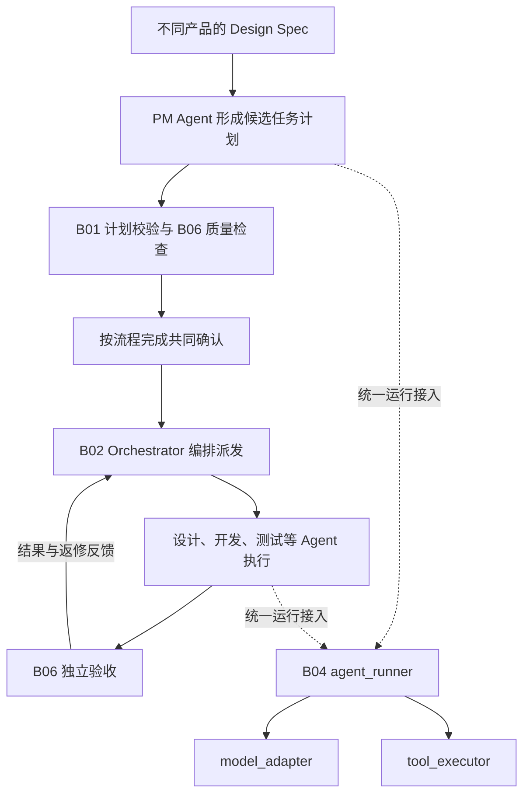

# B04 任务执行协议设计

本文定义通用 SE Workflow 平台的 Agent 运行接入协议。B04 为不同产品的 Design Spec、PM 任务规划及后续设计、实现、测试、评审提供一致的模型与工具接入能力，并提交可核查的多类型产物。

| 项目 | 内容 |
| --- | --- |
| 文档版本 | v0.2.1 |
| 协议版本 | `b04.exec.v0.2` |
| 负责人 | 汤志豪 |
| 工作块及协作标识 | B04 Agent 接入／AgentIntegrationAgent |
| 定位 | 支持不同产品与可扩展角色的通用运行接入层 |
| 对应模块 | `model_adapter`、`agent_runner`、`tool_executor` |
| 文档状态 | 待交叉评审的设计草案 |
| 更新日期 | 2026-11-17 |
| 测试案例 | 校园失物招领；补充不同任务结构的产品样例以验证通用性 |

本次为未发布草案的接口一致性修订，协议标识保持 `b04.exec.v0.2`，模块标识保持原值。新增枚举和字段须由全部消费方按协议第 14 节共同确认，不能据此声明兼容已部署旧实现。角色模板 v0.1 的专业职责保持适用。

## 1 目标与设计依据

### 1.1 设计依据

1. 《多智能体共识收敛 Workflow 优化版》（`多智能体共识收敛Workflow_优化版.docx`）：共享黑板、必要上下文、结构化输出、主持人控制与人类确认。**待团队补充**：当前仓库未收录此原始总设计文档，补齐后应恢复其有效仓库链接。
2. 《第十组 设计规格与开发任务编排》（`第十组 设计规格与开发任务编排.docx`）：第 3—6 节通用执行流程，第 8 节异常恢复，第 9.4 节跨项目迁移，以及第 10 节职责和协作要求。**待团队补充**：当前仓库未收录此原始分工文档，补齐后应恢复其有效仓库链接。
3. 本轮项目目标澄清：实现通用、可定制的 SE Workflow 平台，支持不同产品的 Design Spec、PM Agent 任务分解及 Orchestrator 编排。校园失物招领用于验证平台能力。当前可访问的仓库概述见 [通用项目总览](<../docs/PROJECT_OVERVIEW.md>)，工作块职责见 [项目说明](<../README.md>)；两者不替代上述原始文档及其章节依据。

本修订保留总设计中的版本追溯、受控执行、独立验收和人类确认要求，将案例业务规则移至案例配置与测试部分。新增字段、方法签名、产物类型和迁移方式属于拟议接口，须由相关模块评审后进入共同基线；文档不表示实现、批准或验收已经完成。

### 1.2 协议目标

- 同一运行入口支持不同产品、可配置 Workflow 和可扩展 Agent 定义。
- 支持 PM 从 Design Spec 生成候选任务计划，也支持计划接受后的任务执行。
- 模型服务、角色模板、工具能力和输出契约分别配置、独立版本化。
- 交付任务计划、设计文档、代码、测试报告等实际产物及执行证据。
- 通过身份、快照、授权、预算和事件实现可追溯的执行与恢复。

通用性以已注册能力和输入输出契约为边界。新增角色若复用现有模型、工具和产物能力，可通过配置接入；新工具、新模型协议或新执行环境仍需实现相应适配器。

### 1.3 总体流程



B04 同时支撑规划调用和任务调用。PM 生成候选任务图的专业规则归 B01；Orchestrator 的阶段推进、任务派发和状态迁移归 B02。B04 完成一次受授权的 Agent 调用，并如实返回候选产物和执行事件。

图示为参考阶段流程。具体阶段、角色组合、确认主体和质量门槛由 B02 的版本化 Workflow 配置，不要求所有产品采用同一条固定流水线。选定流程所声明的必要确认与独立验收不得由执行器自行省略。

## 2 职责边界与可定制内容

### 2.1 工作块职责

| 工作块 | 主责 | 与 B04 的边界 |
| --- | --- | --- |
| B01 规格规划 | Design Spec／任务 schema、PM 规划规则、需求追溯、plan_validator | 提供专业模板和契约；B04 承载 PM 调用与结构检查，不代替业务覆盖和计划合理性判断 |
| B02 流程编排 | 阶段控制、依赖就绪、资源分配、派发、重派、暂停恢复和全局状态 | 调用 B04，消费执行事件；B04 不自行重排其他任务或放行下游 |
| B03 黑板数据 | 共享快照、任务和事件记录、产物索引、持久化及原子操作 | B04 通过授权接口读写执行记录和候选引用，不另建全局状态源 |
| B04 Agent 接入 | 模型适配、Agent 注册与运行、工具执行、候选产物提交 | 不自行确认需求、接受计划、批准发布或降低验收规则 |
| B05 交互展示 | 平台配置交互、运行展示、控制入口和成果导出 | 展示 B04 的能力与执行详情；控制经 B02，案例前端单独配置 |
| B06 质量共识 | 计划质量、独立验收、证据判断、故障注入与回归 | 消费候选产物和证据；B04 自检不作为唯一验收，B01 按总设计复核覆盖及证据 |

B04 仅向 B02 报告结果，由 B02 决定全局 `SUCCEEDED`、`FAILED`、`BLOCKED` 等状态并调用 B03 持久化。存储服务实施原子写入不改变状态决策权的归属。

B01—B06 是平台开发团队的工作块，不要求用户产品生成的每项任务都绑定这六个块。运行时 Agent、模型实例、任务所有者和团队工作块分别标识。

平台共同接口和规则的评审遵循开发团队约定；用户产品运行时的审批角色、人数和触发阶段由其 Workflow 配置。两类治理记录分别保存，不将六名开发成员作为每个用户产品的默认审批者。

### 2.2 配置分层

| 配置 | 内容 | 主责与消费者 |
| --- | --- | --- |
| 产品规格 | 功能、设计条目、领域实体、接口、约束和验收要求 | B01 定义输入契约；B03 保存；PM 和执行 Agent 按需读取 |
| Workflow 定义 | 阶段、确认门槛、允许调用、资源容量和预算策略 | B02 主责；B04 遵循运行授权 |
| Agent 定义 | 能力、模板、输入输出契约、模型策略和工具需求 | 专业块维护内容，B04 维护注册格式和运行适配 |
| 模型配置 | provider、model_id、参数、能力和凭据引用 | B04 维护适配；实际选择进入版本化项目配置 |
| 工具与环境配置 | 工具注册、参数 schema、工作区、可访问资源和执行环境 | B04 提供适配，与 B02/B03 确认授权及资源边界 |
| 产物与检查契约 | 产物类型、结构、必要检查、独立评审和接受条件 | B01/B06 定义要求；B04 检查结构并提交 |
| 测试案例配置 | 具体业务规格、角色组合、任务样例、预期和故障数据 | 相关业务主责块提供，B06 组织验证 |

产品规格描述业务要求，不能自行扩大运行授权。实际工具和写入范围取项目、阶段、Agent 定义和本次派发授权的交集。

## 3 可扩展 Agent 与 PM 规划

### 3.1 Agent 定义

Agent 定义是可版本化的配置，不在核心代码中使用固定的四角色枚举。

| 字段 | 含义 |
| --- | --- |
| agent_definition_ref | 不可变定义引用及版本 |
| capability_refs | 已注册能力，例如任务规划、接口实现或文档评审 |
| prompt_template_ref | 角色提示词及版本，由相应专业块维护 |
| input_contract_ref | 输入类型、必要引用和允许输入状态 |
| output_contract_ref | 产物种类、schema、数量和必要检查 |
| model_policy_ref | 可用模型、必要能力及参数策略 |
| tool_requirement_refs | 所需工具能力及参数约束 |
| resource_profile_ref | 运行环境、容量需求和预算要求 |
| escalation_target | 缺输入、矛盾或能力不足时的责任接口 |

B04 提供能力目录，描述可用 Agent、模型、工具、输入输出类型及限制。PM 读取其冻结版本规划任务，B02 派发前再次核对可用性。模型能力缺失不能通过静默丢弃必要输入或工具要求来掩盖。

默认模板可以包含 PM、设计、数据库、后端、前端、测试与评审角色；产品可注册其他角色，也可只使用其中一部分。角色实例数由 Workflow 配置，B02 分配，B04 不自行扩容绕过资源队列。

### 3.2 PM 规划的输入输出

| 项目 | 规划阶段要求 |
| --- | --- |
| 输入 | 当前产品已确认的 Design Spec、约束、能力目录、规划规则、任务输出契约，以及必要的决策和未决事项 |
| 输出 | 候选 Task Plan、规格到任务的映射、依赖声明、假设和待确认项 |
| 任务条目 | 唯一 task_id、目标、规格引用、输入、输出、依赖、所需能力和验收要求 |
| B04 检查 | 可解析、符合声明结构、引用可读取、产物真实存在，调用及资源信息可追溯 |
| B01 检查 | 需求覆盖、任务边界、依赖引用和无环性、唯一主责及验收可执行性 |
| B06 检查 | 计划质量、边界反例、证据要求和未解决阻断项 |
| 接受 | 按 Workflow 完成指定评审与人类确认，由 B02 登记接受引用并加载任务图 |

PM 提交计划是候选产物提交，不直接写入生效的任务图。计划通过 JSON 结构检查也不等于需求覆盖、依赖合理性或共同确认已经通过。

### 3.3 首次规划与重规划

平台预先配置的阶段 Workflow，和 PM 为某个产品生成的开发任务图，是两种不同对象。

- 首次 PM 调用由 B02 按已配置的规划阶段发起；此时没有开发任务图，允许 `task_id=null`、`plan_ref=null`。
- 输出的新计划版本由候选产物记录承载，不要求调用前已有输出计划版本。
- 计划接受后，B02 依据该计划创建或加载任务，后续调用关联其 `task_id` 和 `plan_ref`。
- 重规划读取旧计划、变更请求和影响信息，输出新候选计划。B04 不替换运行中的计划，失效传播和重新派发由 B02 决定。
- PM 阶段尚无编程仓库时，允许 `source_control=null`，产物使用 B03 的版本化存储。

## 4 三个核心模块

### 4.1 职责与输入输出

| 模块 | 输入 | 输出 | 职责及边界 |
| --- | --- | --- | --- |
| model_adapter | 模型配置、标准消息、期望响应结构、工具描述和调用预算 | 标准化响应、结构化内容或工具调用意图、调用标识、用量和错误 | 转换供应商协议与能力差异；不决定产品任务、依赖调度或执行工具 |
| agent_runner | 调用包、Agent 定义、冻结上下文、输入输出契约和授权 | 多类型候选产物、调用／工具记录、自检与执行事件 | 管理一次调用的生命周期，组装必要上下文、检查响应、组织工具及提交；不接受计划或决定全局状态 |
| tool_executor | 工具及版本、参数、调用身份、资源授权、操作编号和时限 | 实际结果、文件或对象引用、变更清单、退出信息和错误证据 | 执行授权工具并记录副作用；不内置具体业务规则，不直接运行未经校验的模型建议 |

运行链路为：runner 组装上下文，adapter 调用模型；runner 校验行动并交 executor 执行，再把结果按需反馈模型，最后整理候选产物。循环受本次调用预算约束。

### 4.2 输入与输出的检查层次

1. **adapter 层**：模型请求可转换，服务响应可归一，实际能力及调用错误如实返回。
2. **runner 层**：输入输出满足类型和引用契约，行动处于授权范围，产物与本次输入对应。
3. **专业校验层**：B01 的规划校验或相应产品规则判断内容是否合理。
4. **独立质量层**：B06 判断规定证据与行为是否满足验收。
5. **流程控制层**：B02 依据检查、确认和版本有效性决定状态及后续派发。

必要的产品规则通过版本化上下文、契约和已注册检查器提供，不在三个模块中硬编码 `lost_at`、发布接口或固定任务编号。

## 5 通用调用包

### 5.1 调用身份

| 字段 | 规则 |
| --- | --- |
| project_id、run_id | 标识项目和 Workflow 运行，隔离上下文、产物与执行记录 |
| invocation_id | B02 分配的逻辑调用编号；首次规划也具有该编号 |
| task_id | 所属产品任务编号；无开发任务图的阶段调用为 null |
| attempt_id | 同一 invocation 每次实际派发单调递增，由 B02 分配 |
| retry_count、retry_budget | 失败重派次数及预算，由 B02 维护 |
| revalidation_id | 上游变化引发重验的引用，普通调用为 null |
| dispatch_id | 本次派发意图标识；传输重发沿用 |
| idempotency_key | 建议由 project_id、run_id、invocation_id、attempt_id 组成 |
| input_snapshot_id、input_snapshot_sha256 | 冻结输入和配置的引用及内容校验值 |

event_id 仅属于事件信封，由 runner 通过 B03 持久化接口分配；不属于调用包、模型请求或工具请求的必填身份。重传事件沿用原编号。

task_id 用于关联业务任务，不作为所有调用的必需前提。重试沿用 invocation_id；新输入触发的重验保留逻辑调用关系并分配新 attempt。不同任务和不同阶段不得共用一个 invocation_id。

### 5.2 字段结构与条件要求

| 分组 | 字段 | 必需性与约束 |
| --- | --- | --- |
| 协议与模式 | protocol_version、execution_mode | 必需；模式为 mock 或 live |
| 身份与尝试 | project_id、run_id、invocation_id、task_id、attempt_id、dispatch_id、idempotency_key、retry_count、retry_budget、revalidation_id | 键必须存在；task_id 和 revalidation_id 可为 null；不要求 event_id |
| Workflow | workflow_definition_ref、invocation_kind | 必需；kind 从已注册契约选择，示例包括 plan、design、implement、test、review |
| Agent | agent_definition_ref、model_config_ref | 定义必需；模型配置按定义要求，确定性适配须明确声明 |
| 目标与契约 | goal、input_contract_ref、output_contract_ref | 必需；输出契约明确种类和必要检查 |
| 上下文 | inputs、spec_ref、plan_ref | inputs 为有版本的引用数组；spec_ref、plan_ref 按阶段要求，可为 null |
| 授权与资源 | lease_ref、tool_config_ref、write_scope、limits | 必需；空工具集、空文件范围也须显式声明 |
| 工作区与代码扩展 | workspace_ref、source_control | 非代码调用可为 null；修改仓库的代码任务须声明 |
| 团队归属 | ownership | 可选追溯标签，例如 block_id／role_id，不作为运行角色枚举 |
| 升级 | escalation_target | 必需，指向责任角色或模块 |

spec_ref、plan_ref 应同时出现在 inputs 和冻结快照中，重复声明必须一致。规划已有 Design Spec 时 spec_ref 必需；输入计划为空时不得伪造 plan_version。接口契约通过 inputs 引用，由任务配置决定是否需要，不强制每个产品都有 C1 或 HTTP API。

write_scope 分别声明工作区路径和产物命名空间。文件范围为空的规划任务仍可向授权命名空间提交版本化计划；不能据此任意写本机文件或其他项目数据。

### 5.3 首次 PM 规划调用模板

本节所有 JSON 均为设计模板，尖括号内容须替换并通过契约校验后才能执行。引用名称、角色标识、工具配置和预算数值为示例，不表示相关接口或配置已经实现。

```json
{
  "protocol_version": "b04.exec.v0.2",
  "execution_mode": "mock",
  "project_id": "product-cli-demo",
  "run_id": "run-demo-001",
  "invocation_id": "invoke-plan-001",
  "task_id": null,
  "attempt_id": 1,
  "retry_count": 0,
  "retry_budget": 2,
  "revalidation_id": null,
  "dispatch_id": "dispatch-plan-001",
  "idempotency_key": "product-cli-demo:run-demo-001:invoke-plan-001:1",
  "workflow_definition_ref": "workflow:se-basic@1",
  "invocation_kind": "plan",
  "agent_definition_ref": "agent:pm-planner@1",
  "model_config_ref": "model:mock-planner@1",
  "goal": "根据产品设计规格形成可校验的候选任务计划",
  "input_contract_ref": "contract:planning-input@1",
  "output_contract_ref": "contract:task-plan-output@1",
  "input_snapshot_id": "snapshot-plan-001",
  "input_snapshot_sha256": "<snapshot_sha256>",
  "inputs": [
    {
      "artifact_ref": "spec:product-cli-demo@1",
      "kind": "design_spec"
    },
    {
      "artifact_ref": "catalog:runtime-capabilities@1",
      "kind": "capability_catalog"
    }
  ],
  "spec_ref": "spec:product-cli-demo@1",
  "plan_ref": null,
  "lease_ref": "<active_lease_ref>",
  "tool_config_ref": "tools:planning-readonly@1",
  "write_scope": {
    "workspace_paths": [],
    "artifact_namespaces": [
      "product-cli-demo/plans"
    ]
  },
  "workspace_ref": null,
  "source_control": null,
  "limits": {
    "execution_timeout_seconds": 300,
    "model_call_timeout_seconds": 90,
    "max_model_calls": 3,
    "max_total_tokens": 12000,
    "max_tool_calls": 10
  },
  "ownership": {
    "block_id": "B01",
    "role_id": "SpecPlannerAgent"
  },
  "escalation_target": "B01"
}
```
### 5.4 接收校验

1. 校验版本、类型、必填字段和阶段条件；基本身份不完整时同步拒绝。
2. 核验 B02 的可信派发上下文、当前 attempt、阶段门槛、资源和租约。
3. 原子检查幂等键；同键同包返回已有调用引用，同键异包拒绝。
4. 读取快照，核对输入及配置的版本、校验值、项目归属和允许状态。
5. 核对 Agent、模型、工具、输入输出类型及环境能力，能力不足则明确返回。
6. 登记执行和待发送事件，再开始实际调用；未通过前不调用模型或工具。

输入状态按阶段契约校验：开发依赖通常要求已接受产物；评审调用可以读取明确指定的候选。可读取候选不等于候选已经接受，不能用统一“全部输入必须已接受”规则阻断评审本身。

## 6 跨模块接口

所有签名描述逻辑行为，不预设框架、HTTP、消息队列或数据库。

### 6.1 B01 与规划接口

B01 提供规划规则、PM 模板、产品输入和 Task Plan schema，并消费候选计划。B04 向 B01/B02 提供版本化能力目录。

PM 调用由 B02 按规划阶段授权后进入统一入口。B01 不需要另写模型调用通道，也不通过 B04 绕过计划确认。B01 的 plan_validator 可作为专业校验模块或经注册的工具使用，其规则所有权与结论不因调用位置改变。

### 6.2 B02 调用 B04

| 拟议接口 | 返回 | 行为 |
| --- | --- | --- |
| invoke_agent(envelope) | InvocationReceipt | 接收规划或任务调用，或返回拒绝／重复派发的已有引用 |
| get_invocation(invocation_ref) | InvocationSnapshot | 查询本地阶段、执行终结结果、停止情况及最近事件 |
| stop_invocation(invocation_ref, reason) | StopReceipt | 请求停止指定 attempt，区分 confirmed、pending、unknown |
| describe_capabilities(catalog_ref) | CapabilityCatalog | 提供可规划和派发的能力、契约、限制及版本 |

invocation_ref 使用第 14.1 节完整 InvocationRef，包含 project_id、run_id、invocation_id、task_id、attempt_id、dispatch_id；task_id 键必须存在但可为空。InvocationReceipt 包含 accepted、duplicate、invocation_ref、reason_code、message。接收回执不表示产物验收或计划接受。

### 6.3 B04 回传 B02

沿用总设计中的 `submit_event(event)` 入口。EventReceipt 的完整字段见第 14.8 节，receipt_status 表达 recorded、stale 或 rejected，并给出原因：

- recorded：本事件已记录，重复重传返回相同确认。
- stale：属于过期 attempt、失效输入或被撤销授权，仅保留历史。
- rejected：身份、结构或内容冲突，不覆盖原记录。终结事件进入第 14.8 节终结对账流程；非终结事件保留拒收回执和原事件引用，交 B02 登记控制诊断或决定，不能伪造 submission_id 调用终结对账接口。

事件发送失败重传原 event_id，消耗传输预算，不启动第二次 Agent 调用。预算用尽后保留待发送记录，供恢复及查询。

### 6.4 B04 使用 B03

| 数据能力 | 约定 |
| --- | --- |
| 读取规格、配置与输入快照 | 按不可变引用读取，返回版本、校验值、项目归属和状态 |
| 调用及工具去重登记 | 原子处理派发和 operation_id，同键异内容报冲突 |
| 授权及租约核对 | 约束项目、资源、当前 attempt 和有效写入范围 |
| 候选产物登记 | 存储多类型内容与元数据，返回实际可解析的引用 |
| 执行与事件持久化 | 保存过程、终结结果、待发送事件和恢复证据 |
| 接受记录读取 | 区分候选、接受及失效引用，不由 B04 更新全局接受结论 |

具体原子方法由 B02/B03/B04 共同确认。成员本机副本不作为共同状态源；本地工作区只用于隔离执行。

### 6.5 B05 与 B06

B05 展示角色、模型和工具能力，以及调用阶段、输入、产物、阻塞和日志引用。平台配置选择经项目配置及 B02 生效；暂停、恢复、取消通过 B02。失物招领参考页面属于案例界面，不是平台通用交互的固定页面。

B06 通过 B03 获取候选、manifest 和自检证据，并向 B02 返回独立质量事件。B04 提供执行工具和结果，不选择更容易通过的验收规则。B04/B05 固定交叉评审，涉及接口的其他消费方仍参与评审；按总设计保留 B01 对覆盖和证据的复核。

## 7 执行生命周期

### 7.1 通用步骤

1. 加载 Agent 定义、输入输出契约、资源及工具配置。
2. 读取当前调用需要的产品规格、产物和决策，记录来源，不携带其他产品上下文或无关聊天历史。
3. 按产物配置准备执行环境；纯规划可使用版本化对象存储，代码修改准备隔离分支和工作区。
4. 经 adapter 调用模型，校验结构和行动；经 executor 调用工具，保留真实结果。
5. 执行契约要求的局部检查，记录未运行、失败和已知问题。
6. 登记多类型候选及 manifest，发送 candidate_submitted，等待外部评审。

### 7.2 本地阶段与终结

本地阶段为 `ACCEPTED → PREPARING → EXECUTING → SELF_CHECKING → SUBMITTING → TERMINAL`，用于诊断。TERMINAL 记录已提交候选、执行失败、执行阻塞或已停止之一。

这些不是第二套全局任务状态。规划调用的“已提交候选”不等于计划接受，代码调用的“已提交候选”也不等于任务 SUCCEEDED。

### 7.3 自检与专业检查

runner 对声明结构、引用和权限做检查，不自行判断全部产品语义。若候选可读取但专业检查失败或规定证据不全，可以如实提交并标 failed／incomplete，由独立流程拒绝或反馈。

无法形成满足基本结构、真实存在性或范围约束的候选时，报告 execution_failed。规格矛盾、缺少必要输入或决定时，报告 execution_blocked。不得伪造产物、修补输入事实或放宽输出契约。

专业检查返回失败和执行工具本身故障分别记录。例如“Task Plan 存在依赖环”是计划检查结果；校验器无法启动才属于工具执行故障。

## 8 模型与工具契约

### 8.1 model_adapter

逻辑请求包含调用身份、标准消息、期望响应结构、工具描述、模型配置和剩余预算。逻辑结果包含 provider、model_id、request_id、时间、文本或结构化内容、工具调用意图、终止原因、可获得用量及错误。

- 供应商参数保留在模型配置中，产品输入和产物契约不随供应商改变。
- adapter 归一响应，runner 按输出契约校验；业务解释和规划合理性由相应专业模块判断。
- 模型不支持必要输入、工具或输出能力时返回能力不足，不静默丢失信息。
- SDK 重试须关闭或明确计入调用预算并留记录，不执行无记录重试。
- 用量不可得时标记 unavailable，不虚构数值。
- 密钥通过配置引用和独立凭据注入获取，不进入公共记录。
- 基础实现一次 attempt 固定模型配置；切换通过 B02 新派发，保留原因、旧失败／异议和预算历史。

### 8.2 tool_executor

工具请求包含 invocation_ref、operation_id、tool_binding_ref、tool_name、tool_version、arguments、lease_ref 和 timeout_seconds；结果回显绑定并包含实际状态、时间、输出引用、变更、可获得的退出码及错误。模型名到版本绑定、写入内容暂存与 ToolFeedback 遵循第 14.4—14.5 节。

工具必须注册参数和结果契约。工具集可包含规格读取、JSON 校验、文档操作、文件修改、构建、测试或其他已适配能力，按 Agent 和阶段授权。工具的存在不自动授权调用。

对文件操作，执行前解析真实路径，复核授权范围，防止绝对路径、`..`、符号链接或 Windows junction 越界，执行后检查实际变更。对对象存储写入，核对项目和产物命名空间。外部副作用工具须提供幂等或状态核对能力。

相同 operation_id 和参数可重用已确认结果；同编号异参数拒绝。完成状态不明时先核查实际副作用，不直接重做。工具退出码、日志、真实文件及对象引用是执行依据，模型文字声明不代替工具结果。

运行时授权与成员个人选择 IDE、模型及辅助工具分别管理，不建立个人开发工具白名单。

### 8.3 mock 与 live

mock 模式使用确定性适配验证流程，也须形成实际可读取的对象或文件，并明确标记模式。live 模式记录真实模型、工具和环境。

mock 的结构检查、规划和故障注入结果不能直接证明真实模型或产品业务通过验收。产品类型、调用阶段和执行模式均须进入证据。

## 9 多类型产物与接受

### 9.1 产物类型

产物种类按版本化注册表扩展，不在 runner 中强制“所有结果都是代码”。

| 示例 kind | 内容 | 典型检查 |
| --- | --- | --- |
| task_plan | 任务、依赖、能力需求、追溯及未决项 | schema、引用、覆盖、DAG、验收可执行性 |
| design_document | 设计说明、接口、数据或交互方案 | 结构、规格追溯、专业评审 |
| source_bundle | 代码、配置、迁移及构建输入 | 文件清单、提交、构建和行为检查 |
| test_report | 用例、输入、预期、实际和执行环境 | 被测版本、证据完整性和可复现性 |
| review_report | 异议、证据、回应和处理建议 | 目标版本、规则引用及独立性 |
| change_proposal | 范围或设计变更建议及影响 | 来源、影响范围、待确认决定 |

schema 检查属于相应格式的验证，专业检查和接受仍按职责执行。其他 kind 经注册契约及存储能力评审后接入。

### 9.2 通用 Manifest

字段名、必填性和内嵌／引用边界以第 14.7 节为准；本表是分类摘要，不是允许省略字段的替代 schema。

| 分组 | 必需内容 |
| --- | --- |
| 身份 | 协议版本、执行模式、项目、run、invocation、attempt、dispatch，task_id 可为空 |
| 输入 | 快照及校验值、输入引用、Workflow、Agent、模型与工具配置版本 |
| 产物 | artifact_ref、kind、版本、media_type、内容 SHA-256、字节数及适用 schema_ref |
| 执行 | author、实际模型与调用、模板版本、工具操作引用、起止时间 |
| 检查 | output_contract_ref、规定检查、自检引用、缺失项和整体状态 |
| 问题 | 修改摘要、已知问题、open_questions 和异常引用 |
| 代码扩展 | source_control 为 null，或包含仓库、base_commit、candidate_commit |
| 评审 | 初始 review_status=pending，外部接受结论另行登记 |

产物必须可读取并与校验值一致。JSON 对象使用 B03 登记的不可变实际字节计算校验值，不能仅依赖字段含义相似。schema_ref 对结构化类型按输出契约必填；其他文档类型使用相应格式和评审契约。

### 9.3 首次规划候选 Manifest 模板

```json
{
  "manifest_contract_version": "b04.manifest.v0.2",
  "protocol_version": "b04.exec.v0.2",
  "execution_mode": "mock",
  "project_id": "product-cli-demo",
  "run_id": "run-demo-001",
  "invocation_id": "invoke-plan-001",
  "task_id": null,
  "attempt_id": 1,
  "dispatch_id": "dispatch-plan-001",
  "input_snapshot_id": "snapshot-plan-001",
  "input_snapshot_sha256": "<snapshot_sha256>",
  "workflow_definition_ref": "workflow:se-basic@1",
  "agent_definition_ref": "agent:pm-planner@1",
  "model_config_ref": "model:mock-planner@1",
  "tool_config_ref": "tools:planning-readonly@1",
  "output_contract_ref": "contract:task-plan-output@1",
  "artifacts": [
    {
      "artifact_ref": "candidate:product-cli-demo/plan@1",
      "kind": "task_plan",
      "version": "1",
      "media_type": "application/json",
      "schema_ref": "schema:task-plan@1",
      "sha256": "<artifact_sha256>",
      "size_bytes": 2048
    }
  ],
  "execution_record_ref": "<execution_record_ref>",
  "self_check_refs": [
    "<schema_check_ref>",
    "<reference_check_ref>"
  ],
  "self_check_status": "passed",
  "missing_check_refs": [],
  "known_issue_refs": [],
  "source_control": null,
  "review_status": "pending",
  "submission_id": "submission:run-demo-001:invoke-plan-001:1",
  "input_refs": [
    {
      "artifact_ref": "spec:product-cli-demo@1",
      "kind": "design_spec",
      "sha256": "<spec_sha256>",
      "state": "accepted"
    },
    {
      "artifact_ref": "catalog:runtime-capabilities@1",
      "kind": "capability_catalog",
      "sha256": "<catalog_sha256>",
      "state": "accepted"
    }
  ],
  "prompt_template_ref": "prompt:pm-planner@1",
  "author": "service:agent_runner",
  "started_at": "2026-11-16T01:59:00.000Z",
  "finished_at": "2026-11-16T02:00:00.000Z",
  "change_summary": "生成当前产品的候选任务计划并保留自检与已知问题",
  "model_call_refs": [
    "<model_call_record_ref>"
  ],
  "tool_operation_refs": [
    "<tool_operation_record_ref>"
  ],
  "required_check_refs": [
    "check:plan-schema@1",
    "check:plan-references@1"
  ],
  "open_questions": []
}
```
其中 size_bytes 为格式示例，实际提交须以真实字节数替换。self_check_status=passed 仅表示本次自检通过，不表示 Task Plan 的覆盖、无环检查、独立质量检查或人类确认已通过。

### 9.4 代码与非代码交付

代码修改任务继续遵循总设计：以接受的 base_commit 建立隔离分支，提交 candidate_commit，经交叉评审、连续集成和合并后形成 accepted_commit。整合改变内容时重跑受影响检查。

纯规划、设计和报告可使用 B03 版本化对象，不强制先存在 Git 仓库；如果项目配置要求入库，则附加代码仓库扩展。文档或报告同样不能以聊天中的承诺代替实际可读取产物。

manifest 建议在产物或候选代码形成后独立登记，不要求包含在其所引用的同一提交中，避免提交编号与 manifest 相互依赖。

### 9.5 证据与接受

每份检查证据记录 check_ref、evidence_kind、执行模式、输入快照、被检产物及校验值、检查入口、预期、实际、结果和环境。自检使用 self_check，独立检查由相应独立流程标识。

结果为 passed、failed、not_run；整体状态为 passed、failed、incomplete。检查后内容、依赖或配置改变，应重跑受影响检查，不能只替换旧报告中的版本号。

B04 提交候选；B01/B06 及相关消费方按产物类别评审，按 Workflow 完成人类确认。B02 依据接受记录和有效性推进阶段或任务。正式代码交付还须核对接受提交，其他产物核对接受版本。计划接受触发任务图加载，不由 candidate_submitted 直接触发。

## 10 事件与恢复

### 10.1 公共事件字段

事件包含 protocol_version、event_id、event_type、project_id、run_id、invocation_id、task_id、attempt_id、dispatch_id、input_snapshot_id、input_snapshot_sha256、event_seq、occurred_at、execution_mode、producer 和 payload。

task_id 可为空；producer 标识 B04 执行入口，agent_definition_ref 放入 payload，避免把执行入口与业务角色混为一谈。event_seq 在同一次 dispatch 内递增，重传不增加。时间使用 UTC ISO 8601。

### 10.2 事件类型

| event_type | 含义与控制边界 |
| --- | --- |
| execution_accepted | 执行入口已接受，不表示业务或规划成功 |
| execution_started | 开始当前 attempt 的实际调用 |
| execution_progress | 阶段、进度和用量，不释放依赖 |
| candidate_submitted | 已登记多类型候选，由外部检查与接受 |
| execution_failed | 模型、工具或提交故障导致无法形成合规候选 |
| execution_blocked | 缺输入、矛盾、必要决定或外部条件 |
| execution_stopped | 已确认当前 attempt 停止，附停止范围 |

四种执行终结结果为候选提交、执行失败、执行阻塞和已停止，彼此互斥。候选后的质量失败来自独立验收流程，不再由 B04 发送相互矛盾的终结事件。

重复事件沿用 event_id 和内容。过期 attempt 只保留历史；迟到进度不回退终结状态。乱序到达的终结事件仍须独立核验身份、快照及产物，冲突交 B02 核对，不采用最后写入覆盖。

### 10.3 规划候选提交事件模板

```json
{
  "protocol_version": "b04.exec.v0.2",
  "event_id": "event-plan-001-04",
  "event_type": "candidate_submitted",
  "project_id": "product-cli-demo",
  "run_id": "run-demo-001",
  "invocation_id": "invoke-plan-001",
  "task_id": null,
  "attempt_id": 1,
  "dispatch_id": "dispatch-plan-001",
  "input_snapshot_id": "snapshot-plan-001",
  "input_snapshot_sha256": "<snapshot_sha256>",
  "event_seq": 4,
  "occurred_at": "2026-11-16T02:00:00.000Z",
  "execution_mode": "mock",
  "producer": "B04",
  "payload": {
    "agent_definition_ref": "agent:pm-planner@1",
    "manifest_ref": "<immutable_manifest_ref>",
    "artifact_kinds": [
      "task_plan"
    ],
    "self_check_status": "passed",
    "missing_check_refs": [],
    "submission_id": "submission:run-demo-001:invoke-plan-001:1",
    "manifest_sha256": "<manifest_sha256>",
    "terminal_record_ref": "<terminal_record_ref>"
  }
}
```
### 10.4 幂等与中断恢复

B02 先持久化派发意图；B04 在产生副作用前完成原子调用登记，持久化工具操作结果和待发送事件。相同派发重发只返回已有引用，不产生第二次有效调用。

候选发布要求当前执行授权、租约和输入仍有效；失败、阻塞、停止及历史核对使用独立的 report／observe／cleanup 授权。后者严格绑定原 project／run／invocation／attempt／dispatch，在执行租约过期、输入失效或新 attempt 生效后仍可按授权追加诊断、停止和投递记录，但不能发布业务候选或推进当前新 attempt。共享控制对象及原子规则见第 14 节。

中断后先核对登记、进程或模型调用、工具副作用、候选和事件，再继续或重传。无法确认时返回 unknown，不盲目重新执行。无法终止的外部调用须隔离其结果及副作用，迟到候选不能写入新 attempt。

协议控制重复有效执行，不承诺外部模型服务在所有中断下绝无重复计费；状态不明时须保留记录并核对。

## 11 异常与预算

### 11.1 错误分类

执行错误包含 code、category、message、stage、operation_ref、evidence_refs、recoverability、requested_action 和 stop_status。字段级类型、cause_ref、origin_layer、details 以及事件处置以第 14.6 节为准。恢复建议不授予 B04 重派权限。

| 拟议代码 | 情况 | 处理 |
| --- | --- | --- |
| EXEC_INVALID_ENVELOPE | 版本、类型、必填或阶段条件不合法 | 同步拒绝，说明缺项 |
| EXEC_DISPATCH_CONFLICT | 同幂等键对应不同输入 | 拒绝覆盖，保留原记录 |
| EXEC_INPUT_INVALID | 引用、项目、输入状态或校验不符 | 报告阻塞，交责任方核查 |
| EXEC_CAPABILITY_UNAVAILABLE | 模型、角色、工具、类型或环境能力不足 | 返回缺失能力，交 B01/B02 调整 |
| EXEC_LEASE_INVALID | 当前 attempt 或租约失效 | 停止新操作，报告停止情况 |
| EXEC_MODEL_ERROR | 模型服务失败或响应无法归一 | 记录实际调用和错误 |
| EXEC_TOOL_ERROR | 工具不可用、执行机制故障或兼容的读取／执行拒绝 | 记录分类、操作及副作用状态 |
| EXEC_RUNNER_ERROR | 未预期的 runner 协调异常 | 停止新动作，保留诊断并按 report 授权反馈 |
| EXEC_WRITE_SCOPE | 文件或对象写入超出范围 | 拒绝操作并保留证据 |
| EXEC_ARTIFACT_INVALID | 输出不存在、结构不符或校验失败 | 不登记为合规候选，报告错误 |
| EXEC_TIMEOUT | 调用或执行超时 | 停止并核对未结束调用 |
| EXEC_BUDGET_EXHAUSTED | 本次资源预算耗尽 | 停止新调用，保留已有结果与缺项 |

专业检查得到依赖环、缺业务字段等结论，不等于执行基础设施故障。案例中的业务 HTTP 错误也独立于上述 EXEC_ 分类。

### 11.2 重派与重验

总设计默认 retry_budget=2，即首次失败后最多自动重派两次；实际值由 Workflow 配置并冻结。B02 分配新 attempt_id，失败重派增加 retry_count。SDK 重试和模型切换不得重置预算或隐藏额外调用。

上游变化导致的重验使用 revalidation_id 和新 attempt_id，不因重验启动增加 retry_count；重验失败后的失败重派才消耗预算。无有效进展或预算耗尽时交 B02 阻塞并报告，不能无限循环。

### 11.3 暂停、停止与失效

暂停由 B02 停止新派发，运行中的调用可按原授权提交候选。取消或超时后，B04 停止新调用并终止可终止操作；StopReceipt 区分 confirmed、pending、unknown。

B02 只有确认旧调用停止，或副作用与产物已有效隔离，才能安全重派。版本失效和授权撤销后，B04 停止新的有效写入，保留历史。恢复时重新核对快照、控制条件和资源，不将所有 RUNNING 调用直接重跑。

## 12 平台验收与测试案例

### 12.1 通用平台验收

下表为拟议 B04 验收项，具体脚本与证据格式由 B06 确认。B05 交叉评审，B01 复核覆盖及规定证据，B02 依据结果决定状态。

| 编号 | 动作 | 通过标准 |
| --- | --- | --- |
| B04-AC-01 | 相同运行契约接入不同模型配置 | 产品和任务结构稳定，实际模型及差异可追溯 |
| B04-AC-02 | 提交多类型候选 | 实际可读取，kind、版本、校验值和 manifest 一致 |
| B04-AC-03 | 仅返回“已完成”或删除产物 | 不形成有效交付，独立验收不通过 |
| B04-AC-04 | 缺少输出契约要求的检查证据 | 如实标缺，外部质量门槛不放行 |
| B04-AC-05 | 重发相同派发包 | 返回同一调用引用，无第二次有效执行 |
| B04-AC-06 | 同键改变输入包 | 冲突被拒绝，原快照不变 |
| B04-AC-07 | 重复事件、乱序进度和旧 attempt 回调 | 去重或保留历史，不覆盖当前有效结果 |
| B04-AC-08 | 越界路径、命名空间、工具或失效租约操作 | 操作被拒绝，范围外资源不变，有记录 |
| B04-AC-09 | 模型错误、工具故障和超时 | 错误及停止情况真实，重派受 B02 控制 |
| B04-AC-10 | 在派发、工具和提交阶段中断恢复 | 核对实际状态，不盲目重复副作用 |
| B04-AC-11 | 只有自检通过，无独立检查或必要确认 | 不自动接受计划或标记全局成功 |
| B04-AC-12 | 切换模型或耗尽预算 | 保留原因、失败及异议历史，预算不重置 |
| B04-AC-13 | 完成具体产品的业务用例 | 使用该产品配置验证，结果与产物版本绑定 |
| B04-AC-14 | mock 和 live 分别提交 | 模式明确，模拟结论不冒充真实结果 |
| B04-AC-15 | 无已有开发计划、无 Git 仓库时调用 PM | 正常生成版本化候选 Task Plan，不要求伪造 plan_ref 或提交 |
| B04-AC-16 | 为产品注册复用现有能力的新 Agent | 通过定义和契约接入，无需修改核心角色枚举 |
| B04-AC-17 | 输入两种结构不同产品的 Design Spec | 同一执行核心支持不同任务数量、依赖、角色和产物 |
| B04-AC-18 | 提交计划、设计文档、代码和报告 | 各自应用输出契约，Git 仅按项目和产物策略要求 |
| B04-AC-19 | PM 输出含依赖环或遗漏需求的候选计划 | B04 如实提交或报告结构问题，B01/B06 拒绝不合格计划，B02 不加载生效 |
| B04-AC-20 | 请求未支持能力，或混用其他项目上下文 | 明确返回缺口或拒绝越界，不静默降级或串用 |
| B04-AC-21 | 重规划形成新候选版本 | 旧计划不被 B04 覆盖，B02 按评审和影响处理后采用 |
| B04-AC-22 | 对照调用包与事件字段校验 | event_id 仅事件必需，InvocationRef 的 task_id 键允许 null |
| B04-AC-23 | 租约失效后提交候选及诊断 | 候选拒绝，绑定原调用的 report／observe／cleanup 仍可按授权工作 |
| B04-AC-24 | 对比 attempt 与 invocation 预算 | 子额度重分配不清除父消耗或未知预留，不重复扣账 |
| B04-AC-25 | 永久拒收终结事件 | 通过 submission_id 对账，有 decision_ref 或责任方阻塞，不造第二终结 |

AC-01 可先使用模拟适配检查接口一致性，真实异构模型接入结论需要真实调用证据。每项记录输入、预期、实际、环境、模式、产物版本及独立评审引用。

### 12.2 校园失物招领测试配置

失物招领是一个产品样例。S1/C1、LR-01—05、T01—T11、DB-01／BE-01／FE-01／QA-01、TC-P01—03 和 D-01 都属于该样例的数据、角色配置或测试引用，不作为平台核心固定值。

| 案例内容 | 测试用途 | 主责与边界 |
| --- | --- | --- |
| T03 认证与个人信息 | 验证后端执行、权限和契约检查 | B04 提供参考后端，BE 角色按案例配置运行 |
| T04 发布、搜索和详情 | 验证业务边界、产物与证据提交 | 依据 C1，核心执行器不实现 lost_at 规则 |
| T05 认领申请 | 验证依赖接续、事务及重复申请检查 | 依赖经接受的上游产物，规则来自产品规格 |
| TC-P01／02／03 及隐私用例 | 验证正常、缺失、非法时间和公开字段 | B06 维护验收，B04 提交局部自检 |
| D-01 返修闭环 | 验证错误定位、重派、版本失效和复测 | B02 控制，B04 执行返修，B06 独立复测 |

T04 缺 lost_at 返回 400／REQUIRED_FIELD；空值、空字符串或非法格式返回 400／INVALID_FIELD；拒绝后不写入。上述规则由 C1 和案例代码／检查器实现。

正常门槛下，缺 TC-P02/TC-P03 或行为失败的候选不能放行。隔离漏检夹具另预置错误成功 r1，由 T10 发现 D-01，B02 撤销放行并派发返修；上游变更后的 T05 使用新快照重验，完整回归通过后恢复交付。该故障夹具不能成为绕过正常门槛的入口。

### 12.3 跨产品测试

建议使用失物招领 Web 产品和命令行数据处理工具两组独立 Design Spec。后者可没有前端页面和业务数据库，具体任务由 PM 按其规格生成，不预置必须出现哪些任务或固定任务数量。

检查更换产品规格、角色／工具配置和输出契约后，B04 核心不依赖 lost_at、固定 HTTP 路径或 T01—T11。验证 PM 产生不同候选计划、B02 按不同任务图派发、B04 产生相应类型产物，B06 使用各自规则检查。

本节为测试设计，不代表两个产品或通用性验收已经实现或通过。

## 13 交付与兼容迁移

### 13.1 分阶段交付

| 阶段 | B04 交付 | 完成依据 |
| --- | --- | --- |
| 通用协议 | 本文、调用及产物 schema、职责与条件规则 | 专业块和接口消费方评审 |
| 可配置接入 | Agent／模型／工具注册、能力目录和版本化定义 | PM 与自定义角色可以使用共同入口 |
| 最小闭环 | 三个模块最小实现、PM 规划、多类型真实产物与事件 | 贯通 B02/B03，B06 验证失败和恢复 |
| 产品验证 | 失物招领案例及另一结构不同产品 | 核心复用，配置与产物按产品变化 |
| 真实联调 | 真实模型、案例执行、独立验收及接受记录 | 运行和证据可复现，mock／live 清晰 |

截至本修订，工作区以设计文档及制作产物为主，未发现三个核心模块、独立角色配置或真实验收报告。当前交付是协议修订，schema、模板和实现仍按阶段补齐。

### 13.2 v0.1 到 v0.2 的迁移

v0.2 调整了身份、前置条件及产物结构，属于不兼容的草案修订。未声明的旧格式不得按新格式静默解释；如需兼容，使用显式版本转换并保留原输入。未实际部署前无需伪造历史迁移。

| v0.1 内容 | v0.2 处理 |
| --- | --- |
| 仅以 task_id 标识逻辑执行 | 新增 invocation_id；首次阶段调用允许 task_id=null |
| 固定 runtime_role 四角色 | 改为 agent_definition_ref；旧值由显式映射表转换 |
| block_id／role_id 参与运行角色判断 | 移入可选 ownership 追溯标签，不限制用户产品任务归属 |
| 所有调用必须有 plan_version、C1 | 使用阶段条件和版本化输入引用；首次规划允许 plan_ref=null |
| 所有候选必须有 candidate_commit | 通用 artifact_ref、版本及校验值；代码按 source_control 扩展 |
| dispatch_task／get_execution／stop_execution | 新入口 invoke_agent／get_invocation／stop_invocation，兼容别名须声明 |
| 每个角色固定一个实例 | 由 Workflow 配置容量并由 B02 分配，B04 遵守租约 |
| 必填 required_test_ids | 改由输出契约声明必要检查；代码场景可映射原用例编号 |
| 案例规则分布在通用条款 | 集中到第 12.2 节及产品配置，不进入核心判断 |
| AC-04／AC-13 针对固定案例 | AC-04 泛化检查证据，AC-13 使用产品配置，新增 AC-15—21 |

### 13.3 接口评审待确认项

| 编号 | 待确认内容 | 协作方 | 确认前边界 |
| --- | --- | --- | --- |
| B04-OQ-01 | B01 Task Plan schema、PM 输入和计划校验衔接 | B01/B06 | 先用模板模拟，不宣称计划基线已批准 |
| B04-OQ-02 | 初始规划阶段、调用身份、派发与控制接口 | B02 | 不要求先有开发任务图，不将拟议方法描述为已实现 |
| B04-OQ-03 | 快照、幂等、租约、事件待发送及多类型产物原子接口 | B02/B03 | 不另建全局状态源，不跳过未知执行核对 |
| B04-OQ-04 | Agent 注册、角色模板所有权、能力目录和模型／框架版本 | B01/B02/B04及专业块 | 不写死未确认 API 或固定角色上限 |
| B04-OQ-05 | 工具参数、资源范围、路径语法、环境及可终止性 | B02/B03/B04 | 仅运行授权明确、能够隔离和记录的能力 |
| B04-OQ-06 | 产物 schema、自检、独立质量门槛和接受事件 | B01/B03/B06 | 缺规定证据不放行，结构通过不代替专业确认 |
| B04-OQ-07 | 平台配置／展示／导出与 B04 能力接口 | B02/B05 | 控制经 B02，配置变更按版本生效 |
| B04-OQ-08 | 两种产品样例、失物招领参考实现和跨产品验收 | B01/B03/B05/B06 | 业务逻辑留在案例层，测试推演不冒充运行证据 |
| B04-OQ-09 | 旧字段和旧方法是否保留兼容层 | 所有消费方 | 显式版本分发，禁止静默转换或丢字段 |

本平台设计的评审使用共同上下文与版本，B04/B05 固定交叉评审，所有接口消费方确认所消费的契约。平台共同规格、任务 schema 和验收规则按总设计收集六名开发成员明确确认；用户产品的运行审批按其 Workflow 配置。阻断项暂停受影响部分，无关设计可继续。

### 13.4 十项问题修订追溯

| 问题 | 统一规则 | 检查重点 |
| --- | --- | --- |
| 01 event_id 必填范围 | 第 5.2、14.1 节仅事件要求 | 调用 JSON 不需要事件身份 |
| 02 失效后的终结反馈 | 第 14.2、14.8 节独立 report／observe／cleanup | 候选受执行门槛，诊断仍可记录原调用 |
| 03 进行中返回类型 | 第 14.1 节固定 Result，新增 in_progress | runner 查询同号，不重发 |
| 04 工具名与版本 | 第 14.4 节冻结唯一绑定 | 请求、意图、执行及结果关联一致 |
| 05 新内容引用 | 第 14.4 节显式暂存归一 | 实际字节、哈希、草稿权限和重传稳定 |
| 06 工具结果回填 | 第 14.5 节标准 ToolFeedback | 状态、错误、退出及副作用不丢失 |
| 07 错误与阶段 | 第 14.6 节代码、字段与事件处置 | 接收后不能追溯变成同步拒收 |
| 08 控制及预算 | 第 14.2—14.3 节共享类型和计数范围 | 父额度、子额度、原子预留和未知消耗 |
| 09 Manifest 承载 | 第 14.7 节必须内嵌摘要 | execution_record_ref 不替代必需字段 |
| 10 终结拒收 | 第 14.8 节独立对账与明确 resolution | 原终结不改，B02 对账或决定新 attempt |

## 14 共享字段与状态契约

本节是四份文档的字段与状态唯一基线。模块文档补充实现职责，不另定义同名字段。除明确可省略的扩展外，字段键必须存在；“可为空”表示 JSON null，不等于可省略。示例占位符仅用于设计，运行前须解析为真实值。

基础类型约定：ID 和标量引用为非空字符串，attempt_id／call_seq／event_seq 为正整数；retry_count、retry_budget、control_generation 和预算计数为非负整数。时间为 UTC ISO 8601 字符串；sha256 为 64 位十六进制字符串。InvocationRef、ModelCallRef、OperationRef 是下文规定的对象，不按标量引用处理。数组无元素时使用 []；必需布尔值不使用 null。示例中的 `<...>` 是待替换占位符。

### 14.1 身份、返回类型与进行中状态

| 类型 | 必需字段／规则 |
| --- | --- |
| InvocationRef | project_id、run_id、invocation_id、task_id、attempt_id、dispatch_id；task_id 可为空，其余不可为空 |
| ModelCallRef | invocation_ref: InvocationRef、model_call_id、call_seq；查询／停止必须使用完整引用，不只传裸编号 |
| OperationRef | invocation_ref: InvocationRef、operation_id；模型工具意图编号不代替此引用 |
| 调用信封 | 使用第 5 节；不得要求 event_id |
| 事件信封 | 使用第 10 节；runner 请求 B03 在持久登记时分配 event_id、event_seq，重传不变 |
| ModelResult.status | ok、in_progress、error、cancelled、unknown |
| ToolResult.status | completed、in_progress、rejected、failed、timed_out、stopped、unknown |
| StopReceipt／ModelCancelResult／ToolStopResult.stop_status | confirmed、pending、unknown；描述停止请求或结束核对结果 |
| ToolResult.stop_status | 正常已结束为 confirmed；未请求停止且仍在运行时为 null；停止后使用上述三值 |

generate／execute_tool 始终返回各自 Result，不返回未声明的 Snapshot 或 Handle。重复请求若已有确定结果，返回原结果；确认仍在执行时返回 in_progress；确实无法确认时才返回 unknown。in_progress 的 response／payload、error、finished_at 和最终耗时为 null，可携带已知记录引用；它不是失败，也不表示停止已确认。

runner 收到 in_progress 后仅在原 deadline 和控制预算内查询 get_call／get_operation，不分配新调用／操作编号、不重复发送，也不将其作为完成的 tool 消息回填模型。get 方法返回各自 Snapshot。超时、撤权或无法确认时进入原有停止和核对流程。

### 14.2 可信 ControlContext

call_context、CallControl、access_context 和 ToolControl 使用同一基础结构，由可信服务解析和验证，不由模型或请求字符串自授权限。CallControl／ToolControl 在此结构上注入配置读取、Ledger 和取消信号等运行端口。

| 字段 | 类型与含义 |
| --- | --- |
| control_contract_version | 固定 b04.control.v0.1 |
| context_ref、subject_ref | 控制上下文与已认证服务身份引用 |
| invocation_ref | 完整 InvocationRef，绑定唯一原调用 |
| input_snapshot_id、input_snapshot_sha256 | 冻结输入身份；诊断允许引用已失效输入 |
| purpose | execute、observe、report、cleanup 之一 |
| execute_grant_ref、lease_ref | 当前业务执行授权与租约；非 execute 时可为空 |
| observe_grant_ref | observe 时必需，其他 purpose 可为 null；查询原记录、资源及授权日志 |
| report_grant_ref | report 时必需，其他 purpose 可为 null；只允许原调用诊断、终结和事件记录 |
| cleanup_grant_ref | cleanup 时必需，其他 purpose 可为 null；只停止／核对原资源，不允许新业务执行 |
| control_generation | 控制服务当前代际，最终动作重新核验，不将快照中的旧值当永久授权 |
| read_scope_ref、write_scope、tool_binding_set_ref | execute 时为解析后的读范围、写范围对象与工具绑定；其他 purpose 可为 null，不授予额外权限 |
| draft_namespace_ref | 本次可用的受控草稿区；无草稿写入授权时可为空 |
| budget_ticket_ref | execute 时必需；其他目的使用独立控制／传输额度引用 |
| deadline_at、cancel_signal_ref | 本次有效截止与停止信号引用，信号不可用时可为空并遵守强制检查 |

切换 purpose 时必须由可信控制服务核发对应上下文，不能修改本地字符串自授权限。各 grant 有自己的有效期和资源范围。execute 要求当前 attempt、租约和输入有效；observe／report／cleanup 验证服务身份、原调用归属、对应 grant 和资源绑定，不要求旧执行租约仍有效。它们不能把旧结果推广为新 attempt 的业务成果，也不能绕过候选发布门槛。

下面是独立失败夹具的 report 上下文：旧执行租约已失效，但有效 report grant 允许保存原调用诊断；它不能用于生成、工具业务操作或候选发布。

```json
{
  "control_contract_version": "b04.control.v0.1",
  "context_ref": "<report_context_ref>",
  "subject_ref": "service:agent_runner",
  "invocation_ref": {
    "project_id": "product-cli-demo",
    "run_id": "run-report-demo-001",
    "invocation_id": "invoke-plan-001",
    "task_id": null,
    "attempt_id": 1,
    "dispatch_id": "dispatch-report-plan-001"
  },
  "input_snapshot_id": "snapshot-report-plan-001",
  "input_snapshot_sha256": "<snapshot_sha256>",
  "purpose": "report",
  "execute_grant_ref": null,
  "lease_ref": "<expired_lease_ref>",
  "observe_grant_ref": null,
  "report_grant_ref": "<active_report_grant_ref>",
  "cleanup_grant_ref": null,
  "control_generation": 2,
  "read_scope_ref": null,
  "write_scope": null,
  "tool_binding_set_ref": null,
  "draft_namespace_ref": null,
  "budget_ticket_ref": "<control_budget_ticket_ref>",
  "deadline_at": "2026-11-16T02:20:00.000Z",
  "cancel_signal_ref": null
}
```
### 14.3 BudgetTicket 与计数范围

BudgetTicket 由 B02/B03 认可的预算服务分配。字段为 ticket_ref、ledger_ref、invocation_ref、scope、purpose、parent_ticket_ref、limits、reserved、consumed、unsettled、expires_at 和 state。scope 为 invocation 或 attempt，purpose 区分 model_send、tool_execute、control 和 transport。

| 字段 | 类型与约束 |
| --- | --- |
| ticket_ref、ledger_ref | 票据和权威账本的标量引用 |
| invocation_ref | 完整 InvocationRef，记录本票据的申请来源 |
| scope、purpose | 上述枚举，不能由客户端自行修改扩大范围 |
| parent_ticket_ref | 父 invocation 票据引用；根票据为 null，attempt 票据必须非空 |
| limits、reserved、consumed、unsettled | 使用同一计数键集合的对象，各值为非负整数；后三项为账本观测值，unsettled 是 reserved 中待核对部分，不能重复相加扣账 |
| expires_at | 有效期截止时间；过期票据不能授权新业务执行 |
| state | active、exhausted、expired 或 closed；只有 active 且权威账本有足够余额时可预留，已占用资源仍可结算 |

scope=invocation 的账本键为 project_id、run_id、invocation_id，完整 invocation_ref 中的 attempt_id／dispatch_id 仅记录申请来源，不把父预算切成多个额度；scope=attempt 再绑定 attempt_id、dispatch_id。父子必须属于同一逻辑调用。查询、结算与清理原消耗不要求重新开放已经关闭的业务票据。

业务票据 limits 的标准计数名为 max_model_calls、max_total_tokens、max_tool_calls，计数使用非负整数；控制／传输票据分别使用 max_control_actions／max_transport_attempts。票据有效期与额度由权威账本核验，客户端传入的 reserved／consumed／unsettled 仅为观测快照，不能作为授权依据。

调用包 limits 是单个 attempt 的上限。每个 attempt 子票据同时受父 invocation 票据约束；父票据上限由 Workflow／resource_profile 冻结，不因重派、模型切换或重验清除已消耗和未知预留。新 attempt 可以有新子额度，但不得突破剩余父额度。retry_budget 另行管理。

runner 申请或转交子票据，不重复扣执行次数。adapter 按 transport_attempt_id 原子预留／结算模型实际发送；executor 按 OperationRef 原子预留／结算实际工具执行，自检也计入工具额度。查询、同号返回已知结果和事件重传不再扣模型／工具次数，分别受控制／传输额度约束。

预检明确未执行可释放对应预留；发送或副作用未知时保留 unsettled。草稿暂存受资源配置中的字节与存储额度限制。report／cleanup 不因业务调用额度耗尽而被一并阻断，但仍有独立的有限额度和期限。

### 14.4 ToolBinding 与内容暂存

ToolBindingSet 为冻结工具配置的展开结果。每项必需字段为 binding_ref、model_tool_name、tool_name、tool_version、driver_ref、model_input_schema_ref、executor_input_schema_ref、normalization_profile_ref、command_profile_refs、model_input_schema_sha256 和 executor_input_schema_sha256。

绑定的 executor_input_schema_ref 必须等于注册 ToolDefinition.input_schema_ref；model_input_schema_ref 可以因显式归一不同，两份实际 schema 字节分别核对各自哈希。

同一次调用中 model_tool_name 唯一，只能映射到一个固定版本和配置；多版本需使用不同别名。ModelRequest.tools 的每项包含 binding_ref，模型只看到对应公开工具名和参数 schema；adapter 保留内部绑定并在工具意图中附回 binding_ref。binding_ref 来自已冻结映射，不接受模型改写。

runner 根据 binding_ref 构造 ToolRequest.tool_binding_ref、tool_name 和 tool_version，executor 再核对；ToolResult 回显 tool_binding_ref。origin.source=model 时 model_call_id／tool_call_id 必须非空；source=self_check 时 check_ref 必须非空；source=runner 时相关非适用键为 null，不伪造模型意图。命令 profile 必须属于该绑定的 command_profile_refs。

write_file 的默认模型侧 schema 可接收 path、mode、content、encoding 和 expected_target_sha256；executor 侧仍接收 content_ref 和 expected_content_sha256。绑定须声明 normalizer:inline-text-to-draft@1，不能依靠隐式猜测：

1. runner 校验模型参数并先持久化意图到 operation_id 的映射。
2. 按明确编码生成最终字节，在 execute 授权和 draft_namespace_ref 内调用 B03 的 stage_draft_content。
3. stage_draft_content 的请求包含 InvocationRef、OperationRef、源意图指纹、media_type、字节和命名空间；返回 content_ref、sha256、size_bytes。同映射重试复用同一不可变内容，异内容拒绝。
4. runner 保存原参数与归一参数指纹、草稿引用和来源，替换为 executor 参数并再次校验。
5. executor 读取授权草稿、核对哈希后执行文件操作；草稿暂存成功不表示文件已写入。

未授权草稿区或存储能力不足时先失败，不伪造 content_ref。已有合法 content_ref 可通过另行声明的模型输入契约直接使用。归一不能改变已授权目标、扩大范围或静默转换换行及 BOM。

### 14.5 标准 ToolFeedback

truncation 的结构为 {fields: string[], original_refs: ArtifactRef[]}。只有已结束且允许继续处理的模型来源操作才组装 tool 消息。runner／self_check 操作没有对应模型意图时只登记证据，必要摘要作为有来源的数据注入，不能伪造 tool_call_id。

ToolFeedback 必需字段为 feedback_contract_version=b04.tool-feedback.v0.1、invocation_ref、input_snapshot_id、input_snapshot_sha256、execution_mode、model_call_id、tool_call_id、operation_id、tool_binding_ref、status、result_code、payload、exit_code、stop_status、side_effects_state、error、output_refs、changes、operation_record_ref 和 truncation。

runner 从真实 ToolResult 和意图映射生成这些字段，不能只序列化 payload。error 保留类别、阶段和可核对引用；内容按访问规则脱敏、限长，truncation 明示截断字段及原文引用。内部 grant、凭据和未授权日志不进入模型消息。adapter 只转换消息协议与工具关联，不删除控制语义。

completed 且 check_outcome=failed 仍是合法已完成工具反馈；in_progress／unknown／停止未确认不作为正常完成反馈触发下一轮生成。

以下 ToolFeedback 与 tool_executor 文件写入请求的身份、来源和绑定对应，表示独立模拟夹具的已完成反馈，不是已经执行的文件操作。

```json
{
  "feedback_contract_version": "b04.tool-feedback.v0.1",
  "invocation_ref": {
    "project_id": "product-cli-demo",
    "run_id": "run-tool-demo-001",
    "invocation_id": "invoke-implement-001",
    "task_id": "CLI-PARSE",
    "attempt_id": 1,
    "dispatch_id": "dispatch-tool-001"
  },
  "input_snapshot_id": "snapshot-tool-001",
  "input_snapshot_sha256": "<snapshot_sha256>",
  "execution_mode": "mock",
  "model_call_id": "mc-implement-001",
  "tool_call_id": "mc-implement-001:tool:1",
  "operation_id": "op-write-parser-001",
  "tool_binding_ref": "binding:cli-write-file@1",
  "status": "completed",
  "result_code": "TOOL_COMPLETED",
  "payload": {
    "path": "src/parser.py",
    "sha256": "<content_sha256>"
  },
  "exit_code": null,
  "stop_status": "confirmed",
  "side_effects_state": "verified",
  "error": null,
  "output_refs": [
    "<written_file_ref>"
  ],
  "changes": [
    {
      "path": "src/parser.py",
      "change_type": "created",
      "before_sha256": null,
      "after_sha256": "<content_sha256>"
    }
  ],
  "operation_record_ref": "<write_operation_record_ref>",
  "truncation": {
    "fields": [],
    "original_refs": []
  }
}
```
### 14.6 错误归一与事件处置

ExecError 的必需字段为 code、category、message、stage、operation_ref、cause_ref、origin_layer、evidence_refs、recoverability、requested_action、stop_status 和 details。operation_ref 在非工具错误时可为空；cause_ref 按 model／tool／runner 指向 ModelCallRef、OperationRef 或本地记录。

| 字段 | 类型与约束 |
| --- | --- |
| code | 第 11.1 节声明的 EXEC_ 错误码字符串 |
| category、message、stage、requested_action | 非空字符串；stage 标识出错执行阶段，category 与动作按本节处置矩阵归一，来源模块的细分信息保存在 details |
| operation_ref | OperationRef 或 null，不用 operation_id 裸字符串代替 |
| cause_ref | 下文规定的 {layer, ref} 对象 |
| origin_layer | model、tool 或 runner，与 cause_ref.layer 一致 |
| evidence_refs | 受控证据引用字符串数组，可为空 |
| recoverability | 下文规定的四值枚举 |
| stop_status | confirmed、pending 或 unknown；未启动且确认无活动资源也为 confirmed，不能因报告失败直接假定已停止 |
| details | 对象；details.model／details.tool 为相应来源的结构化详情，无详情时为 {} |

cause_ref 使用有判别字段的结构 {layer, ref}：layer=model 的 ref 为 ModelCallRef，layer=tool 为 OperationRef，layer=runner 为受控本地记录引用。

ModelError 的 retry_advice 映射为 recoverability；等待建议、request_delivery、provider_error_code 与原 MODEL_ code 保存在 details.model，原记录保存在 cause_ref／evidence_refs。ToolError 的原 code、副作用及退出信息保存在 details.tool。requested_action 由下表和冻结策略生成，不由模型授权。

| 阶段／情况 | 对外结果 | 事件与动作 |
| --- | --- | --- |
| 接收前调用包无效或同键异内容 | InvocationReceipt.accepted=false，EXEC_INVALID_ENVELOPE／EXEC_DISPATCH_CONFLICT | 不生成 execution_accepted；不调用模型／工具 |
| 接收后内部 ModelRequest／ToolRequest 无效 | EXEC_MODEL_ERROR／EXEC_TOOL_ERROR，保留原 MODEL_REQUEST_INVALID／TOOL_REQUEST_INVALID | execution_failed；不能追溯改成同步拒收 |
| 接收后缺输入、规格矛盾、能力或配置缺口 | EXEC_INPUT_INVALID／EXEC_CAPABILITY_UNAVAILABLE | execution_blocked，列所需决定；不得自动补猜 |
| 模型／工具故障 | 对应 EXEC_MODEL_ERROR／EXEC_TOOL_ERROR | 允许的局部纠正用新 call／operation 且计费；耗尽策略后 execution_failed |
| 权限越界或执行租约失效 | 写入使用 EXEC_WRITE_SCOPE；读取／执行拒绝使用 EXEC_TOOL_ERROR 且 category=permission；失效使用 EXEC_LEASE_INVALID | 停止新副作用，report 授权提交 execution_failed；不自动扩大权限 |
| 超时／预算耗尽 | EXEC_TIMEOUT／EXEC_BUDGET_EXHAUSTED | execution_failed，未知停止状态保留，不盲目重发 |
| 基础产物结构或存在性失败 | EXEC_ARTIFACT_INVALID | 无法按策略纠正时 execution_failed |
| 专业自检失败或不完整，但基础产物有效 | 无基础设施错误替代业务结论 | candidate_submitted，标 failed／incomplete，外部不放行 |
| 显式取消且已确认停止、无已有终结 | 停止结果 | execution_stopped；未知停止时保留核对，超时按超时规则 |
| 未预期 runner 异常 | EXEC_RUNNER_ERROR，保留受控诊断 | 停止新动作，report 授权提交 execution_failed |

归一时 request_delivery=unknown、stop_status=unknown 或原建议 reconcile_before_retry／reconcile_required 优先映射 requires_reconciliation；配置、凭据和能力问题映射 requires_decision；明确不可恢复映射 not_retryable；其余仅在冻结策略允许局部纠正时为 policy_retry_allowed，否则 requires_decision。retry_after_seconds 保留在 details.model，不隐式 sleep 或重试。

recoverability 使用 not_retryable、requires_decision、requires_reconciliation 或 policy_retry_allowed；任何值都不是重派授权。对未知发送或副作用优先 requires_reconciliation。已终结 attempt 不再局部纠正。执行模块只归一错误，B02 仍决定全局状态和新派发。

### 14.7 Canonical Manifest

Manifest 的以下元数据必须内嵌，不允许仅通过 execution_record_ref 代替：

| 分组 | 必需字段 |
| --- | --- |
| 版本与身份 | manifest_contract_version=b04.manifest.v0.2、protocol_version、execution_mode、project_id、run_id、invocation_id、task_id、attempt_id、dispatch_id、submission_id |
| 输入与配置 | input_snapshot_id、input_snapshot_sha256、input_refs、workflow_definition_ref、agent_definition_ref、prompt_template_ref、model_config_ref、tool_config_ref、output_contract_ref |
| 执行摘要 | author、started_at、finished_at、change_summary、model_call_refs、tool_operation_refs |
| 产物与检查 | artifacts、required_check_refs、self_check_refs、self_check_status、missing_check_refs、known_issue_refs、open_questions |
| 接受边界 | source_control、review_status=pending、execution_record_ref |

input_refs 每项包含 artifact_ref、kind、sha256 和 state，片段另带 selector。artifacts 每项包含 artifact_ref、kind、version、media_type、schema_ref、sha256 和 size_bytes；不适用 schema_ref 时为 null。source_control 为 null，或至少有 repository_ref、base_commit、candidate_commit。model_config_ref 可按确定性角色契约为 null，调用／操作数组允许为空但键不可省略。

model_call_refs／tool_operation_refs 是 B03 不可变调用／操作记录引用数组；查询和停止仍使用这些记录内的完整 ModelCallRef／OperationRef，不把记录 URI 当作裸执行编号。

execution_record_ref 承载完整消息、供应商原文、日志、详细时序与 Ledger 等大对象；必需摘要不能藏到该记录中。接受方先校验内嵌字段，再按权限读取证据。candidate_submitted.payload 必须含 submission_id、manifest_ref 和 manifest_sha256，确保事件、Manifest、自检与实际字节一致。

### 14.8 原子提交与拒收对账

提交请求 TerminalSubmissionDraft 的必需字段为 submission_id、invocation_ref、input_snapshot_id、input_snapshot_sha256、terminal_kind、manifest_ref、manifest_sha256、error_ref。落库的 TerminalSubmission 在此基础上由 B03 追加 event_id、event_seq、commit_receipt_ref，客户端提交前不需要伪造这些服务端字段。候选必须有 Manifest，诊断无 Manifest 时为 null；只有失败／阻塞按需有 error_ref。submission_id 在首次提交前持久分配，一次 attempt 只能关联一个，不因重传改变。

以下 TerminalSubmissionDraft 对应上述 report 失败夹具，客户端不提供服务端事件编号；候选发布仍须使用 execute 条件。

```json
{
  "submission_id": "submission:run-report-demo-001:invoke-plan-001:1",
  "invocation_ref": {
    "project_id": "product-cli-demo",
    "run_id": "run-report-demo-001",
    "invocation_id": "invoke-plan-001",
    "task_id": null,
    "attempt_id": 1,
    "dispatch_id": "dispatch-report-plan-001"
  },
  "input_snapshot_id": "snapshot-report-plan-001",
  "input_snapshot_sha256": "<snapshot_sha256>",
  "terminal_kind": "execution_failed",
  "manifest_ref": null,
  "manifest_sha256": null,
  "error_ref": "<lease_invalid_exec_error_ref>"
}
```
所有终结事件 payload 都包含 submission_id、terminal_record_ref 和 agent_definition_ref。候选另含 Manifest 引用及哈希、产物类型和自检状态；失败／阻塞含 error_ref 及已归一错误摘要；停止含 stop_status=confirmed、reason 和原资源引用。event_id／event_seq 由 runner 请求 B03 原子分配，不由模型或 TerminalSubmissionDraft 提供。

B03 的 commit_terminal(draft: TerminalSubmissionDraft, control_context) 返回 CommitReceipt（submission_id、commit_status、terminal_record_ref、event_ref、commit_receipt_ref、reason_code）；get_terminal_submission(submission_id, observe_context) 返回原记录。候选使用 execute 条件，诊断使用 report 条件，两者共享“原 attempt 尚无终结”的原子 CAS。事务响应不明先查询，不能再创建另一个结果。

commit_status 为 committed、duplicate、rejected 或 unknown。committed 表示原子落库成功；duplicate 表示同 submission_id、同内容已成功，返回同一组记录引用；两者的三个记录引用均非空、reason_code 为 null。rejected 表示确认本次没有提交，reason_code 必需，记录引用可为空；已存在不同终结时返回冲突原因及原记录引用，不覆盖它。unknown 表示结果无法确认，已知引用可返回，其余为 null，必须查询同一 submission_id。只有明确查明没有终结且拒绝原因已消除，才能继续提交；候选因执行权限失效被拒时，可在 report 授权下将尚未提交的草稿改为诊断，沿用已分配的 submission_id。任何已提交内容都不可更换。

EventReceipt 字段为 event_id、receipt_status、reason_code、receipt_ref 和 reconciliation_required。无法解析输入事件编号时 event_id 为 null，由 receipt_ref 关联，runner 仍从原 Outbox 记录取得 original_event_id；正常 recorded／stale 的 reason_code 可为 null。receipt_status 为 recorded、stale 或 rejected；reconciliation_required 为布尔值，recorded／stale 为 false，rejected 为 true。recorded 结束投递；stale 只留历史；终结事件 rejected 保留原事件并进入下述终结对账，非终结事件按第 6.3 节处理，不修改原 event_id 或内容。

runner 通过独立控制接口 reconcile_terminal(request, report_context) 与 B02 对账。请求含 submission_id、invocation_ref、original_event_id、rejection_receipt_ref、terminal_record_ref；B02 读取 B03 原记录并核验。TerminalReconcileReceipt 含 submission_id、resolution、reason_code、decision_ref、next_action_ref。

| resolution | B02 与 runner 行为 |
| --- | --- |
| recorded | B02 按可信终结记录补记独立对账决定，投递状态为 reconciled；原拒收事件仍留历史 |
| stale | 记原 attempt 历史并关闭投递，不推进新 attempt |
| retry_delivery | 只用于可重试的通道问题，仍重传原事件，不用于反复提交格式错误 |
| new_attempt_required | B02 记录当前全局失败／阻塞和原因，按预算决定新 attempt；B04 不伪造第二个终结事件 |
| manual_required | B02 登记阻塞、责任方和检查点，输出待决定事项，不将拒收静默当作已完成 |

永久拒收、身份冲突或对账预算耗尽必须形成 decision_ref 或有责任方的阻塞记录。业务终结、投递与对账是不同维度，不能由 delivery=recorded 推断独立验收通过。report／observe 授权支持在旧执行租约失效后完成本流程。


## 15 修订记录

| 版本 | 日期 | 内容 | 评审状态 |
| --- | --- | --- | --- |
| v0.1 | 2026-11-16 | 建立开发任务执行、事件、产物和恢复协议，以失物招领为主要示例 | 未形成正式共同基线，本版替代 |
| v0.2 | 2026-11-16 | 调整为通用运行接入层；支持不同产品、PM 首次规划、可扩展角色和多类型产物；明确模块边界、条件字段、跨产品验收及迁移 | 原草案 |
| v0.2.1 | 2026-11-16 | 修复十项一致性问题，建立共享控制、状态、工具桥接、Manifest 及终结对账契约 | 待评审 |
